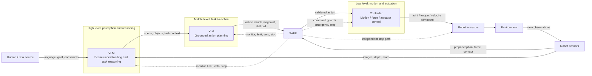

# Embodied AI: Overall Structure

This document outlines a modular embodied-AI stack. The module options below are a practical catalog, not an exhaustive list; implementations can be mixed as long as their interfaces are explicit.

## 1. System Graph

The normal command path is **task → VLM → VLA → safety checks → controller → actuators**. Sensor feedback closes the loop. Safety is a cross-cutting function: it can reject a plan, constrain a command, or stop execution independently of the learned models.

## 2. Module Catalog

Detailed module guides: [VLM](1_vlm.md), [VLA](2_vla.md), [Controller](3_controller.md), and [Safety](4_safety.md).

| Level / module | Responsibility | Possible implementation formats | Typical input | Typical output |
|---|---|---|---|---|
| **High: VLM** | Interpret instructions and observations; identify objects, relations, and task context | Image-language model; video-language model; multi-camera model; vision-language model with tool use; cloud-hosted or on-device model; model plus symbolic scene graph | Text instruction, RGB/video, optional depth, robot state, conversation/context | Structured scene description, object grounding, task decomposition, constraints, confidence, clarification request |
| **Middle: VLA** | Ground task intent in the robot and produce executable actions | End-to-end vision-language-action policy; hierarchical planner calling skills; behavior tree; task-and-motion planner; diffusion or autoregressive action policy; policy with learned skills / motion primitives | Instruction or subtask, visual features or observations, scene state, robot state, skill and capability definitions | Action chunk, end-effector target, waypoint sequence, skill call, discrete action, or trajectory proposal |
| **Low: Controller** | Track targets and convert desired motion into timely robot commands | Joint-space position / velocity / torque control; Cartesian or operational-space control; impedance / admittance control; model-predictive control; whole-body control; trajectory tracking; vendor-specific servo API | Validated setpoint or trajectory, current joint state, force/contact feedback, timing constraints | Joint position, velocity, torque, gripper command, or base command at the control rate |
| **Cross-cutting: Safety module** | Enforce operating limits, monitor hazards, and provide stop / recovery behavior | Command shield or action filter; runtime monitor; collision and keep-out checker; speed / torque / workspace limiter; safety state machine; watchdog; independent hardware E-stop / safety PLC | Sensor and robot state, proposed plans and commands, workspace and policy limits, health / timing signals | Allow, clamp, modify, reject, request re-plan, controlled stop, or emergency stop |

## 3. Module Interfaces

Choose one or more representations at each boundary and document units, coordinate frames, timestamps, confidence, and failure behavior.

| Boundary | Useful interface representations |
|---|---|
| Sensors → VLM / safety | RGB image or video; depth / point cloud; camera calibration; joint and base state; force-torque; tactile/contact events; timestamped observation bundle |
| VLM → VLA | JSON-like task and scene schema; object IDs with poses and confidence; scene graph; grounded language; constraints and affordances; explicit `unknown` / request-for-clarification result |
| VLA → safety / controller | Named skill with typed arguments; discrete action; Cartesian pose or waypoint; timed trajectory; joint trajectory; action chunk with validity horizon and confidence |
| Safety → controller / robot | Approved command; bounded command; rejection plus reason; controlled-stop request; emergency-stop signal on an independent path where required |
| Controller → robot | Position, velocity, torque, gripper, or mobile-base setpoints using the robot's documented units and control rate |
| Robot → feedback loop | Timestamped joint state, end-effector pose, force/contact, actuator health, completion / fault status |

An interface should include at least: a schema or message type, units and frames, timestamps, validity duration, limits, and a defined response to stale, missing, malformed, or low-confidence data.

## 4. Runtime Pipeline

1. **Acquire:** Collect synchronized sensor observations and robot state; reject or mark stale data.
2. **Understand:** The VLM identifies relevant scene entities and interprets the task. It can request clarification when the instruction or scene is ambiguous.
3. **Plan:** The VLA selects a skill or produces a short-horizon action proposal grounded in current state and available robot capabilities.
4. **Check:** The safety module checks the proposal against state, workspace, collision, force, speed, timing, and task-specific constraints. It allows, limits, rejects, or stops.
5. **Execute:** The controller tracks the accepted target and issues low-level commands at the required control rate.
6. **Observe and recover:** New sensor feedback is checked for progress, contact, unexpected motion, and faults. The system replans, requests help, or stops when needed.

## 5. Safety and Operational Notes

- Keep fast, deterministic limits close to the controller or in an independent safety system; do not rely on a VLM or VLA as the sole safety mechanism.
- Apply checks to both proposed actions and the final commands sent to actuators. Use an independent emergency-stop path where the risk assessment requires it.
- Define safe behavior for communication loss, model timeout, stale observations, invalid actions, controller faults, and safety-module faults.
- Log inputs, model / policy versions, decisions, safety interventions, commands, and outcomes for replay and evaluation.
- Validate in simulation and staged hardware tests, with explicit operating limits and a human-override procedure.