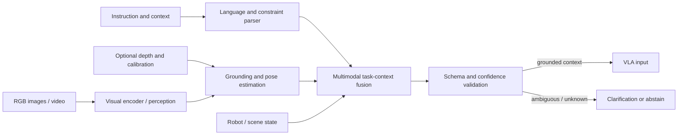

# VLM: Perception and Task Reasoning

The Vision-Language Model (VLM) converts human instructions and visual observations into grounded, structured context for the VLA. It describes what is perceived and what the task means; it does not directly command actuators.

Related pages: [overall structure](0_overall_structure.md) · [VLA](2_vla.md) · [safety](4_safety.md)

## 1. Responsibilities and Boundaries

- Parse language instructions, constraints, and relevant conversation context.
- Identify task-relevant objects, regions, relations, affordances, and uncertainty from images or video.
- Resolve visual references such as "the red cup" into stable object IDs and image regions or estimated poses.
- Produce a structured task context for the VLA, or explicitly ask for clarification.
- Optionally call read-only tools such as object databases or scene-query services, subject to an allowlist.

The VLM should not be treated as a collision checker, real-time controller, or safety authority. Its outputs are hypotheses with confidence and provenance, and require validation by downstream modules.

## 2. Internal Structure



Typical blocks include:

| Block | Purpose | Possible formats |
|---|---|---|
| Input adapter | Normalize instructions and sensor payloads | ROS 2 message adapter; HTTP / RPC service; in-process Python or C++ API; edge-device stream consumer |
| Language parser | Extract goals, entities, constraints, and references | Prompted general VLM; instruction-tuned model; parser plus schema-constrained generation |
| Visual perception | Encode images/video and identify relevant content | Single-frame image encoder; temporal video model; multi-camera encoder; detector / segmenter plus VLM |
| Grounding | Link language entities to visual regions or spatial entities | Bounding boxes; segmentation masks; object IDs; 2D keypoints; 3D pose estimates; scene graph |
| Context fusion | Combine visual, language, and robot state | Model-native fusion; explicit scene-state store; symbolic scene graph with model-generated updates |
| Output validator | Enforce schema, freshness, and confidence requirements | JSON Schema / typed message validation; semantic checks; abstention and clarification policy |

## 3. Implementation Formats

- **Image-language model:** One or more still images per request. Simple and often lower latency, but temporal changes must be captured by repeated observations.
- **Video-language model:** A clip or sampled frame sequence. Useful for motion and event interpretation; requires explicit clip windows, sampling, and latency limits.
- **Multi-camera model:** Fuses several viewpoints. Include camera IDs, calibration, synchronized timestamps, and rules for conflicting views.
- **VLM plus specialist perception:** A VLM interprets intent while detector, segmenter, depth, or pose models provide measurable geometry.
- **On-device or edge inference:** Keeps perception near the robot and can reduce network dependence; constrained by compute, thermal limits, and model size.
- **Remote inference service:** Can use larger models but adds network latency, availability, data-governance, and disconnection concerns.
- **Tool-using VLM:** May query approved scene or robot capability services. Keep tools typed and permission-scoped; do not expose unrestricted command execution.

These formats can be combined. For manipulation, a common pattern is a VLM for task interpretation plus calibrated geometric perception for pose and collision-relevant measurements.

## 4. Inputs and Outputs

Inputs may include:

- Instruction, subtask, conversation context, and user-specified constraints.
- Timestamped RGB images or video, camera identifiers, and calibration metadata.
- Optional depth, point clouds, object tracks, and upstream detections.
- Robot identity, available tools / end effectors, current state, and allowed operating region.

Outputs should be typed and machine-readable, with a natural-language explanation optional and non-authoritative. A conceptual output shape:

```json
{
  "status": "grounded",
  "task": {
    "goal": "place object A on surface B",
    "constraints": ["keep object upright"]
  },
  "entities": [
    {
      "id": "object_A",
      "label": "cup",
      "reference": {"camera": "wrist", "region_xyxy": [120, 80, 260, 310]},
      "pose": null,
      "confidence": 0.91
    }
  ],
  "observation_timestamp": "<timestamp>",
  "uncertainties": []
}
```

The schema is illustrative. Define real units, coordinate frames, timestamp encoding, confidence semantics, object-ID lifetime, and a distinct `unknown` or `needs_clarification` state for the target robot.

## 5. Runtime and Failure Behavior

1. Validate required inputs and observation freshness.
2. Interpret the task and select only observations relevant to the current subtask.
3. Ground referenced entities and preserve the source observation timestamp.
4. Validate the output schema and consistency with the robot capability registry.
5. Return grounded context, abstain, or request clarification; never silently invent missing geometry.

Handle missing or occluded objects, contradictory views, low confidence, stale frames, model timeout, malformed output, and unavailable tools explicitly. A timeout or validation failure should become a typed failure result, not an executable action. Downstream behavior belongs to the VLA and safety policy.

## 6. Verification

- Measure entity grounding, relation accuracy, pose quality where applicable, constraint extraction, and calibration of confidence.
- Test occlusion, lighting changes, unusual viewpoints, distractors, ambiguous language, negation, and conflicting observations.
- Measure end-to-end latency and tail latency with the intended cameras and hardware.
- Verify schema rejection, stale-frame handling, abstention, prompt-injection resistance for tool use, and behavior during service loss.
- Replay logged observations and compare structured outputs across model and prompt versions.