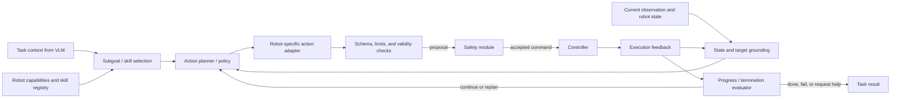

# VLA: Grounded Action Planning

The Vision-Language-Action (VLA) module turns a task and current robot observations into a robot-specific action proposal. It connects high-level intent from the [VLM](1_vlm.md) to the [controller](3_controller.md), with every proposal checked by the [safety module](4_safety.md).

Related pages: [overall structure](0_overall_structure.md) · [VLM](1_vlm.md) · [controller](3_controller.md) · [safety](4_safety.md)

## 1. Responsibilities and Boundaries

- Select, sequence, and parameterize robot skills to accomplish a task.
- Ground object references and constraints in the current scene and robot state.
- Produce actions at an appropriate abstraction and horizon for downstream execution.
- Monitor task progress using feedback and replan when assumptions no longer hold.
- Return explicit completion, failure, or human-assistance outcomes.

The VLA proposes actions; it does not independently authorize unsafe motion. It should use robot capabilities and typed skill definitions rather than assuming a particular arm, gripper, base, or coordinate convention.

## 2. Internal Structure



| Block | Purpose | Possible formats |
|---|---|---|
| Task interface | Consume goals, constraints, entities, and uncertainty | Typed task schema; behavior-tree blackboard; ROS 2 action goal; RPC request |
| Capability registry | Describe robot actions and preconditions | Skill API; action-server registry; schema catalog; planning-domain description |
| State grounding | Maintain current object, robot, and task state | Scene graph; tracked-object table; symbolic state; learned latent state |
| Planner / policy | Choose next action or skill | Hierarchical policy; behavior tree; task planner; task-and-motion planner; end-to-end policy; diffusion / autoregressive action model |
| Action adapter | Convert abstract choices to robot-specific targets | Skill invocation; Cartesian waypoint generator; joint-trajectory interface; mobile-base command adapter |
| Progress monitor | Decide whether to continue, retry, replan, or terminate | Predicates and postconditions; learned success classifier; temporal logic monitor; hybrid rule-and-model evaluator |

## 3. Action Representation Options

- **Discrete action:** A named action such as `open_gripper` or `select_object`. Easy to validate; expressive detail is delegated to a skill.
- **Skill call:** A typed skill name plus arguments and preconditions. Useful for reusable manipulation and navigation primitives.
- **Cartesian target or waypoint:** End-effector pose in a declared frame, optionally with approach direction and tolerances.
- **Joint target or trajectory:** Joint positions with timing and interpolation metadata. Closely coupled to a robot model and must be validated against limits.
- **Action chunk:** A short sequence of low-level targets predicted at once. Include chunk duration, validity horizon, and a stop/replan condition.
- **Velocity or torque proposal:** Fine-grained and potentially responsive, but increases real-time and safety demands. Apply strict rate and range limits and do not bypass the controller's command guard.

Use the highest-level representation that preserves the needed capability. Short horizons improve feedback responsiveness; longer chunks can improve throughput but increase the cost of stale assumptions.

## 4. Inputs and Outputs

Inputs commonly include VLM task context, current camera and scene state, robot configuration, active skill definitions, previous action and outcome, and safety feedback.

A conceptual proposal envelope:

```json
{
  "proposal_id": "<unique-id>",
  "task_id": "<task-id>",
  "action": {
    "type": "skill_call",
    "name": "pick_object",
    "arguments": {"object_id": "object_A"}
  },
  "preconditions": ["object_A is visible", "gripper is available"],
  "valid_until": "<timestamp>",
  "confidence": 0.84,
  "expected_postcondition": "object_A is held"
}
```

For a trajectory or action chunk, define the coordinate frame, units, timestamps, sampling rate, interpolation, and validity horizon. Outputs should identify the model or policy version and give a typed status such as `proposal`, `complete`, `blocked`, `failed`, or `needs_human`.

## 5. Execution Loop and Recovery

1. Confirm that required entities, robot capabilities, and preconditions are known.
2. Choose a subgoal and generate a bounded-horizon proposal.
3. Send the proposal through safety validation before it reaches the controller.
4. Compare execution feedback with expected progress and postconditions.
5. Continue, re-ground, retry within a defined budget, replan, ask for help, or terminate.

Do not repeat a failed action indefinitely. Recovery should account for changed object poses, lost grasp, blocked paths, controller rejection, stale observations, and safety intervention. Replan from refreshed state after an interruption; do not assume a rejected action partially executed unless feedback confirms it.

## 6. Verification

- Evaluate task success, completion time, intervention rate, retries, and recovery quality on representative tasks.
- Test grounding errors, missing capabilities, precondition violations, changing scenes, and interrupted execution.
- Check action schema, coordinate frames, units, expiry, and bounds at the adapter.
- Confirm safety rejection does not cause repeated resubmission of the same proposal.
- Compare simulated and hardware performance and retain explicit limits on supported tasks and environments.