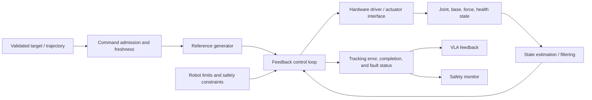

# Controller: Motion and Actuation

The controller converts accepted targets from the [VLA](2_vla.md) into timely commands for the robot and reports execution state. It owns the fast feedback loop; it must not assume that a high-level model can satisfy servo timing or actuator constraints.

Related pages: [overall structure](0_overall_structure.md) · [VLA](2_vla.md) · [safety](4_safety.md)

## 1. Responsibilities and Boundaries

- Track validated position, velocity, force, or trajectory targets.
- Read robot state and close the control loop at the required deterministic rate.
- Enforce robot configuration limits and report saturation or tracking errors.
- Coordinate multiple degrees of freedom where required, including arms, grippers, and mobile bases.
- Report accepted, running, completed, canceled, and faulted command states.

The controller does not interpret open-ended language or decide task intent. It receives typed, validated commands and reports measured execution state. Safety limits should also be enforced at the controller or lower boundary, but this is not a substitute for independent safety hardware where required.

## 2. Internal Structure

| Block | Purpose | Possible formats |
|---|---|---|
| Command admission | Validate type, timestamp, validity, and ownership | ROS 2 action / topic; fieldbus command; vendor API; local typed service |
| State estimation | Filter and synchronize measurements | Encoder state; IMU fusion; joint-state estimator; force-torque filtering; robot-state publisher |
| Reference generator | Interpolate or shape targets | Trapezoidal / S-curve profile; spline; time-parameterized trajectory; online trajectory generator |
| Control law | Track reference | PID; computed torque; Cartesian impedance; admittance; operational-space controller; MPC; whole-body controller |
| Hardware abstraction | Convert controller output to device commands | ROS control hardware interface; vendor SDK; CAN / EtherCAT / serial driver; simulator interface |
| Status and watchdog | Detect stale commands, tracking errors, and faults | Deadline monitor; trajectory action result; tracking-error threshold; driver health state |

## 3. Control and Command Formats

- **Joint position:** Target angles or linear joint positions. Specify joint names, radians or meters, and limit behavior.
- **Joint velocity:** Desired rates with explicit units, duration, and timeout. Requires continuous monitoring and command expiry.
- **Joint torque / effort:** Desired effort with units and bounded operating envelope; requires hardware and safety support.
- **Cartesian pose / twist:** End-effector target or velocity in a named frame, with orientation convention and reference frame.
- **Impedance / admittance:** Desired compliance or force response. Define stiffness, damping, force frames, and contact limits.
- **Trajectory:** Time-indexed joint or Cartesian targets with interpolation, start-state tolerance, and cancellation semantics.
- **Mobile base:** Linear/angular velocity, pose goal, or path, with an explicitly selected navigation controller.

Control rate is robot- and driver-dependent. The architecture should document target update rate, actual loop rate, jitter budget, watchdog timeout, and command validity duration rather than assuming one universal rate.

## 4. Inputs and Outputs

Inputs include an accepted target, measured joint/base state, force or contact observations where available, robot configuration, and safety constraints. Outputs include actuator setpoints and a timestamped status stream.

Every command contract should define:

- Joint names or coordinate frame, units, and orientation convention.
- Start-state requirements, trajectory timing, interpolation, and end condition.
- Maximum duration and command expiry; behavior on missed updates.
- Position, velocity, acceleration, torque, and workspace limits as applicable.
- Cancel, pause, controlled stop, and fault semantics.

Useful status fields include command ID, acceptance state, timestamp, measured state, target error, saturation flags, controller mode, health state, and terminal result. Keep measured state distinguishable from commanded state.

## 5. Fault Handling

Detect and report stale commands, missing state, actuator faults, deadline overruns, tracking error, unexpected contact, limit saturation, and communication loss. On fault, follow a configured safe response such as reject, hold, controlled stop, or hand off to an independent stop mechanism. The correct response depends on the robot and hazard analysis; a generic software "hold" is not always safe.

The controller should reject malformed or expired commands, prevent command overlap unless blending is explicitly supported, and report whether cancellation stopped motion or only stopped future updates. Do not silently reinterpret units, frames, or joint order.

## 6. Verification

- Unit-test command validation, frame transforms, interpolation, limit handling, cancellation, and timeout behavior.
- Measure loop frequency, jitter, end-to-end command latency, tracking error, and watchdog response under load.
- Test simulated and hardware faults, communication loss, stale feedback, and abrupt target changes.
- Validate each control mode on a constrained test setup before enabling it in the full system.
- Record commanded and measured values separately for diagnosis and replay.