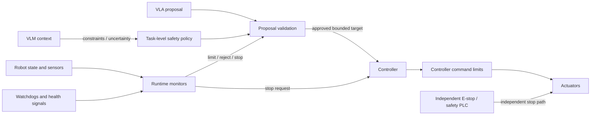

# Safety Module: Runtime Guarding and Stop Paths

The safety module constrains system behavior so that perception and action proposals cannot directly create unbounded motion. It monitors state and intent, validates commands, and coordinates stop and recovery behavior. Safety-critical functions may require certified components and an independent hardware path; a software module using learned-model outputs is not, by itself, a certified safety system.

Related pages: [overall structure](0_overall_structure.md) · [VLM](1_vlm.md) · [VLA](2_vla.md) · [controller](3_controller.md)

## 1. Safety Layers

The architecture can contain multiple layers:

| Layer | Role | Examples |
|---|---|---|
| Task-level policy | Check task constraints and allowed operation | Allowed object / region; no-go zones; human approval; task-specific rules |
| Proposal validator | Reject malformed, stale, infeasible, or disallowed actions | Schema, workspace, joint-limit, collision, force, speed, expiry checks |
| Runtime monitor | Watch measured state and execution over time | Human proximity, unexpected contact, tracking error, sensor health, deadline watchdog |
| Controller command guard | Clamp or reject commands close to actuation | Velocity / acceleration / torque caps; joint limits; command timeout |
| Independent safety system | Provide risk-assessed protective and emergency stop functions | Hardware E-stop; safety PLC; safety-rated scanner, interlock, or drive function |

## 2. Responsibilities and Decision Outcomes

For each action or monitored condition, produce an explicit outcome:

- **Allow:** Proposal passes configured checks.
- **Clamp:** Adjust a command only when the constraint and transformation are well-defined; report the change.
- **Reject:** Do not execute; return a reason and relevant measured state.
- **Request replan:** State changed or proposal became invalid; require refreshed observations and a new proposal.
- **Controlled stop:** Ask the controller to stop using the configured stop profile.
- **Emergency stop:** Trigger the independent mechanism when the hazard policy requires it.
- **Degraded mode:** Continue only within a defined restricted operating envelope.

Do not silently modify high-level intent. A clamp or substitution must be observable to the VLA and recorded. Repeated rejection should not create an automatic retry loop.

## 3. Checks and Data

Potential checks depend on the robot and environment:

- **Command integrity:** schema, finite numeric values, correct robot ID, sequence number, timestamp, validity window, and source.
- **Kinematic limits:** joint position, velocity, acceleration, jerk, and configuration constraints.
- **Workspace:** allowed and forbidden regions for the base, links, end effector, and payload.
- **Collision and proximity:** robot self-collision, environment obstacles, human proximity, and uncertainty margins.
- **Dynamic constraints:** torque / effort, payload, contact force, speed, and braking limits.
- **Execution health:** command tracking error, sensor freshness, communication status, controller mode, actuator health, and watchdog deadlines.
- **Task-specific constraints:** object retention, orientation, fragile-object limits, restricted tools, and required human confirmation.

Inputs should include timestamped measured state, relevant sensor-health status, proposed action and its provenance, robot geometry/configuration, limits, and active operating mode. Checks must account for sensor uncertainty and stale or missing measurements explicitly.

## 4. Integration Contracts

The proposal gate should sit before execution, while monitors continue during execution. The controller should also enforce local command bounds so a missed upstream check does not automatically become an unbounded actuator command. Where the risk assessment requires independent protection, the emergency-stop path must not depend on the VLM, VLA, general-purpose computer, or network connection.

Define a safety decision message with at least:

- Proposal / command ID and timestamp.
- Decision (`allow`, `clamp`, `reject`, `stop`, or configured equivalent).
- Checked limits or rule IDs and a concise reason.
- Any transformed command, with original command preserved for audit.
- Validity period and required operating mode.
- Recovery requirement, such as refresh state, replan, operator acknowledgment, or reset procedure.

Safety configuration should be versioned and tied to the robot model, payload, tool, environment, and operating mode. Do not accept model-generated changes to safety limits at runtime.

## 5. Stop, Recovery, and Failure Modes

Specify behavior for: sensor loss or stale data; monitor timeout; safety process crash; controller or drive fault; network loss; invalid configuration; emergency-stop activation; and inability to confirm that motion stopped. Failures should move to a defined state and require the appropriate reset or operator action.

An ordinary software stop request and a hardware emergency stop have different semantics and latency. Document which component owns each, how stop completion is confirmed, whether brakes or gravity compensation are involved, and how restart is authorized. Never infer that the robot is stationary merely because a command was sent.

## 6. Verification and Assurance

- Derive limits and stop behavior from a documented hazard analysis for the robot, tool, payload, and environment.
- Test boundary values, invalid and stale commands, sensor dropouts, monitor overload, communication loss, and simultaneous faults.
- Verify that rejection, clamping, controlled stop, and emergency stop are distinguishable and auditable.
- Measure detection latency, stop latency, stopping distance, and residual motion under representative worst-case conditions.
- Fault-inject failures in the monitor, controller, network, and sensors; verify independent safety functions remain effective.
- Maintain an evidence trail for configuration versions, tests, incidents, interventions, and operator resets.

This document is an architecture guide, not a safety certification or substitute for a robot-specific risk assessment and applicable standards.