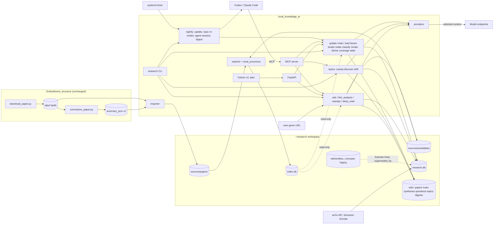

# Local Research Library: System Specification

Version 1.12, 2026-10-29. Status: planning complete, no open items; the build order in section 15 is the agreed starting point. No code exists yet.

This document is self-contained. A reader who has not seen the earlier discussion can start from here. Measured facts about the existing archive come from `~/Embodiment_structure/SUMMARY_AUDIT.md`.

---

## 1. Purpose

A local system over a collection of about 3,450 unique computer-vision and robot-learning papers that can:

1. Answer technical questions with citations to the original papers, at page level where possible.
2. Compare methods on assumptions, inputs and outputs, training data, evaluation settings, results, and limitations.
3. Identify trends across the collection with an explicit denominator and date range, both at facet level and for named topics (an idea such as steering, or world-action-model VLAs) over time.
4. Recommend approaches and experiments for the user's own research problems, using project notes.
5. Accumulate knowledge across sessions and update it when papers arrive.
6. Account for the entire collection on request, not only the top retrieved papers.
7. Take a link to a paper or project, place it against the collection, and return a detailed report: closest papers by relation type, what in the collection improves on or contradicts each of its components, gaps, and improvement proposals labeled as hypotheses.

Everything durable lives on the user's Ubuntu machine. Cloud models receive selected context and return analysis; they hold no state.

### Invariants

- Indexing a PDF is not analysis of it. A summary does not establish full-text coverage.
- Missing information stays `unknown`; it is never turned into a negative finding.
- Reported results, author claims, agent inferences, project observations, and hypotheses are stored with separate labels and never merged into one confidence score.
- Every claim shown to the user carries an evidence pointer or is visibly marked as unsupported.
- Trend and whole-library statements name the snapshot, the paper count, the date range, and the number of papers that could not be classified.
- Knowledge is durable only after a local write succeeds.

---

## 2. Decision log

| # | Topic | Decision | Date | Status |
|---|---|---|---|---|
| D1 | Foundation | Fork of llmwiki (`~/local_knowledge_ai`) is the codebase. llmwiki's index, extraction, watcher, MCP server, and VaultFS are reused unchanged. | 2026-10-29 | decided |
| D2 | Generator | `~/Embodiment_structure` stays as it is: acquisition and detailed per-paper summarization only. | 2026-10-29 | decided |
| D3 | Research layer placement | New package `api/research/` inside the fork, with its own `research.db` next to llmwiki's `index.db`. llmwiki tables are never written by research code. | 2026-10-29 | decided |
| D4 | Language | English throughout for rendered pages, hubs, and agent-written syntheses. Legacy Chinese pages remain until replaced. | 2026-10-29 | decided |
| D5 | Relation vocabulary | Eleven types (section 8.2). Input assumptions are facets, not relations. | 2026-10-29 | decided |
| D6 | User interface | No Next.js web app, no Chrome extension. A Python UI, AnythingLLM-style chat first, built after the research layer works. Kotaemon's three-pane evidence layout is the later target; kotaemon code is not used. | 2026-10-29 | decided |
| D7 | Entity pages | Rendered from records by templates, not written by an LLM. Agents may append an analysis section the renderer never touches. | 2026-10-29 | decided |
| D8 | Summaries | Existing schema-v1 summaries are the bootstrap records; they are not regenerated. The 404 papers without a summary are run through the existing generator. | 2026-10-29 | decided |
| D9 | Legacy wiki pages | Keep in place; never move. Rendered pages go to `wiki/papers/`, hubs to `wiki/hubs/`, agent syntheses to `wiki/syntheses/`. After the builder's last run, one batch adds `legacy: true` to every page under `wiki/entities/`, `wiki/concepts/`, and `wiki/overview.md`, and `superseded_by: wiki/papers/<paper_id>.md` to each entity page whose rendered page exists. Search and the UI demote legacy paths. Nothing is deleted. Moving was rejected because 13,427 `links_to` edges and the builder's verification query are keyed on `wiki/entities/`. Section 9.6. | 2026-10-29 | decided |
| D10 | Generator schema | No generator change. Post-hoc locators first: claims resolve against `index.db` page text, `summary_saw_pages` comes from `pdftotext` form feeds, legacy page footnotes are loaded as hints with origin `legacy_wiki`. Schema v2 is pre-designed (section 9.7) and triggered only by measured failure: under 85% unique-page resolution on the 100-claim set, or over 10% misattribution in the 30-pair audit. | 2026-10-29 | decided |
| D11 | First Ask provider | OpenAI-compatible adapter first, default target the local Codex proxy (`127.0.0.1:8787`, text only). The same adapter serves Ollama (`qwen3.5` installed) for tests and sweep-triage trials, and DeepSeek. Anthropic adapter second. Deterministic fake for tests. Adapters probe health and fail fast; provider, model, and base URL are recorded per attempt. Figure checks run through the agent CLIs until an image-capable provider is configured. Section 12. | 2026-10-29 | decided |
| D12 | Paper identity | `paper_id` is the importer's id (`arxiv-…`, `doi-…`, `sha256-…`), reused verbatim. The join to `index.db` is `asset_version.content_hash = documents.content_hash` (verified equal to the file sha256). `documents.id` is random and is never stored as identity. | 2026-10-29 | decided |
| D13 | Citation relations | `cites` comes from reference-section parsing in `relations/citations.py`. llmwiki's `document_references.cites` rows are wiki-footnote to PDF links, not paper to paper; they serve staleness propagation only. Rendered pages emit llmwiki's footnote format so propagation works unchanged. | 2026-10-29 | decided |
| D14 | Legacy builder | `llmwiki-refresh.service` runs to completion (about 1,200 sources left at about 800 pages per day), then is disabled and `~/llmwiki` is retired. No research code writes under `wiki/` before that. Nightly agent refresh reuses the same `codex exec` with MCP pattern, started by the `research` CLI. | 2026-10-29 | decided |
| D15 | Paper sets | A `paper_set` table (name, definition, frozen member list) backs `sweep --set`, trend denominators, and the retrieval evaluation set. | 2026-10-29 | decided |
| D16 | Build order | Section 15, version 1.1. Provider adapter and jobs come before sweeps and the facet model pass; the renderer waits for the builder's last run; the 404-summary generator run and the builder's last run proceed in parallel with step 1. Superseded by D29. | 2026-10-29 | superseded |
| D17 | Link analysis mode | Fourth answering mode. Input is a URL (arXiv abstract or PDF, direct PDF, project page, GitHub repository). The system fetches it with its own small fetcher (llmwiki's `url_ingest` service turned out to be hosted-only: it needs Postgres, S3 and OCR services; corrected in round 10) and extracts it with `pdftotext` through `pages.py`, registers it as a source with `scope = candidate`, builds a temporary `paper_record`, matches it by facets, citation overlap, and FTS, and renders a report under `wiki/questions/` with snapshot id and coverage line. Promotion into the collection on request. Fetched content is data, never instructions. Section 9.8. | 2026-10-29 | decided |
| D18 | Deep read | Research-layer job per paper that reads the whole PDF (all pages, appendices; page images when the provider supports them) into a schema-v2 record with page locators, superseding the bootstrap record through the section 9.3 update path. On demand by paper set, never whole-collection by default (about 30k tokens per paper text-only). `coverage.record.detail_json.depth` ∈ {bootstrap, deep}. Section 9.9. | 2026-10-29 | decided |
| D19 | Result conflict detector | Deterministic job over `claim` rows and benchmark facets: pairs of records that report different numbers for the same method on the same benchmark and metric become candidate `contradicts` relations with origin `existing_summary` and verification `unverified`, listed on `wiki/syntheses/contradictions.md`. No new relation type. Section 9.10. | 2026-10-29 | decided |
| D20 | Lab and author entities | `lab` comes from the collection (the Scholar profile or channel that pulled the paper in), deterministic, at bootstrap. `author` needs external metadata because `papers.json` carries no author field; it arrives with D26 through the arXiv API. Lab and author hubs under `wiki/hubs/`; shared authors are a cheap signal for `concurrent`. Section 9.12. | 2026-10-29 | decided |
| D21 | Version diff pages | When an arXiv v2 arrives, `asset_version.predecessor_id` links the PDFs; the loader produces a new record and `versions.py` renders `wiki/papers/<paper_id>.versions.md` with the field-level diff of the two records and the page-count change. Section 9.10. | 2026-10-29 | decided |
| D22 | Weekly digest | Job that renders `wiki/digests/<year>-W<week>.md`: papers added since the previous digest, grouped by facet cluster, each with its nearest existing papers by relation type and a coverage line. Section 9.10. | 2026-10-29 | decided |
| D23 | Answers as pages | Every Ask answer (focused, advice, link analysis) is persisted under `wiki/questions/<slug>.md` with snapshot id, evidence list, and coverage line, plus an `answer` row. A repeated question extends the same page. Pages go stale through llmwiki's propagation when a cited record or page changes. Section 9.10. | 2026-10-29 | decided |
| D24 | User annotations | llmwiki stores highlights and comments as JSON in `documents.highlights`; the research layer reads that column read-only and turns each annotation into a `finding` with origin `project_observation` and a locator. Section 9.11. | 2026-10-29 | decided |
| D25 | Experiment records | `experiment` table (project, hypothesis, setup, result, failure, status, linked papers) for the user's own work, starting with the 3DFA project. Advice mode queries experiments before papers. Section 9.11. | 2026-10-29 | decided |
| D26 | External metadata | Optional, cached enrichment in `paper_external`: arXiv API first (free, no key; authors, canonical title, versions, categories), Semantic Scholar second (venue, citation counts) under its rate limit. Used for ranking and trend weighting only; never required for correctness; never written into `paper_record`. Section 9.12. | 2026-10-29 | decided |
| D27 | Backup and restore | `research backup` writes `research.db` and `index.db` with SQLite's online backup API and `wiki/` as a tarball into a dated directory; `research restore` rebuilds a workspace from one; a restore test is part of acceptance. Section 9.14. | 2026-10-29 | decided |
| D28 | Figure caption index | `figure` table built from caption lines in page text (`Figure N`, `Fig. N`, `Table N`) with page and image reference. Extracted page `elements` are empty on the local extractor path, so they are not the source. Section 9.13. | 2026-10-29 | decided |
| D29 | Build order | Section 15, version 1.2: the twelve additions are placed by their dependencies; deep read (D18) and answers as pages (D23) precede link analysis (D17). Superseded by D32. | 2026-10-29 | superseded |
| D30 | Topics | First-class `topic` entity (name, definition, inclusion and exclusion criteria, seed papers, aliases, variant vocabulary, `definition_version`) and `topic_membership` (paper, topic, definition version, disposition yes/no/unknown, basis, evidence, variant, run). Built by a topic sweep that prefilters by FTS and facets to hundreds of candidates, then triages compact records with a model; on the order of 100k to 300k tokens per topic. New papers are triaged against all active topics at ingest in one call. Rendered as `wiki/topics/<topic_id>.md` with quarter counts against the collection denominator, first appearances, lineage, variants over time, numbers over time, contradictions, open questions, and the caveat that the trend is within this collection. Section 9.15. | 2026-10-29 | decided |
| D31 | Paper dates | `paper.date` (YYYY-MM) comes from the arXiv id (YYMM) for the 2,986 arXiv papers with `date_precision = month` and `date_source = arxiv_id`; the 295 papers without an arXiv id use the `papers.json` year with precision `year`. Measured: `papers.json` year differs from the arXiv year for 26% of arXiv papers, 90% of those by one year later (venue year), so `papers.json` is never the primary date when an arXiv id exists. Every trend, digest, and topic chart buckets by `paper.date`. | 2026-10-29 | decided |
| D32 | Build order | Section 15, version 1.3: topics are step 7, after sweeps and before the facet model pass; dates from arXiv ids land in step 1. | 2026-10-29 | decided |
| D33 | Topic policy | Hybrid. Fixed, user-defined topics with versioned definitions and explicit membership are the only basis for trend counts and charts. Automatic clustering is a discovery layer: periodic community detection on the relation graph (`cites`, `extends`, `same_benchmark`, `same_task_family`; Leiden or similar; embedding clustering later, once semantic retrieval exists) produces candidate topics with a draft definition and seed papers. Nothing is counted from a candidate. The user promotes a candidate by accepting or editing its definition. A quarterly drift check compares each fixed topic's members with the clusters they fall into and flags splits or absorption. Section 9.15, items 7 to 9. | 2026-10-29 | decided |
| D35 | Orchestration | `research update` is the one idempotent chain that brings the knowledge system up to date after papers land; `research nightly` runs it, re-renders topic pages, launches the single open-ended agent session over MCP, and renders the digest when due; `research install-timer` installs it as a systemd user timer. Three cadences: the watcher (continuous, model-free), `update` (per batch, nearly model-free), the nightly agent (the only open-ended model session). An update never touches findings, experiment records, user annotations, or the bodies of question pages. Staleness is computed and stored by the research layer, because this fork has no `propagate_staleness` and local mode never sets `documents.stale_since`. Section 9.17. | 2026-10-29 | decided |
| D36 | Load and scheduling | Routine intake is 3 to 7 papers per day (50 to 190 per month by arXiv date in 2026); one-day spikes in download history were bulk pulls when labs were added. Per paper, `research update` costs 20 to 60 s of extraction CPU, seconds for everything else, and one classification call of about 6k input and 1k output tokens: a few CPU-minutes and under 50k tokens per day. The nightly agent session is capped at 20 stale pages with carry-over and a task budget. Bulk additions run through the same chain in the background, resumable. The only heavy one-time costs are the bootstrap topic sweeps (4M to 12M tokens) and the locator pass; extraction is already complete for 3,278 papers. Whole-library sweeps, deep reads, link analyses, and topic redefinitions run only when the user triggers them. Retiring the legacy builder lowers background load below today's level. Section 9.18. | 2026-10-29 | decided |
| D37 | Update triggers | The update chain is triggerable by the timer, by the user from a terminal (`research update --all`, `research nightly --now`), by an agent through an `update` MCP tool, and by the UI through `/research/update`, all with the same chain and caps. One chain at a time per workspace, enforced by a job lease: a trigger during a running chain attaches to that job. The `update` tool never starts a nightly agent session from inside an agent session unless `run_nightly_agent` is explicitly set. Every job row records its trigger (timer, cli, agent with session id, ui). Section 9.17. | 2026-10-29 | decided |
| D38 | Source layout | `sources/papers/<basename>/` holds the PDF only, one flat directory per unique paper under the importer's existing basenames, which are not renamed. PDFs are copied from `labs/` (the user chose copies over hardlinks; disk is not a constraint, and copies keep the workspace independent of in-place rewrites in `labs/`). Other PDF bytes for the same paper sit in the same directory under `versions/<sha256[:24]>/<filename>`, as the importer already does, linked by `asset_version.predecessor_id`. Candidates from link analysis live under `sources/candidates/<id>/`. Summaries are never copied: the loader reads `summary_json` in place from `labs/`, and the readable per-paper Markdown is the rendered `wiki/papers/<paper_id>.md`. The `labs/` hierarchy stays the generator's and is modeled as `lab` rows and lab hubs, not as folders in the workspace. Section 9.19. | 2026-10-29 | decided |
| D39 | Page images | No page images exist today: llmwiki's extractor keeps only images embedded in a PDF and wrote none for this collection, and nothing renders pages. Pages are rendered on demand with `pdftoppm` at 150 dpi into `~/research/.research/page_images/<content_hash>/p<N>.png`, research-owned, outside `sources/`, keyed by content hash so a re-imported identical PDF reuses them. Rendering is triggered by `evidence`, `figures`, deep read, link analysis, and the UI page viewer, and by `research images` for a set. The `figures` coverage layer is `done` when every page that carries a caption has a render. llmwiki's own image extraction stays at its default; any asset it writes beside a PDF is llmwiki's file. Sections 7.2, 9.13, 9.19. | 2026-10-29 | decided |
| D34 | Initial topics | Forty fixed topics chosen by the user from the keyword inventory (`docs/keywords_inventory.md`, local only), listed in section 9.16 with their phrase-presence upper bounds. Nine phrases were deliberately left as facets or clustering candidates, not topics. Initial pass: 40 sweeps at 100k to 300k tokens each, 4M to 12M input tokens; afterwards one call per new paper against all 40 definitions. | 2026-10-29 | decided |

---

## 3. Repositories and responsibilities

| Location | Role | Planned changes |
|---|---|---|
| `~/Embodiment_structure` | Generator. Downloads PDFs per lab or channel, writes `papers.json`, summarizes each PDF into schema-v1 JSON plus Markdown. | None. The `prepare_llmwiki.py` importer moves into the fork. |
| `~/local_knowledge_ai` | The system. Fork of llmwiki with the research layer, research MCP tools, CLI, and later the Python UI. | All new code. |
| `~/research` | Workspace on disk: sources, wiki, `index.db`, `research.db`. | New `research.db`, rendered page directories, `sources/candidates/` (D38). |
| `~/research-dev` | Development workspace: 252 papers from six whole collections (`ETHZ-RSL`, `vikash_kumar`, `具身智能之心`, `mengdi`, `sergey`, `chelsea`; 253 PDFs, 14 papers shared between collections, 14 out of focus, no summaries missing), imported 2026-10-29 with the PDF-only default (the first four collections before round 1, `sergey` and `chelsea` after round 11). Every build step is exercised here first; `~/research` is touched only after a step passes on it. | Its own `research.db` (no `index.db` yet); disposable, re-creatable with `research import --lab …` (`tests/dev/README.md`). |
| `~/llmwiki` | Older copy with the batch wiki builder (`wiki_build.py`, systemd unit `llmwiki-refresh.service`). | Runs to completion, then the unit is disabled and the copy retired (D14). |

---

## 4. Starting state (measured 2026-10-29)

| Item | Value |
|---|---|
| Collections | 76 (researcher Scholar profiles and Bilibili channels) |
| PDFs | 4,094; 45 GB; median 19 pages; all text-extractable in a 60-PDF sample |
| Unique papers | about 3,452 by title; 2,986 distinct arXiv ids; 644 cross-collection copies |
| Years (`papers.json`) | 2023: 508, 2024: 763, 2025: 1,159, 2026: 1,672; this field is the venue year and disagrees with the arXiv submission year for 771 of 2,986 arXiv papers (26%), 694 of them one year later |
| Dates from arXiv ids | 2,986 papers with month precision, 2020-12 to 2026-10; by submission year 2022: 72, 2023: 409, 2024: 720, 2025: 855, 2026: 927; 295 papers have only a `papers.json` year |
| Schema-v1 JSON summaries | 3,692 files; 3,096 distinct by bytes (3,116 distinct basenames); cross-collection copies are byte-identical; one key set; 23 top-level fields; median 27 KB |
| Papers without a real summary | 404 (378 of them have a pages-1-to-3 category stub that must not be imported) |
| Summary input | `pdftotext`, truncated at 90,000 characters; 17% of PDFs exceed it, losing a median 20% of text (appendices) |
| Summary model | `gpt-6-astra` via local Codex proxy or `deepseek-v4-pro`; not recorded per file; no token usage recorded |
| Numeric fidelity | 94% of numbers in results fields appear verbatim in the PDF text (300-pair sample); attribution not yet audited |
| Unknown density | median 9.5% of leaf strings; highest in deployment (47%) and training-cost (36%) fields |
| Workspace | 3,281 papers in the importer catalog with ids `arxiv-…`, `doi-…`, `sha256-…` and `pdf_sha256`; 35 unreadable PDFs ignored; `index.db` 1.4 GB |
| `sources/papers` on disk | 34 GB of PDF copies, no non-PDF files; produced by `prepare_llmwiki.py --pdf_only`, now the importer's default |
| `index.db` contents | 3,259 ready sources, 20 failed; 64,800 pages, numbered from 1; 157,409 chunks; 2,294 wiki pages; `documents.content_hash` equals the file sha256; `document_references`: 7,908 `cites` (wiki footnote to PDF) and 13,427 `links_to` (wiki to wiki) |
| Page images | none exist: no PNG or JPG under `sources/`, the image cache is empty; `pdftoppm` and `pdftocairo` are installed |
| `pdftotext` page breaks | form-feed count equals `pdfinfo` page count, so the 90,000-character cap maps to exact pages |
| Existing wiki | Chinese pages with page-level PDF footnotes: 2,045 entity pages (every one carries `source:`, 1,404 also `source_id`, the `documents.id` of its PDF), 248 concept pages, `overview.md`; builder writes about 800 pages per day (808, 823, 415 by 13:30 on the three days measured), about 1,200 sources left |
| Local model endpoints | Codex proxy expected at `127.0.0.1:8787` (OpenAI chat completions, drops file parts; not running at measurement time); Ollama at `127.0.0.1:11434` with `qwen3.5` and `qwen2.5`; an Anthropic gateway configured for Claude Code; Codex CLI on `gpt-6.1-sol` |

---

## 5. Architecture

### 5.1 Layers

```
┌──────────────────────────────────────────────────────────────────────────────┐
│ Triggers: systemd user timer · user terminal · Codex / Claude Code session   │
│           · Python UI                                      (D35, D36, D37)   │
├──────────────────────────────────────────────────────────────────────────────┤
│ Clients: Codex CLI / Claude Code over MCP     ·     Python UI over HTTP      │
├──────────────────────────────────────────────────────────────────────────────┤
│ Interfaces                                                                   │
│  MCP server  llmwiki tools: guide search read create edit append lint        │
│              research tools: records relations evidence coverage sweep       │
│                 remember link experiments figures topics update jobs         │
│  FastAPI     existing local routes + /research/* (papers relations coverage  │
│                 ask link sweeps findings experiments figures answers topics  │
│                 update jobs)                                                  │
│  CLI         `research`: init import load facets locate relate render        │
│                 coverage sweep ask link deep-read topic experiment           │
│                 conflicts versions digest figures external annotations       │
│                 backup restore update nightly install-timer jobs usage serve │
├──────────────────────────────────────────────────────────────────────────────┤
│ Research layer  api/research/                                                │
│  orchestration  cli · jobs (task keys, leases, usage, triggered_by)          │
│                 · update chain (11 stages) · nightly                         │
│  ingest         identity · importer · loader · facets (+vocab/) · locators   │
│                 · figures                                                    │
│  knowledge      relations/ (deterministic citations baselines asserted)      │
│                 · conflicts · versions · entities (labs, authors) · external │
│                 · topics (definitions, sweep, classify, discover, drift)     │
│  pages          render/ (papers, hubs) · legacy · digest · page_state        │
│  answering      retrieval · ask (focused, advice) · link_analysis · sweeps   │
│                 · deep_read · providers/ (openai_compat fake anthropic)      │
│  memory         memory (findings, sessions) · annotations · experiments      │
│                 · backup                                                     │
├──────────────────────────────────────────────────────────────────────────────┤
│ llmwiki services, unchanged: watcher · local_processor · pdf_extract ·        │
│  page_store · chunker · references · url_ingest · html_parser                │
│  (research code calls them as libraries; index.db is read-only to it)        │
├──────────────────────────────────────────────────────────────────────────────┤
│ Storage  ~/research                                                          │
│  sources/papers/<basename>/  sources/candidates/<id>/                        │
│  wiki/papers/ wiki/hubs/ wiki/syntheses/ wiki/questions/ wiki/topics/        │
│     wiki/digests/   (rendered or agent-written, English)                     │
│  wiki/entities/ wiki/concepts/ wiki/overview.md   (legacy, Chinese, marked)  │
│  .llmwiki/index.db  (written by llmwiki only)                                │
│  research.db        (written by api/research only)                           │
└──────────────────────────────────────────────────────────────────────────────┘
      ▲ import: PDFs + schema-v1 summaries          ▲ fetch / enrich (jobs)
┌─────┴────────────────────────────────┐   ┌────────┴─────────────────────────┐
│ Generator  ~/Embodiment_structure    │   │ Outside: user-given URLs (arXiv, │
│ download_paper · summarize_paper     │   │ PDF, project page, GitHub) ·     │
│ labs/<lab>/{pdfs,summary_json}       │   │ arXiv API · Semantic Scholar     │
└──────────────────────────────────────┘   └──────────────────────────────────┘
                                             ▲ selected context, no state
                                   ┌─────────┴────────────────────────────────┐
                                   │ Model endpoints: Codex proxy (default) · │
                                   │ Ollama qwen3.5 · Anthropic · fake (tests)│
                                   └──────────────────────────────────────────┘
```

### 5.2 Component diagram



### 5.3 Rules that hold the structure together

1. **One-way dependencies.** `api/research/` imports llmwiki's `services` and `infra`. No llmwiki module imports `api/research/`.
2. **One owner per database.** llmwiki code is the only writer of `index.db`; research code opens it read-only (`mode=ro`). `api/research/db.py` is the only opener of `research.db`.
3. **One entry point.** The `research` CLI starts the API, the watcher, the UI, and every batch job; `research update` is the one chain that runs the batch jobs in order (section 9.17). The `llmwiki` launcher remains for upstream compatibility.
4. **Files are the source of truth for prose; the database is the source of truth for facts.** Wiki pages are files; records, facets, relations, coverage, and findings are rows. Rendered pages are derived from rows and regenerable.
5. **Every model call is a job.** Inputs are hashed, outputs are checkpointed, usage is recorded, reruns skip unchanged inputs.

---

## 6. Repository structure of `local_knowledge_ai`

```text
local_knowledge_ai/
├── api/                          FastAPI service (existing, local mode)
│   ├── main.py                   KEEP; add research router and lifespan hook
│   ├── config.py, deps.py, auth.py, scoped_db.py     KEEP
│   ├── routes/                   KEEP local routes; hosted routes unused
│   │   └── research.py           NEW: /research/* for the Python UI
│   ├── services/                 KEEP: local, page_store, chunker, pdf_extract,
│   │                             references, graph, parsers, extracted_assets
│   ├── domain/                   KEEP: watcher, local_processor, file_types
│   ├── infra/                    KEEP: db/sqlite, local_migrations, local_http
│   ├── html_parser/              KEEP, unused for papers
│   └── research/                 NEW
│       ├── db.py                 research.db connection, WAL, migrations runner
│       ├── migrations/           0001_baseline.sql …
│       ├── models.py             typed rows (section 7)
│       ├── identity.py           paper_id from arXiv / DOI / hash; map to documents.id
│       ├── importer.py           from Embodiment_structure/prepare_llmwiki.py
│       ├── loader.py             summary_json → paper_record
│       ├── facets.py             tags and fields → field_value
│       ├── vocab/                benchmarks.yaml, datasets.yaml, robots.yaml,
│       │                         modalities.yaml, tasks.yaml
│       ├── locators.py           claim → page; summary_saw_pages
│       ├── relations/            deterministic.py, citations.py, baselines.py, asserted.py
│       ├── render/               templates/, entity.py, hubs.py
│       ├── legacy.py             legacy page index, `legacy` and `superseded_by` marking (D9)
│       ├── coverage.py           per-paper per-layer status; reports
│       ├── sweeps.py             whole-library reviews
│       ├── memory.py             findings, hypotheses, project notes, session summaries
│       ├── annotations.py        documents.highlights → findings (D24)
│       ├── experiments.py        experiment records (D25)
│       ├── retrieval.py          FTS + facet SQL + relation neighbors
│       ├── ask.py                context builder, citation check, persistence as pages (D23)
│       ├── link_analysis.py      URL → candidate source → report (D17)
│       ├── deep_read.py          whole-PDF schema-v2 records (D18)
│       ├── conflicts.py          result conflict detector (D19)
│       ├── entities.py           labs, authors, hubs (D20)
│       ├── versions.py           arXiv version diff pages (D21)
│       ├── digest.py             weekly digest pages (D22)
│       ├── external.py           arXiv and Semantic Scholar enrichment (D26)
│       ├── figures.py            figure caption index (D28)
│       ├── backup.py             backup and restore (D27)
│       ├── topics.py             topic definitions, topic sweeps, ingest triage, topic pages (D30)
│       ├── providers/            base.py, fake.py, openai_compat.py, anthropic.py
│       ├── jobs.py               job and attempt tables, leases, checkpoints, usage
│       └── cli.py                `research` command
├── mcp/
│   ├── local_server.py           KEEP; register research tools
│   ├── vaultfs/                  KEEP
│   └── tools/research/           NEW: records, relations, evidence, coverage, sweep, remember
├── ui/                           NEW, later: app.py, client.py
├── shared/sqlite_migrations/     KEEP untouched (index.db schema)
├── converter/                    KEEP, unused unless Office files appear
├── tests/unit/research/          NEW; fixtures from real summary_json and small PDFs
├── AGENTS.md                     NEW; CLAUDE.md symlinks to it
├── ARCHITECTURE.md               this document
└── web/, extension/, supabase/, docker/   UNUSED, left for clean upstream merges
```

---

## 7. Data model: `research.db`

Separate SQLite file, foreign keys on, WAL mode, own migrations. Column lists are the minimum for the first version; evolving attributes live in validated JSON columns.

| Table | Columns | Notes |
|---|---|---|
| `paper` | `paper_id` PK, `title`, `arxiv_id`, `doi`, `date` (YYYY-MM or YYYY), `date_precision` ∈ {month, year}, `date_source` ∈ {arxiv_id, papers_json, external}, `venue_year`, `bib_json`, `scope`, `lab_id` FK | `scope` ∈ {in_focus, out_of_focus, candidate}; out_of_focus marks non-robotics papers pulled in by Scholar profiles (about 7.5%) so denominators stay honest; candidate marks a paper fetched by link analysis and not yet promoted, excluded from every denominator |
| `asset_version` | `asset_id` PK, `paper_id` FK, `kind` ∈ {pdf, summary_json, summary_md}, `content_hash`, `path`, `predecessor_id`, `created_at` | Identical bytes dedupe to one row (3,692 summary files become 3,096 rows); arXiv versions share a paper; `content_hash` joins `documents.content_hash` in `index.db` (D12) |
| `paper_record` | `record_id` PK, `paper_id` FK, `asset_id` FK, `schema_version`, `depth`, `record_json`, `generator_model`, `generator_input_cap`, `generator_tool`, `created_at`, `superseded_by` | `record_json` is the full schema object (v1 from the generator, v2 from deep read); `depth` ∈ {bootstrap, deep}; `generator_model` may be `unknown` |
| `field_value` | `id` PK, `paper_id` FK, `record_id` FK, `field`, `value_norm`, `value_raw`, `origin`, `reasoning_type`, `verification`, `locator_json` | One row per normalized facet value; raw value kept |
| `claim` | `claim_id` PK, `record_id` FK, `field_path`, `text`, `numbers_json`, `locator_json`, `verification` | Extracted from `results`, `comparison_summary`, `benchmark_and_evaluation`, `data_and_training_setup`, and `evidence_strength`; locators filled by `locators.py` |
| `relation` | `id` PK, `src_paper_id`, `dst_paper_id`, `type`, `origin`, `evidence_json`, `verification`, `note`, `created_at` | Unique on (src, dst, type); undirected types store `src < dst`; `evidence_json` holds page or field references |
| `coverage` | `paper_id` FK, `layer`, `status`, `detail_json`, `updated_at` | PK (paper_id, layer); layers in 7.2 |
| `paper_set` | `set_id` PK, `name`, `definition_json`, `members_json`, `frozen_at` | Named paper sets for sweeps, trends, and the retrieval evaluation set; `members_json` is frozen at creation (D15) |
| `review_run` | `run_id` PK, `question`, `criteria_json`, `set_id` FK, `snapshot_json`, `status`, `created_at`, `usage_json` | `snapshot_json` freezes record versions for the set's members |
| `review_item` | `run_id` FK, `paper_id` FK, `disposition`, `basis`, `evidence_json`, `status`, `attempt` | `disposition` ∈ {yes, no, unknown, needs_pages}; `basis` ∈ {record, pages, both} |
| `finding` | `finding_id` PK, `kind`, `text`, `origin`, `reasoning_type`, `verification`, `links_json`, `project`, `created_at`, `revised_from` | `kind` ∈ {finding, hypothesis, decision, project_note, experiment} |
| `session_summary` | `session_id` PK, `client`, `started_at`, `ended_at`, `decisions_json`, `open_issues_json`, `next_steps_json` | Written at session end by the agent via `remember` |
| `answer` | `answer_id` PK, `question`, `mode`, `set_id` FK, `snapshot_json`, `page_path`, `evidence_json`, `coverage_json`, `created_at`, `extends` | One row per Ask run; `page_path` under `wiki/questions/`; `extends` points at the earlier answer the page was extended from (D23) |
| `experiment` | `experiment_id` PK, `project`, `hypothesis`, `setup_json`, `result_json`, `failure`, `status`, `paper_ids_json`, `finding_id` FK, `created_at`, `revised_from` | `status` ∈ {planned, running, done, abandoned}; the user's own experiments, queried first by advice mode (D25) |
| `lab` | `lab_id` PK, `name`, `kind` ∈ {scholar_profile, channel}, `external_id`, `collection` | One per `labs/*` collection; `external_id` is the Scholar user id or channel id (D20) |
| `author` | `author_id` PK, `name_norm`, `names_json`, `external_ids_json` | From external metadata only (D20, D26) |
| `paper_author` | `paper_id` FK, `author_id` FK, `position` | PK (paper_id, author_id) |
| `paper_external` | `paper_id` FK, `provider` ∈ {arxiv, semantic_scholar}, `payload_json`, `fetched_at`, `etag` | PK (paper_id, provider); cached, refreshed by a job, never merged into `paper_record` (D26) |
| `figure` | `figure_id` PK, `paper_id` FK, `asset_id` FK, `kind` ∈ {figure, table}, `label`, `caption`, `page`, `image_ref` | From caption lines in page text; `image_ref` is the page image path when one exists (D28) |
| `conflict` | `conflict_id` PK, `claim_a` FK, `claim_b` FK, `method_norm`, `benchmark`, `metric`, `values_json`, `relation_id` FK, `status` | `status` ∈ {open, explained, resolved}; `explained` carries a note (different split, different checkpoint) (D19) |
| `topic` | `topic_id` PK, `name`, `group`, `aliases_json`, `definition`, `inclusion_json`, `exclusion_json`, `seed_paper_ids_json`, `variants_json`, `definition_version`, `origin` ∈ {user, cluster}, `status` ∈ {candidate, active, retired}, `cluster_run_id`, `created_at`, `revised_from` | A new definition version is a new row with `revised_from`; memberships are keyed by version, so a chart names the definition that produced it (D30). Only `status = active` topics are counted or charted; `candidate` rows come from clustering and carry a draft definition (D33) |
| `page_state` | `page_path` PK, `kind` ∈ {paper, hub, synthesis, question, topic, digest, candidate}, `rendered_from_json`, `stale` (0/1), `stale_reason_json`, `stale_since`, `last_rendered_at`, `last_refreshed_at` | Owned by the research layer; `rendered_from_json` lists the record ids, relation snapshot, and membership version a page was built from; set stale by `research update`, cleared by a re-render or an agent refresh (D35) |
| `cluster_run` | `run_id` PK, `method`, `params_json`, `edge_types_json`, `snapshot_json`, `clusters_json`, `drift_json`, `created_at` | One row per discovery run or drift check; `clusters_json` maps cluster id to paper ids and the candidate topic it produced; `drift_json` lists fixed topics flagged for split or absorption (D33) |
| `topic_membership` | `topic_id` FK, `definition_version`, `paper_id` FK, `disposition` ∈ {yes, no, unknown, needs_pages}, `basis` ∈ {record, pages, both, seed, user}, `evidence_json`, `variant`, `variant_note`, `run_id` FK, `updated_at` | PK (topic_id, definition_version, paper_id); `variant` is one of the topic's `variants_json` ids or NULL with the raw description in `variant_note` (D30) |
| `job` | `job_id` PK, `task_key`, `input_hash`, `config_json`, `status`, `triggered_by`, `lease_until`, `created_at`, `finished_at`, `progress_json`, `result_json` | `task_key` unique per (task, inputs) so reruns are idempotent; `triggered_by` ∈ {timer, cli, agent:<session_id>, ui} (D37); the update chain's `result_json` holds the coverage delta |
| `attempt` | `attempt_id` PK, `job_id` FK, `started_at`, `ended_at`, `status`, `usage_json`, `error` | `usage_json`: model, input tokens, output tokens, cached tokens, cost estimate |

### 7.1 Status dimensions

Stored as separate columns, never collapsed:

- `origin`: `original_source`, `existing_summary`, `deep_read`, `legacy_wiki`, `external_metadata`, `project_observation`, `conversation`
- `reasoning_type`: `reported_result`, `author_claim`, `agent_inference`, `hypothesis`, `project_decision`
- `verification`: `unverified`, `source_checked`, `contradicted`, `unresolved`
- job `status`: `pending`, `running`, `completed`, `failed`, `cancelled`

### 7.2 Coverage layers

| Layer | Meaning of `status = done` |
|---|---|
| `pdf` | PDF bytes present and readable |
| `text` | Page text extracted into `index.db` |
| `figures` | Rendered page images exist for every page that carries a figure or table caption (D39); `partial` lists the pages still missing |
| `summary_text` | Pages the generator actually saw (`summary_saw_pages` from the 90k cap) |
| `appendix` | Appendix pages read by any analysis step |
| `record` | A `paper_record` exists; `detail_json.depth` ∈ {bootstrap, deep} (D18) |
| `facets` | Facets normalized |
| `locators` | Claims resolved to pages (with resolved fraction in `detail_json`) |
| `relations` | Deterministic and citation relations built |
| `entity_page` | Rendered page exists and matches the current record |
| `attribution_audit` | Record checked against pages by a model or a person |

Status values: `missing`, `partial`, `done`, `failed`, `suspect`. `suspect` on the `record` layer means the record probably describes a different paper than the PDF (section 9.7 mismatch rule); the title-keyed summary cache makes this possible for the 22 duplicate titles.

### 7.3 Evidence contract

An evidence pointer is `{asset_id, content_hash, page, locator}` where `locator` is one of: a character span in the page text, a quoted string, a table or figure id, or a section name. Physical page index is 1-based, equals `document_pages.page` in `index.db`, and is separate from printed page labels. Summary-derived claims point at the summary asset until a locator job or a verification step adds a PDF page. Locators that no longer resolve after a PDF changes are reported, not redirected.

---

## 8. Vocabulary

### 8.1 Facets (per paper, from `field_value`)

Controlled vocabularies in `api/research/vocab/`, each with canonical ids, display names, and aliases:

- `modality_in`: rgb, rgbd, depth, point_cloud, tactile, proprioception, language, audio, force_torque
- `camera_setup`: single_view, multi_view_fixed, wrist, head, multi_view_with_wrist; `requires_camera_pose` ∈ {yes, no, estimated, unknown}; `requires_depth` ∈ {yes, no, unknown}
- `action_out`: joint_position, joint_velocity, ee_pose, delta_ee_pose, action_chunk, keypoints, trajectory, language
- `embodiment`: canonical robot ids (aloha_2, franka, ur5, xarm, humanoid_*, quadruped_*)
- `benchmark`, `dataset`: canonical ids
- `task_family`: manipulation_rigid, manipulation_deformable, bimanual, dexterous, locomotion, navigation, mobile_manipulation
- `method_family`: vla, world_model, diffusion_policy, act, rl, imitation, object_centric, 3d_representation, scene_graph, planner, vlm

The first pass maps the existing `index_tags` into these; unmapped tags are kept raw with `value_norm = NULL` and reported.

### 8.2 Relations (decided, D5)

| Type | Direction | Built by | Initial verification |
|---|---|---|---|
| `cites` | src cites dst | reference-section extraction, title and arXiv matching | `source_checked` (page of the reference entry) |
| `baseline_of` | dst is a baseline in src's experiments | `main_baseline` and `baselines_compared_against` resolution | `unverified` until a comparison table page confirms |
| `compares_against` | undirected | same fields, when baseline role is unclear | `unverified` |
| `same_benchmark` | undirected | benchmark facets | follows facet verification |
| `same_dataset` | undirected | dataset facets | follows facet verification |
| `same_robot` | undirected | embodiment facets | follows facet verification |
| `same_task_family` | undirected | task facets | follows facet verification |
| `extends` | src extends dst | agent-asserted with evidence | `unverified` |
| `contradicts` | undirected | agent-asserted with evidence | `unverified` |
| `concurrent` | undirected | agent-asserted: same problem and period, no citation either way | `unverified` |
| `survey_covers` | survey src covers dst | survey reference lists | `source_checked` |

`cites` is built by the research layer from the PDF reference section. llmwiki's `document_references.cites` rows are not paper citations: they link a wiki page's footnote to the PDF it cites (D13).

---

## 9. Data flows

### 9.0 Overview: four flows and what each writes

```
A. BOOTSTRAP (once, section 9.1)
   labs/*/pdfs + summary_json ─import─► sources/papers ─watcher─► index.db (done: 3,259 ready)
   summary_json ─load─► research.db: paper, asset_version, paper_record[bootstrap], field_value,
                        claim(+locators), coverage, lab, relation, topic_membership (40 sweeps)
   research.db ─render─► wiki/papers, wiki/hubs, wiki/topics      legacy pages ─mark─► superseded_by

B. ROUTINE UPDATE (per batch, `research update`, section 9.17)        model calls
   1 import    labs → sources/papers (copies)   , asset_version                         none
   2 extract   watcher or reconcile → index.db pages, chunks, images         none
   3 load      → paper, paper_record, date, scope, lab                       none
   4 facets    → field_value (deterministic vocab mapping)                   none
   5 locate    index.db pages → claim.locator_json, figure, coverage         none
   6 relate    reference sections + facets → relation                        ambiguous baselines only
   7 classify  compact record × active topics → topic_membership             one call per new paper
   8 render    rows → wiki/papers/<id>.md, hubs; footnotes → index.db refs   none
   9 derive    claims → conflict; new arXiv version → versions page          none
  10 coverage  → coverage rows, delta into job.result_json                   none
  11 stale     document_references → page_state (syntheses, questions,       none
               topics with changed membership, digest pending)

C. NIGHTLY (`research nightly`, timer or --now)
   B ─► re-render topic pages ─► one agent session over MCP: ≤20 stale pages, task budget,
   syntheses rewritten from rows and verified on pages, question pages get a banner only,
   ends with `remember` ─► digest if due ─► usage recorded as jobs

D. READS (user or agent; nothing here mutates records)
   focused / advice   facets SQL + FTS + relations → compact records → pages for top few
                      → provider → citation check → wiki/questions/<slug>.md + answer row
   link analysis      URL → url_ingest/html_parser → sources/candidates → deep_read record
                      → match (facets, citations, FTS) → report page → promote on request
   whole-library      paper_set snapshot → review_run → per-paper review_item → page
   topic              topic_membership rows at a definition version → wiki/topics/<id>.md
   evidence           claim → {asset, content_hash, page, locator} → index.db page text / image
```

### 9.1 Bootstrap over the existing archive (once)

0. In parallel, no research code involved: the legacy builder finishes its run (D14), and the generator produces the 404 missing summaries through `summarize_paper.sh`. The `research` CLI wraps that run as a job whose config records the model name from the environment, the 90,000-character cap, and the sha256 of `summarize_paper.py`, so these records get real provenance without any generator change.
1. Importer: already run; 3,281 papers in the catalog. Re-run from the fork to confirm identity rules; `paper_id` and `pdf_sha256` are taken from the catalog (D12). The re-run is a no-op for the 3,278 existing copies (hashes unchanged) and records their `asset_version` rows (D38).
2. Loader: 3,692 summary files dedupe by bytes to 3,096 `asset_version` rows and records (`depth = bootstrap`); the 378 category stubs are skipped; papers without a record get `coverage.record = missing` (404 before step 0 completes). Papers with empty `index_tags.robot` get `scope = out_of_focus`. One `lab` row per collection and `paper.lab_id` are set here (D20).
3. Locators: `summary_saw_pages` from `pdftotext` form feeds; numeric claims resolved against `index.db` page text; legacy footnotes loaded as hints. A record whose claims resolve below the mismatch threshold is marked `suspect`. No model calls.
4. Facets: deterministic mapping of `index_tags` to the vocabularies; unmapped tags kept raw and reported. The model pass over unmapped tags is build step 7, after the provider adapter exists.
5. Relations: citation extraction from reference sections, facet-derived relations, baseline resolution by string matching.
6. Renderer, only after the builder's last run: `wiki/papers/<paper_id>.md` for all records; hubs under `wiki/hubs/`; then the legacy marking batch (section 9.6).
7. Coverage report; nothing is marked beyond what was done.
8. Steps 2 to 6 for the papers from step 0 as their summaries arrive.

Model cost: the 404 summaries, the facet pass on unmapped tags, and baseline disambiguation; well under one million tokens beyond the summaries. The full-text re-extraction considered earlier is not needed.

### 9.2 New or updated paper

```mermaid
sequenceDiagram
    participant G as Generator
    participant U as research update
    participant W as watcher + local_processor
    participant R as research.db
    participant K as wiki/
    participant P as provider
    participant N as nightly agent
    G->>G: download, papers.json, summary_json
    U->>U: 1 import: identity, asset_version, copy into sources/papers/
    U->>W: 2 extract (wait, or reconcile directly)
    W->>W: pages, chunks, images into index.db
    U->>R: 3 load record, date, scope, lab
    U->>R: 4 facets, 5 claims + locators + figures
    U->>R: 6 relations (citations, facets, baselines)
    U->>P: 7 classify against all active topics (one call)
    P-->>R: topic_membership rows
    U->>K: 8 render paper page, hubs
    U->>R: 9 conflicts, versions; 10 coverage delta
    U->>R: 11 page_state: dependent pages stale
    N->>K: refresh ≤20 stale syntheses, banner question pages, digest if due
```

### 9.3 Record update

A regenerated summary or a schema change creates a new `paper_record` with `superseded_by` on the old one, re-derives facets, claims, relations, and the entity page for that paper, and marks dependent pages stale: the research layer reads llmwiki's `document_references` (read-only) to find every wiki page that cites the paper's PDF or links to its rendered page, and records them in its own `page_state` table, because this fork has no propagation function and local mode never sets `documents.stale_since`. Old rows are never deleted. Rendered pages and agent syntheses cite as `[^n]: <file>.pdf, p.N` and link other pages with ordinary wiki links; llmwiki parses both into `document_references`, so propagation needs no change (D13).

### 9.4 Answering modes

| Mode | Context | Verification | Persistence |
|---|---|---|---|
| Focused Q&A | facet SQL + FTS + relation neighbors; compact records (about 600 tokens each) for candidates; page text for the top few | every number or claim in the answer must map to an evidence pointer; unmapped ones are marked | page under `wiki/questions/` and an `answer` row (D23); `finding` rows only when the user saves |
| Research advice | experiments and project notes first, then prior findings, relation clusters around the problem, verified evidence | same; agent inferences and hypotheses labeled | page under `wiki/questions/`; accepted hypotheses saved as `finding` with `reasoning_type = hypothesis` |
| Link analysis | a fetched candidate paper's temporary record; its facet, citation, and FTS matches; deep-read records of the closest papers | per-component comparison with evidence; proposals labeled hypotheses; gaps stated as absence in the collection, not in the field | page under `wiki/questions/` with snapshot id and coverage line; candidate promoted into the collection on request (D17) |
| Whole-library review | immutable snapshot of a paper set; batch triage over compact records; page reads for `unknown` and `needs_pages` | per-paper disposition with basis and evidence; coverage report included | `review_run` and `review_item`; resumable; renderable as a wiki page with denominator and date range |
| Trend (facet) | a review run plus `paper.date` buckets and relation counts | same as review | rendered trend page with snapshot id |
| Trend (topic) | a topic's memberships at one definition version, `paper.date` buckets against the collection denominator per quarter, `cites` and `extends` edges among members, claims of members | per-paper disposition with basis and evidence; variants labeled; numbers over time only from resolved claims | `wiki/topics/<topic_id>.md` with snapshot id, definition version, date range, unclassified count, and the in-collection caveat (D30) |

Compact record for triage: `tldr`, normalized facets, `implementation_notes.summary`, `limitations`, year. About 3,452 × 600 ≈ 2M input tokens per whole-library question.

### 9.5 Synthesis pages

Concept, comparison, and trend pages are written by agent sessions (Codex or Claude Code over MCP) that first query `records` and `relations`, then open pages through `evidence` and `read`. They live under `wiki/syntheses/`. Each page's frontmatter lists `paper_ids`, `snapshot`, `date_range`, `denominator`, `unclassified`, and `last_verified`. Lint fails a page whose citations do not resolve or whose frontmatter is missing these fields.

### 9.6 Legacy pages (D9)

The Chinese pages under `wiki/entities/`, `wiki/concepts/`, and `wiki/overview.md` stay where they are, with their file names, for as long as the workspace exists. Rules:

1. No research code writes under `wiki/` until `llmwiki-refresh.service` has finished its run and been disabled (D14). The builder verifies its own output with a query keyed on the `wiki/entities/` path, and 13,427 wiki links point into that directory; moving pages would break both.
2. New output never shares a directory with legacy output: `wiki/papers/` (rendered, one page per `paper_id`), `wiki/hubs/`, `wiki/syntheses/`.
3. After the builder's last run, `legacy.py` runs once: it maps every entity page to a `paper_id` through its `source:` path (all 2,045 pages carry one; `source_id` is a fallback only), adds `legacy: true` to every legacy page, and adds `superseded_by: wiki/papers/<paper_id>.md` to each entity page whose rendered page exists. These are frontmatter-only edits; llmwiki reindexes them like any other change.
4. Legacy footnotes `[^n]: <file>.pdf, p.N` are loaded as locator hints with origin `legacy_wiki` and verification `unverified`. They never satisfy a verification step on their own.
5. Search and the UI call llmwiki's `search` with a path filter that excludes legacy directories by default; the user can include them. Rendered pages link to their legacy page under "Earlier page" so the Chinese prose stays one click away.
6. Nothing is deleted. Legacy concept pages are not rewritten; English syntheses are written fresh under `wiki/syntheses/`.

### 9.7 Locators and the schema v2 trigger (D10)

Post-hoc locators are the first and default mechanism:

- `summary_saw_pages`: the generator truncated `pdftotext` output at 90,000 characters; `pdftotext` separates pages with form feeds and the form-feed count equals the page count, so the pages seen are computed exactly, per record, with the same tool the generator used.
- Claim resolution runs against `index.db` page text (what the UI shows), with `pdftotext` page text as a fallback for table cells that the other extractor scrambles. A number resolves when it appears verbatim on exactly one page of the PDF; several pages give a candidate list; none gives `unresolved`.
- Mismatch rule: a record whose numeric claims resolve below 50% is marked `coverage.record = suspect` and listed in the coverage report. The audit's two low scorers (44%, 65%) calibrate this threshold; it catches a summary attached to the wrong PDF through the title-keyed cache.
- Legacy footnotes are hints (section 9.6, rule 4).

Schema v2 is pre-designed so the trigger decision is cheap, and it is not scheduled for the generator. Trigger: on the labeled 100-claim set, fewer than 85% of claims resolve to a unique page; or the 30-pair attribution audit finds more than 10% of numbers attached to the wrong condition. Design: insert `[[page N]]` markers at the form feeds of the generator's text input; keep all 23 fields; add `page` to every entry of `results`, `comparison_summary`, and `benchmark_and_evaluation.ablations`; set `summary_schema_version` to 2; the loader accepts both versions and the locator step treats a v2 `page` as a locator candidate to be confirmed, not as verification. Schema v2 is the same schema the deep-read job (section 9.9) produces inside the research layer, so the loader, locators, and renderer handle one v2 format whichever side produced it.

### 9.8 Link analysis (D17)

Input: one URL from the user. Accepted kinds and what is fetched:

| URL kind | Fetch | Extract |
|---|---|---|
| arXiv abstract or PDF | PDF through `services/url_ingest` (it already normalizes abstract URLs to the PDF) | `pdf_extract`, page images |
| Direct PDF | same | same |
| Project page | HTML through `httpx`, converted with `api/html_parser` | title, abstract, linked arXiv id or PDF; if a PDF link is found, the PDF path above |
| GitHub repository | README and the repository description through the public API; linked arXiv id if present | same |

Flow:

1. The fetched file is written under `sources/candidates/<year>-<title-slug>/<year>-<title-slug>.pdf`, the importer's human-readable naming (title from PDF page 1, year from the arXiv id; a collision gets a numeric suffix), and indexed by the watcher like any source. It gets a `paper` row with `scope = candidate` and `paper_id` `arxiv-…` when an arXiv id is found, else `url-<sha256[:24]>`; the paper id lives in the database, never in the path. If the arXiv id already exists in the collection, the mode runs against the existing paper and says so.
2. A temporary record is built by the deep-read job (section 9.9) for the candidate only, so it carries page locators from the start. Coverage rows are written for it like for any paper.
3. Matching, deterministic and cheap: facet overlap (modality, action space, embodiment, benchmark, dataset, task family, method family), citation overlap (its reference section against `paper`, in both directions), FTS over its `tldr` and method text against `chunks_fts`, and relation neighbors of the top matches.
4. Report, written by the Ask service with the provider adapter over compact records of the matches, then verified against pages for every number used:
   - closest papers by relation type (`cites`, `same_benchmark`, `same_robot`, `same_task_family`, `method_family`), each with evidence;
   - per component (inputs, representation, policy or model, training data, evaluation), what in the collection improves on it, with the reported numbers and their pages, and what contradicts it;
   - gaps: components for which the collection holds nothing, stated as an absence in this collection with the denominator, never as an absence in the field;
   - improvement proposals, each labeled `hypothesis`, each citing the papers it is built from.
5. The report is a page under `wiki/questions/` with frontmatter `candidate_id`, `paper_ids`, `snapshot`, `denominator`, `unclassified`, `coverage`, and an `answer` row (D23).
6. Promotion: `research link --promote CANDIDATE` moves the directory under `sources/papers/` keeping its `<year>-<title-slug>` name, sets `scope = in_focus`, writes the catalog entry, and runs the normal per-paper pipeline (section 9.2). Without promotion the candidate stays out of every denominator and sweep.

Rules: the system fetches only the URL the user gave and the one PDF or arXiv id that page names; fetched text is data and never carries instructions; nothing fetched is ever written into another paper's record; the candidate is deleted on request together with its rows.

### 9.9 Deep read (D18)

A research-layer job, `deep_read:<asset_hash>:<prompt_hash>`, that produces a schema-v2 record for one paper from the whole PDF:

- Input: every page's text from `index.db` with `[[page N]]` markers, and page images when the configured provider reports `supports_images`; otherwise text only. Appendices are included; the 90,000-character cap does not apply.
- Output: a `paper_record` with `schema_version = 2`, `depth = deep`, origin `deep_read`, `superseded_by` set on the bootstrap record, then the section 9.3 update path (facets, claims, relations, page, staleness). The bootstrap record stays queryable for diffing.
- Coverage: `summary_text` and `appendix` become `done` for all pages read; `record.detail_json.depth = deep`; the generator's truncation fact survives as `summary_text.detail_json.generator_truncated`.
- Facets: when a bootstrap record exists, its generator facets remain the paper's facets (copied onto the deep record); the deep-read tags stay in `record_json` only, because a small model picks plausible but wrong allowed values (round 9: `unitree_g1` on an ANYmal paper). A paper with no earlier record, such as a link-analysis candidate, takes its facets from the deep read with origin `deep_read`.
- Scope and cost: on demand, by `paper_set`, by link analysis, or by a sweep that returns `needs_pages`. About 20k input and 8k output tokens per paper text-only at the median 19 pages; about double with images. A whole-collection deep read would be about 100M tokens and is not scheduled.

### 9.10 Derived pages (D19, D21, D22, D23)

All deterministic jobs; each page lists its snapshot, denominator, and coverage line, and is regenerable.

- Conflicts: `conflicts.py` groups `claim` rows by (normalized method name, benchmark facet, metric) across records; groups whose numbers disagree beyond the metric's tolerance become `conflict` rows and candidate `contradicts` relations (origin `existing_summary`, verification `unverified`). `wiki/syntheses/contradictions.md` lists open conflicts with both pages; a person or an agent marks a conflict `explained` with a note or `resolved` after a page check.
- Versions: when the importer sees a new arXiv version, `versions.py` renders `wiki/papers/<paper_id>.versions.md` with the field-level diff of the old and new records, the page-count change, and any claim whose number changed.
- Digests: `digest.py` renders `wiki/digests/<year>-W<week>.md` from papers whose `asset_version.created_at` falls after the previous digest, grouped by facet cluster, each with nearest existing papers by relation type.
- Questions: `ask.py` writes every answer to `wiki/questions/<slug>.md` (slug from the normalized question; a repeated question appends a dated section and updates the `answer` row with `extends`). Footnotes use llmwiki's format, so the page goes stale through `document_references` when a cited PDF or page changes.

### 9.11 Project memory (D24, D25)

- Annotations: llmwiki keeps highlights and comments as a JSON list in `documents.highlights`. `annotations.py` reads that column read-only, and for each highlight or comment creates or updates a `finding` with origin `project_observation`, reasoning type from the comment (`hypothesis` when the user marks it so, else `project_decision`), and a locator `{asset_id, content_hash, page, quoted string}`. Edits in the UI or MCP flow back by rerunning the job; findings whose highlight disappeared are marked `revised_from` and kept.
- Experiments: `experiment` rows are created through `research experiment add` or the `experiments` MCP tool, and are the first context advice mode loads. Each links to papers by id and to a `finding` for its conclusion. The first project is 3DFA.

### 9.12 Labs, authors, external metadata (D20, D26)

- Labs are deterministic at bootstrap: one `lab` per `labs/*` collection, `external_id` from the Scholar `user=` parameter or the channel id in `papers.json`, `paper.lab_id` set for every paper the collection pulled in (a paper in two collections keeps the first and lists the others in `bib_json`). Lab hubs under `wiki/hubs/labs/`.
- `external.py` runs as a job with a cache: arXiv API for every `arxiv-…` paper (authors, canonical title, version list, categories, no key, batched queries), Semantic Scholar afterwards for venue and citation counts within its public rate limit. Results go to `paper_external`; `author` and `paper_author` are derived from the arXiv payload. Nothing external is written into `paper_record` or shown as evidence; it is used for ranking, author hubs, trend weighting, and the `concurrent` signal (shared authors, same period, no citation either way).

### 9.13 Figures (D28)

`figures.py` scans each page's text for caption lines (`Figure N`, `Fig. N`, `Table N`, with their first sentence) and writes `figure` rows with page and `image_ref`, the rendered page path from D39, produced on first request. The `figures` MCP tool and the UI resolve "the figure that shows …" by FTS over captions, then open the rendered page. The local extractor leaves `document_pages.elements` empty and extracted no embedded images for this collection, so captions plus page renders are the only deterministic source until an element-producing extractor is configured.

Page rendering (D39): `figures.py` also owns `render_page(content_hash, page)`, which runs `pdftoppm -r 150 -f N -l N -png` on the PDF named by `asset_version.content_hash` and writes `~/research/.research/page_images/<content_hash>/p<N>.png`; a second request for the same page returns the existing file. The `.research/` directory is listed in `.llmwikiignore` so the watcher never indexes renders. `research images --paper ID | --set NAME [--pages N-M]` renders ahead of time; nothing renders the whole collection by default (about 64,800 pages).

### 9.15 Topics (D30, D31)

A topic is a named idea whose membership is decided per paper, with evidence, against a written definition. Examples the user gave: "steering" (variants: guidance, test-time optimization, residual flow) and "WAM VLA" (world-action-model VLAs).

1. **Definition.** `research topic add` or the `topics` MCP tool creates a `topic` row from a definition text, inclusion and exclusion criteria, seed paper ids, aliases, and an optional variant vocabulary. Editing the definition creates a new `definition_version` row linked by `revised_from`; old memberships stay attached to their version.
2. **Topic sweep.** A `review_run` with `criteria_json = {topic_id, definition_version}`. Prefilter, deterministic: FTS over `tldr`, `method`, and `keywords_and_features` for the name and aliases; facet filters from the inclusion criteria; relation neighbors (`cites`, `extends`, `same_benchmark`) of the seed papers. This yields hundreds of candidates, not the whole collection. Triage: compact records of the candidates with the definition, in batches, through the provider adapter; each paper gets a disposition, basis, evidence (field paths or pages), and a variant. `unknown` stays `unknown`; `needs_pages` papers can be deep-read on request. Papers outside the prefilter are recorded as `not_screened` in the run's coverage, so the page can say how many papers were never looked at. Cost: about 300 candidates × 600 tokens plus output, 100k to 300k tokens per topic.
3. **Incremental classification.** The per-paper pipeline (section 9.2) ends with one call that triages the new paper's compact record against every active topic's definition at its current version; memberships are written with `basis = record` and the ingest run id. Topic pages and the weekly digest (D22) are re-rendered from rows, so no sweep is repeated for new papers. A new definition version re-runs the topic sweep for that topic only.
4. **Dates.** All time buckets use `paper.date` (D31). A chart row for quarter Q is "members with date in Q / all in-focus collection papers with date in Q"; papers with year precision are bucketed into the year and listed separately, never spread across quarters.
5. **Topic page** `wiki/topics/<topic_id>.md`, rendered by template from rows: definition and version; counts per quarter with the denominator; first appearances in the collection (earliest members by date, with the caveat that earlier work may exist outside the collection); lineage, the `cites` and `extends` edges among members as a dated list; variant breakdown per quarter; key benchmark numbers over time, only from claims with resolved locators, grouped by benchmark and metric; conflicts among members (D19); open questions, written by an agent under `## Agent analysis` and never touched by the renderer; frontmatter with `snapshot`, `definition_version`, `date_range`, `denominator`, `unclassified`, `not_screened`, `last_verified`. Every topic page carries the line: "Trend within this collection (76 labs and channels, papers dated 2020-12 to 2026-10), not the field at large."
6. **Memberships as paper sets.** The yes-members of a topic at a version are exposed as a `paper_set`, so sweeps, comparisons, and the retrieval evaluation can take a topic as their denominator.
7. **Fixed topics only are counted (D33).** Every trend count, chart, digest grouping, and topic page comes from `status = active` topics with explicit `topic_membership` rows. No number is ever derived from a cluster.
8. **Discovery layer.** `research topic discover` runs community detection on the relation graph over `cites`, `extends`, `same_benchmark`, and `same_task_family` edges (Leiden or an equivalent, resolution recorded in `params_json`), on a frozen snapshot. Each community larger than a minimum size becomes a `topic` row with `origin = cluster`, `status = candidate`, a draft definition written by an agent from the members' compact records, the highest-degree members as seeds, and a page under `wiki/topics/candidates/`. Embedding-based clustering joins as a second method once semantic retrieval exists (section 11). A candidate becomes fixed only when the user accepts or edits its definition, which creates a user-origin topic (`revised_from` the candidate) and runs the topic sweep.
9. **Drift check.** Quarterly, or on request, a `cluster_run` with `drift_json`: for each active topic, the distribution of its yes-members over the current clusters. A topic whose members split across clusters with no majority, or whose members are absorbed into a cluster dominated by another topic, is flagged on its page and in the digest; the user decides whether to revise, split, or merge definitions. The check never changes memberships.
10. **What the triage model sees.** A topic sweep shows the model the compact record (tldr, facets, training setup, implementation, limitations) and adds the record's simulation and real-robot evidence lines only when the question or the inclusion and exclusion criteria mention a setting; otherwise a small model treats those lines as extra requirements (measured in round 7). Definitions therefore say "where it was evaluated does not matter" without naming settings.
11. **Measured on the dev set (round 11).** Forty topic sweeps over 100 papers with local `qwen3.5`: 572k input tokens, about 40 minutes, 239 memberships; prefilter sizes from 0 to 80 candidates. Triage is not stable across batch compositions on a small model (B037), so topic membership counts carry the run id and definition version that produced them.
12. **Cost (D34).** Initial pass over the forty topics: 4M to 12M input tokens (40 sweeps at 100k to 300k each, prefilter-dependent). Steady state: one call per new paper against all active definitions, about 40 × 150 definition tokens plus the 600-token compact record, under 10k tokens per paper.

### 9.16 Initial fixed topics (D34)

Chosen by the user on 2026-10-29 from `docs/keywords_inventory.md` (local, gitignored). Counts are phrase-presence upper bounds over the 3,096 unique summaries, not memberships; the topic sweep decides membership. Each topic needs a definition with inclusion and exclusion criteria before its sweep; the notes mark the ones that need them most.

| Group | Topic | Upper bound | Note |
|---|---|---|---|
| Policy architecture and learning | vision-language-action models | 349 | |
| | diffusion policy | 320 | |
| | flow matching | 94 | |
| | latent actions | 16 | |
| | mixture of experts | 32 | |
| | in-context learning | 89 | |
| | reinforcement learning | 77 | author keyword count |
| | imitation learning | 72 | author keyword count |
| Adapting pretrained policies | steering (policy or flow steering) | 101 | mixed senses; variants: guidance, residual flow, test-time optimization |
| | RL fine-tuning of pretrained policies | 66 | |
| | reward learning and preferences | 288 | |
| World models and prediction | world models | 174 | |
| | world action models | 21 | define by mechanism: joint prediction of future observations and actions |
| | video prediction or generation for control | 121 | |
| | inverse dynamics | 42 | |
| Perception and representation | 3D representations for policies (point cloud, voxel, 3D features) | 194 | |
| | object-centric representations | 180 | |
| | keypoints and affordances | 278 | |
| | Gaussian splatting and NeRF | 125 | |
| | scene graphs | 55 | |
| | tactile sensing | 149 | |
| Data and transfer | cross-embodiment transfer | 280 | |
| | learning from human video | 240 | |
| | sim-to-real and domain randomization | 321 | |
| | teleoperation and data collection | 406 | |
| | benchmarks and evaluation | 1,103 | very broad; needs tight inclusion criteria (papers whose contribution is a benchmark) |
| Embodiment and task domain | bimanual manipulation | 260 | |
| | dexterous hands | 285 | |
| | humanoid whole-body control | 264 | |
| | mobile manipulation | 90 | |
| | deformable objects | 238 | |
| | contact-rich manipulation and insertion | 339 | |
| | grasping | 504 | |
| | force, impedance, and compliance control | 74 | |
| | navigation | 347 | |
| | safety and constraints | 330 | |
| Planning and language | LLM and VLM planning | 48 | |
| | task and motion planning | 47 | |
| | large language models | 34 | |
| | human-robot interaction | 10 | |

Not chosen, kept as facets or left to the discovery layer: action chunking and ACT, action tokenization, residual policies, test-time adaptation, scaling laws, multi-view and camera pose, wrist camera, interpretability, legged locomotion.

### 9.17 Orchestration and cadences (D35)

**`research update [--since TS | --paper ID]`** is the one command for "papers landed in `~/research`, bring everything up to date". It runs these stages in order, each a job keyed on its inputs (section 12), so a rerun skips what is unchanged and a crash resumes where it stopped:

| Stage | Module | Model calls |
|---|---|---|
| 1 import | `importer.py`: new or changed PDFs and summaries from `labs/` into `sources/papers/`, identity, `asset_version` rows | none |
| 2 extract | wait for the watcher to index the new sources, or call `local_processor.reconcile_workspace` and `process_document` directly when the watcher is not running; stop with a clear message if a document stays `pending` or `failed` | none |
| 3 load | `loader.py`: records, `depth`, dates, scope, labs | none |
| 4 facets | deterministic mapping; unmapped tags reported, not sent to a model here | none |
| 5 locate | `locators.py`, `figures.py`, mismatch rule | none |
| 6 relate | citations, facet relations, baseline string matching; ambiguous baselines queued for step 8 of the build, not resolved here | none, or one call per ambiguous baseline when `--resolve` is passed |
| 7 classify | `topics.py`: one call per new paper against all active topic definitions | one per new paper |
| 8 render | `render/`: paper pages, hubs touched by the new papers, lab hubs | none |
| 9 derive | `conflicts.py`, `versions.py` for the papers touched | none |
| 10 coverage | coverage rows and the coverage delta since the previous update | none |
| 11 stale | `page_state`: syntheses and question pages that cite a changed record or page, topic pages whose membership changed, digest marked pending | none |

It is deterministic except stages 7 and the optional part of 6, safe to rerun, and ends by printing the coverage delta (papers, records, locators resolved, relations, memberships) and token usage by stage. `--paper ID` runs the chain for one paper; `--since TS` for assets newer than a timestamp; without either, for everything changed since the last completed update.

**`research nightly`** runs, in order: `research update`; re-render of every topic page (counts are deterministic from rows); one agent session over MCP, started with the same `codex exec` pattern the legacy builder used (D14), capped at 20 stale pages per night with carry-over and given a task budget in tokens and wall time (D36), whose brief is to refresh pages marked stale in `page_state` (syntheses rewritten from records and verified against pages; question pages get a "needs refresh" banner in frontmatter and a dated note, never a rewritten body) and to end with `remember`; then the digest (D22) if it is due. Token usage of the agent session is recorded as a job like any other. `research install-timer` writes the systemd user service and timer; `research nightly --dry-run` prints what it would do.

**Three cadences, stated once:**

| Cadence | What runs | Model use |
|---|---|---|
| Continuous | llmwiki watcher: index new files, extract pages and images | none |
| Per batch | `research update` | one small call per new paper for topic classification; otherwise none |
| Nightly | the agent session inside `research nightly` | the only open-ended model session in the system |

**Triggers (D37).** The same chain, the same caps, four ways in:

| Trigger | Entry | Records `triggered_by` as |
|---|---|---|
| systemd user timer | `research nightly` | `timer` |
| user at a terminal | `research update --all`, `research update --since TS`, `research update --paper ID`, `research nightly --now` | `cli` |
| agent session (Codex, Claude Code) | MCP tool `update` (section 10.2) | `agent:<session_id>` |
| Python UI | `POST /research/update` with the same inputs as the tool | `ui` |

Rules:

1. **One chain per workspace.** `research update` takes a lease on the job `update:<workspace>`; a trigger that arrives while the lease is held attaches to the running job, returns its job id, and does not start a parallel chain. A crashed chain's lease expires and the next trigger resumes it.
2. **No recursion.** The `update` tool runs the chain and, by default, does not start the nightly agent session, because the caller usually is an agent session; `run_nightly_agent: true` must be passed explicitly, and the nightly session's own brief is not allowed to pass it.
3. **Asynchronous by default.** The tool and the route return a job id at once; progress, the coverage delta, and usage are read through `jobs` (tool), `research jobs` (CLI), or `/research/jobs/{id}` (route). `dry_run` lists the stages and the papers each would touch without writing.
4. **Provenance.** `job.triggered_by` is set on every chain and on every nightly session, and `research usage` can group by it.

**What an update never touches:** `finding` rows, `experiment` rows, user annotations in `documents.highlights`, and the bodies of question pages under `wiki/questions/`. Those change only through the user, the `remember` tool, or an agent session acting on an explicit brief; an update may mark them stale, never rewrite them.

### 9.18 Load and scheduling (D36)

Measured on 2026-10-29. Intake across the 76 tracked sources, by arXiv-id date, is 50 to 190 papers per month in 2026, which is 3 to 7 per day. The one-day spikes in download history (2,157 PDFs on 2026-10-12) were bulk pulls when labs were added, not the daily rhythm.

Routine cost of `research update` per paper:

| Stage | Cost | Model |
|---|---|---|
| extract (watcher or reconcile) | 20 to 60 s CPU | none |
| load, facets, locators, coverage | under 1 s | none |
| relations | 1 to 3 s | one call only for an ambiguous baseline name |
| topic classification | one call, about 6k input and 1k output tokens | yes |
| render, conflicts, stale marks | under 1 s | none |

At 7 papers per day: a few CPU-minutes and under 50k tokens. Rules:

1. **Nightly cap.** The agent session inside `research nightly` refreshes at most 20 stale pages per night, oldest `stale_since` first, and carries the rest over; it also receives a task budget (tokens and wall time) recorded with its job, so a burst of stale pages spreads across nights instead of one long session.
2. **Bulk additions.** A new lab or several hundred papers go through the same `research update` chain in the background, resumable through the job table. Expected cost: an hour or two of extraction CPU and a few hundred thousand classification tokens. No separate bulk path exists.
3. **One-time heavy costs** are only the bootstrap topic sweeps (4M to 12M tokens, section 9.15) and the locator pass over existing records (CPU only). Extraction is already complete for 3,278 papers and is not repeated.
4. **User-triggered only:** whole-library sweeps (about 2M tokens each), deep reads, link analyses, and topic redefinitions. Nothing schedules them.
5. **Background load** falls once the legacy builder in `~/llmwiki`, which has run a Codex session continuously since 2026-10-27, is retired (D14); the nightly session is bounded by rule 1 and the watcher and `update` are model-free except for classification.

### 9.19 Source layout (D38)

```
~/research/
  sources/
    papers/<basename>/<basename>.pdf          copy of labs/<lab>/pdfs/<basename>.pdf (primary bytes)
                     versions/<sha24>/<f>.pdf other PDF bytes of the same paper, predecessor_id
                     (llmwiki image assets)   only if llmwiki's extractor ever writes them; its files
    candidates/<year>-<title-slug>/<same>.pdf link analysis fetches, scope = candidate; same naming as papers/
  wiki/ …                                     section 9.6 directories
  .llmwiki/index.db                           llmwiki's index
  .research/page_images/<content_hash>/pN.png rendered pages on demand (D39), ignored by the watcher
  research.db
~/Embodiment_structure/labs/<lab>/
    pdfs/*.pdf  summary_json/*.json  summary/*.md  papers.json     unchanged, read in place
```

What a paper directory is expected to hold: the PDF, a later arXiv version if one arrived, and nothing of ours. Everything else about the paper is elsewhere: page text in `index.db`; record, facets, claims, relations, coverage, and memberships in `research.db`; the readable page at `wiki/papers/<paper_id>.md`; page renders under `.research/page_images/`; the original summary in `labs/`.

Rules:

1. **PDF only under `sources/`.** llmwiki's watcher, `relative_path`, and the `read` path guard all require a file to be inside the workspace, so PDFs must appear there. Nothing else does: `summary_json` is read in place from `labs/` by the loader, with `asset_version.path` pointing at the original; the generator's Markdown mirrors are not used. The per-paper readable page is `wiki/papers/<paper_id>.md`, rendered from the record, so a summary file next to the PDF would only invite agents to cite it as evidence.
2. **Copies, not links.** The importer copies each deduplicated PDF from `labs/`, verifying the copy's hash, and rewrites it only when the source bytes change. Hardlinks were considered (same filesystem, 34 GB saved) and rejected by the user: disk is not a constraint, and copies keep the workspace independent of in-place rewrites in `labs/`. Symlinks are rejected by both the importer and the `read` guard.
3. **Flat per-paper directories under the existing basenames.** Identity is `paper_id` in `research.db`, not the folder name. The 2,045 legacy pages and their 7,908 footnotes reference the current paths, so directories are not renamed to `paper_id`, now or later.
4. **Labs as data, not folders.** The `labs/` tree is collection-centric and cannot express the 644 papers that belong to more than one collection; `lab` rows, `paper.lab_id`, the other collections in `bib_json`, and `wiki/hubs/labs/` carry that structure instead.
5. **Versions and candidates.** The importer keeps the primary PDF at the top of the paper directory and any other bytes for the same paper under `versions/<sha256[:24]>/`, each with its own `asset_version` row; candidates stay under `sources/candidates/` until promotion moves them under `sources/papers/`. Every directory, whether imported or fetched, is named `<year>-<title-slug>` so a person can read the listing; paper ids appear only in the database and on pages. The generator's downloader applies the same rule to new PDFs (`download_paper.py`: `paper_basename`, `canonical_paper_name`): the paper's own title and arXiv submission year when the PDF comes from arXiv, else the PDF's first page when the listing title is not Latin, else the listing; `papers.json` keeps the listing as `source_title` and `listing_year`. Files already in `labs/` are not renamed.
6. **Importer defaults.** `prepare_llmwiki.py` writes PDFs only by default; `--with-md` is the opt-in for Markdown summaries, collection pages, and the catalog page, which the research layer does not use.

### 9.14 Backup and restore (D27)

`research backup [--to DIR]` writes `research.db` and `index.db` with SQLite's online backup API (consistent under WAL while the watcher runs), `wiki/` and `sources/` manifests as tarballs (sources by hash list, with the PDFs themselves optional because they are reproducible from `labs/`), and a manifest with hashes. `research restore DIR` rebuilds a workspace from one and reports every missing file. The restore test in section 14 runs on every release.

---

## 10. Interfaces

### 10.1 `research` CLI

| Command | Action |
|---|---|
| `research init <workspace>` | create `research.db`, run migrations |
| `research import` | run the importer from `Embodiment_structure/labs` |
| `research load [--paper ID]` | load summary_json into records |
| `research update [--all \| --since TS \| --paper ID \| --set NAME] [--resolve] [--dry-run]` | the full idempotent chain of section 9.17; attaches to a running chain if one holds the lease; prints coverage delta and usage |
| `research nightly [--now] [--dry-run] [--max-pages N] [--budget TOKENS]`, `research install-timer` | update, topic re-render, agent refresh of at most 20 stale pages (default) under a task budget, digest; systemd user timer (D35, D36) |
| `research facets`, `research locate`, `research relate`, `research render` | the corresponding single stages; all idempotent and resumable |
| `research coverage [--paper ID]` | coverage report |
| `research sweep start "question" [--set NAME]`, `sweep resume RUN`, `sweep show RUN` | whole-library review |
| `research ask "question" [--mode focused\|advice] [--project NAME]` | Ask service from the terminal; writes the answer page (D23) |
| `research link URL [--promote CANDIDATE]` | link analysis (D17); promotion of a candidate into the collection |
| `research deep-read --paper ID \| --set NAME` | deep-read job (D18) |
| `research conflicts`, `research versions`, `research digest`, `research figures`, `research external`, `research annotations` | the derived-page, figure, enrichment, and annotation jobs (D19 to D28) |
| `research experiment add\|list\|update` | experiment records (D25) |
| `research backup [--to DIR]`, `research restore DIR` | backup and restore (D27) |
| `research docs` | regenerate `docs/AS_BUILT.md`, `docs/ISSUES.md`, `docs/QUESTIONS.md` from the code, the workspace, the backlog, and the last dev-loop run |
| `research locate [--paper ID]`, `research figures [--paper ID]` | claims and locators; figure and table caption index (step 2) |
| `research relate [--paper ID]` | citations from reference sections, facet relations, baseline resolution (step 4) |
| `research sweep start "question" [--set NAME] [--include ...] [--exclude ...] [--provider P --model M --base-url U]`, `sweep resume RUN`, `sweep show RUN [--disposition yes]`, `sweep render RUN`, `sweep list` | whole-library review (step 6) |
| `research ask "question" [--mode focused\|advice] [--paper ID] [--project NAME] [--limit N] [--no-page] [--provider ...]` | Ask service: answer with citation check, page under `wiki/questions/` (step 9) |
| `research link URL [--no-deep-read] [--provider ...]`, `research link --promote CANDIDATE`, `research link --remove CANDIDATE` | link analysis report; promotion into the collection; removal (step 11) |
| `research deep-read --paper ID \| --set NAME [--limit N] [--provider ...]` | deep read into a schema-v2 record with page locators (step 10) |
| `research index-text`, `research experiment add\|list\|update` | research-owned keyword index; experiment records (D25) |
| `research topic sync \| list \| prefilter NAME \| sweep NAME \| render NAME \| show NAME \| classify PAPER` | fixed topics: definitions, candidates, membership sweep, page, members, one-paper classification (step 7) |
| `research digest [--since TS] [--label L]`, `research jobs`, `research usage`, `research probe --provider P` | digest page; job list; token usage by task, provider, model, day; provider reachability |
| `research lint [PATHS]`, `research tool NAME [JSON]` | footnote and frontmatter lint over wiki pages; call a research tool function from the shell (step 5) |
| `research render [--paper ID]`, `research legacy index \| mark [--write]` | paper pages and hubs from rows; legacy page index and marking, dry-run by default (step 3) |
| `research images --paper ID \| --set NAME [--pages N-M]` | render pages ahead of demand (D39) |
| `research topic add\|revise\|sweep\|show\|render NAME`, `research topic discover`, `research topic drift`, `research topic promote CANDIDATE` | topics, discovery clustering, drift check, promotion (D30, D33) |
| `research serve` | start API, watcher, and (later) UI |
| `research jobs`, `research usage` | job status and token accounting |

### 10.2 MCP tools (added to the existing server)

| Tool | Inputs | Output |
|---|---|---|
| `records` | filters (facets, year range, scope, text), `fields`, `limit` | paper ids with compact records and coverage flags |
| `relations` | `paper_id`, `types`, `depth`, or `cluster` | typed neighbors with verification state, or paths |
| `evidence` | `paper_id`, `claim_id` or `query` | resolved pages with text and page-image references |
| `coverage` | `paper_ids` or `all` | per-layer status counts and gaps |
| `sweep` | `start` with question and set, `resume`, `status`, `items` | run id, dispositions |
| `remember` | `kind`, `text`, `origin`, `reasoning_type`, `links`, `project` | finding id |
| `link` | `url`, or `promote` with a candidate id | target id and status, closest papers with reasons, citation check, report page path (built) |
| `experiments` | `project`, `status`, or a new record | experiment rows |
| `figures` | `paper_id` or caption `query` | figure rows with page and image reference |
| `topics` | `list`, `show` with `topic_id`, `members` with disposition filter, or a new definition | topics, memberships with evidence, page path |
| `update` | `scope` ∈ {all, since TS, paper ids, set NAME}; `run_nightly_agent` (default no); `dry_run` | job id (new or the running chain's); poll `jobs` for progress, coverage delta, and usage (D37) |
| `jobs` | `job_id` or filters (task, status, triggered_by) | job rows with stage, progress, usage, and the coverage delta when finished |

| `topics` | none, or `topic` with `disposition` | fixed topics with member counts, or one topic's members with evidence and variant (built) |
| `lint_pages` | `paths` or all pages under `wiki/papers`, `wiki/syntheses`, `wiki/questions`, `wiki/topics` | footnotes that do not resolve, pages beyond the PDF, missing synthesis frontmatter |

Existing tools (`guide`, `search`, `read`, `create`, `edit`, `append`, `lint`) stay as they are and are used for page reads and wiki writes. `search` already takes a path filter; research clients pass one that excludes legacy directories by default (section 9.6).

### 10.3 HTTP routes for the UI

`/research/papers`, `/research/papers/{id}`, `/research/relations`, `/research/coverage`, `/research/ask`, `/research/link`, `/research/sweeps`, `/research/findings`, `/research/experiments`, `/research/figures`, `/research/answers`, `/research/topics`, `/research/update` (POST, same inputs as the `update` tool, returns a job id), `/research/jobs/{id}`. Thin wrappers over the same functions the MCP tools call.

### 10.4 Agent rules (`AGENTS.md`)

- Call `records` and `relations` before reading PDFs; read pages to verify, not to discover.
- Cite as `[paper_id p.N]`; never cite a page you did not read in this session.
- Write `unknown` when a record or page does not state something; do not infer absence.
- Label every non-reported statement as inference or hypothesis.
- Save durable results with `remember`; nothing in a reply is durable by itself.
- Keep rendered sections of entity pages untouched; write under the `## Agent analysis` heading only.

---

## 11. Retrieval

- Keyword: llmwiki's `chunks_fts` over page text and wiki pages (Porter tokenizer, English).
- Structured: SQL over `field_value` and `relation`; the primary mechanism for "find all papers that…" and for sweeps.
- Fusion: candidates from facet filters and FTS are merged, scored by match density and record verification, and the top set receives page reads. The score is shown in the UI's evidence list.
- Semantic: deferred. If a retrieval evaluation set shows misses, add an embeddings table over `tldr` and `paper_summary` with sqlite-vec.
- Fallback index: when a workspace has no `index.db`, `research.db` carries its own FTS5 tables `record_fts` (title, record text, tags) and `page_fts` (cached `pdftotext` pages), rebuilt by `research index-text`; the Ask service and sweeps prefilter use them. Question terms present in more than 30% of records are generic and never count as a relevance match.
- Legacy Chinese pages are not usefully tokenized by `porter unicode61`. The tokenizer is not changed, because the `index.db` schema is llmwiki's. Legacy pages are reached through `superseded_by` links and paper ids, not keyword search.

---

## 12. Jobs, provenance, and cost accounting

- Every batch step and every model call runs as a `job` with `task_key = <task>:<input_hash>`; a completed job with the same key is skipped.
- Leases allow a crashed worker's job to be retaken after `lease_until`.
- `attempt.usage_json` records model, token counts, cached tokens, and an estimated cost; `research usage` sums them by task and by day.
- Provenance on every record: generator model if known (else `unknown`), input cap, extraction tool and version, prompt hash when available.
- Provider adapter (D11): one interface with `complete(messages, schema)`, `supports_images`, and `probe()`. Implementations in order: `openai_compat` (covers the Codex proxy at `127.0.0.1:8787`, Ollama at `127.0.0.1:11434/v1`, and DeepSeek through one code path), `fake` (deterministic, for tests), then `anthropic`. The default target is the Codex proxy, which is also the provenance of the existing summaries. Ollama's `qwen3.5` is the zero-cost target for tests and for a sweep-triage quality trial before cloud sweeps are run at about 2M tokens per question.
- No provider is a daemon the system owns. `probe()` runs before a job starts; an unreachable provider fails the job at once with the endpoint named, never a hang. Each `attempt.usage_json` records provider, base URL, and model.
- Image input: the proxy drops file parts and image support is unverified, so no provider claims `supports_images` until tested.
- Ollama (measured 2026-10-29): its OpenAI-compatible `/v1` endpoint ignores `think: false` and spends about 300 reasoning tokens per call, and its default context of 4,096 tokens truncates a six-paper sweep batch silently. The `ollama` adapter therefore uses the native `/api/chat` with thinking off and `num_ctx` 16,384. Sweep prompts carry explicit include and exclude criteria because a small model otherwise reads a related property (real-robot evaluation) as the asked one (sim-to-real transfer). Figure and table-image verification runs through the agent CLIs, which can open page images through `read`.

---

## 13. User interface (deferred)

Version 1, after the research layer works: a Python chat application with a conversation list, a chat pane, an evidence list showing paper, page, score, and a mode selector (focused, advice, review, link). A link pasted into the chat runs link analysis and opens its report page. It calls `/research/*`. Later versions add a page viewer with highlighted passages, a paper view with coverage badges and relations, a relations graph, a coverage dashboard, and a sweeps table. The Next.js app is not used.

---

## 14. Testing and acceptance

- Unit tests per research module with fixtures drawn from real `summary_json` files and small PDFs.
- Integration runs on `~/research-dev` (100 papers, section 3) before any run on `~/research`; the dev workspace is deleted and re-imported whenever its state is in doubt.
- Development loop: `tests/dev/devloop.py` scores the system against `tests/dev/questions.yaml` on the dev workspace. Each question carries a build step, a truth rule computed from the raw inputs by code that shares nothing with the research layer, and a system query; set answers are scored by recall and precision, counts exactly, and questions whose step is not built yet report `not_built`. A build step is done when the loop reports no failures through that step, the unit tests pass, the round is recorded in `tests/dev/ROUNDS.md` with its judgement and open items in `tests/dev/backlog.yaml`, and the documents are updated (`docs/README.md` lists the set): the generated `docs/AS_BUILT.md`, `docs/ISSUES.md`, and `docs/QUESTIONS.md` via `research docs`; this file's section 15 row and decision log and the sections the round touched; `docs/DATA_FLOW.md` when a stage changed; grades for manual answers; CLI help and `AGENTS.md` when they changed; and the backup copy in `~/Embodiment_structure` (`tests/dev/README.md`).
- Loader idempotence: two loads produce no duplicate rows.
- Locator precision on a labeled set of 100 claims.
- Relation precision on a labeled set of 50 citation pairs and 30 baseline pairs.
- Renderer determinism: same record, byte-identical page.
- Sweep resume: kill mid-run, resume, identical final dispositions.
- Retrieval evaluation set built from the user's example questions, with known relevant papers and hard negatives.
- Attribution audit: 30 summary/PDF pairs judged by a model and spot-checked by the user, before any claim about summary reliability beyond numeric presence.
- Conflict detector precision on 30 labeled claim pairs; version diff on one paper with two arXiv versions in the collection.
- Link analysis end to end on a fixture PDF held in `tests/`, with the fake provider: candidate registered, matched, report page written, promotion and deletion both leave no orphan rows.
- Deep read on five papers: v2 record loads, every claim with a `page` resolves on that page, bootstrap record superseded and still queryable.
- Restore test: back up, restore into an empty directory, compare row counts and page hashes.
- Date test: `paper.date` for every arXiv paper equals the id's YYMM; the 771 venue-year disagreements are reported, not silently overwritten.
- Topic test: the two example topics (steering, WAM VLA) swept with the user grading 30 dispositions each; a new paper triaged at ingest appears on the topic page without a sweep; revising a definition leaves the old version's chart reproducible.
- Image test: `evidence` for a claim on page N creates exactly `.research/page_images/<hash>/pN.png`, a second call creates nothing, the watcher indexes nothing under `.research/`.
- Layout test: after the importer re-run every PDF under `sources/papers` has the hash the catalog records and no non-PDF importer output exists under `sources/`; a changed PDF in `labs/` is recopied and reindexed by the watcher.
- Trigger test: an `update` tool call during a running chain returns the running job id and starts no second chain; the tool called from a session without `run_nightly_agent` starts no agent session; `triggered_by` is set on every job created by the timer, CLI, tool, and route.
- Update test: run `research update` twice on the same batch, second run makes no row or page changes and reports zero delta; kill it mid-stage and rerun, final state identical; a changed record marks exactly the pages that cite it stale and no finding, experiment, annotation, or question body changes.
- Policy test: a candidate topic from clustering has no memberships and appears in no count; promoting it creates a user-origin topic and a sweep; the drift check flags a topic whose members were split across two clusters in a fixture graph.

---

## 15. Build order

Version 1.3 (D32). Steps 0a and 0b need no research code and run while step 1 is built. Additions D17 to D28 are placed by their dependencies; deep read and answers as pages precede link analysis; topics follow sweeps.

| Step | Deliverable | Acceptance |
|---|---|---|
| 0a | Legacy builder finishes; unit disabled; `~/llmwiki` retired (D14) | `progress.json` at the last readable source; no process writing under `wiki/` |
| 0b | Generator run for the 404 missing summaries, wrapped as a job with model, cap, and script hash recorded | 404 new summary files; run manifest saved |
| 1 | `research.db` migrations, identity from the catalog, dates from arXiv ids (D31), importer moved in (PDF-only default, D38), loader with byte dedupe, deterministic facet mapping, `summary_saw_pages`, coverage, labs (D20), backup and restore (D27); `research update` with stages 1 to 4 and 10, gaining a stage as each later step lands | counts reconcile: 3,692 files, 3,096 distinct records, papers with and without a record, 35 ignored and 20 failed PDFs as coverage rows; second load adds no rows; restore test passes. **Round 1 (2026-10-29) on `~/research-dev`:** 100 papers, 101 PDFs, 82 records (108 summary assets), 16 step-1 questions pass, second load adds no rows, 35 unit tests; open items B001 to B004 in `tests/dev/backlog.yaml`; not yet run on `~/research`, restore test not yet written. **Round 12:** dev set grown to six collections (252 papers); promoted link-analysis entries survive a partial re-import (B036); a reload keeps an existing deep-read record current (the bootstrap record is superseded, not the reverse) |
| 2 | Locators, claims, mismatch rule; figure caption index (D28); 100-claim labeled set; 30-pair attribution audit using resolved pages | locator precision and audit misattribution rate measured; v2 trigger evaluated and recorded in the decision log; figures found for a labeled set of 30 captions. **Round 2 (2026-10-29) on `~/research-dev`:** 2,436 claims, 1,139 resolved to one page, 1,235 with candidates, 62 unresolved; on the loop's 40 unique-page numeric claims 38 resolve correctly (recall and precision 0.95); 1,376 captions indexed (recall 0.99); page text from `pdftotext` because the dev workspace has no `index.db`; no record marked suspect. Not done: the labeled 100-claim set and the 30-pair attribution audit, so the v2 trigger is not yet evaluated; open B009 to B011 |
| 3 | Renderer to `wiki/papers/` and `wiki/hubs/` (including lab hubs); legacy marking (after 0a) | pages for all records pass `lint`; byte-identical on rerender; every legacy entity page with a rendered counterpart carries `superseded_by`. **Round 3 (2026-10-29) on `~/research-dev`:** 82 paper pages with llmwiki-format footnotes to resolved pages (80 carry at least one), 67 hubs (facet values and the 4 collections), byte-identical on rerender, `page_state` rows written; legacy marking implemented and tested on a fixture only, because the dev workspace has no legacy pages and `~/research` is untouched until the builder finishes (D14). Not done: llmwiki `lint` not run on the pages |
| 4 | Citation relations from reference sections; facet-derived relations; baseline resolution by string matching; conflict detector (D19); version diff pages (D21) | in-collection citation graph; precision on 50 citation pairs, 30 baseline pairs, 30 conflict pairs; contradictions page rendered. **Round 4 (2026-10-29) on `~/research-dev`:** 51 `cites` edges with page evidence (precision 1.00, recall 0.86 against arXiv-id and title mentions anywhere in the PDFs), 91 of 100 PDFs with a detectable reference section, 29 `baseline_of` edges from 73 method names, 2,388 facet pairs (1,537 of them `same_task_family`, B016); relations shown on paper pages. Not done: conflict detector and version diff pages (moved to a later round), labeled precision sets, `method_family` relations |
| 5 | MCP research tools, `AGENTS.md`, first English synthesis under `wiki/syntheses/`; annotations job (D24) | an agent answers one example question with resolved citations and a coverage line; a highlight made in llmwiki appears as a finding. **Round 5 (2026-10-29) on `~/research-dev`:** tools `records`, `relations`, `evidence`, `coverage`, `figures`, `remember`, `lint_pages` registered on the llmwiki MCP server (20 tools in total), `AGENTS.md` written, `wiki/syntheses/tactile-sensing-as-input.md` produced through the tool functions with snapshot, denominator, unclassified count, and footnotes only to resolved pages; `research lint` clean on 83 pages. Not done: the synthesis was not produced by an agent session over MCP transport (B019); the annotations job (D24) moved to a later round; `sweep`, `topics`, `link`, `experiments`, `update`, `jobs` tools arrive with their steps |
| 6 | Provider adapter (`openai_compat`, `fake`), jobs, leases, usage; sweeps over a `paper_set`; weekly digest job (D22) | one whole-library question with per-paper dispositions; kill-and-resume test; usage summed; first digest page rendered. **Round 6 (2026-10-29) on `~/research-dev`:** adapters `openai_compat`, `ollama` (native API, thinking off, 16k context), `fake`; jobs with leases and per-call usage; sweep over the frozen `all` set (80 papers with a record) for the sim-to-real question with local `qwen3.5` in 53 s and 56k input tokens: 22 yes (precision 0.95 against the generator's tag), 20 unknown, 4 refused of which 3 defensible; resumable (tested with the fake provider, interrupted after two batches); sweep page and digest page rendered and lint-clean. Round 11: the `needs_pages` pass exists (`sweep pages`), one page per question with run history; `openai_compat` still tested against Ollama's `/v1` only. Round 12: the default `all` set follows the collection instead of staying frozen at its first use (B040); on 214 papers the review reaches precision 0.73 after grading (record-pass yes answers contradicted by their own evidence, B041; page-pass false positives, B038) |
| 7 | Topics (D30, D33, D34): definitions for the forty fixed topics, topic sweep, incremental triage at ingest, topic pages under `wiki/topics/`; discovery clustering v1 and the drift check; `research nightly` and the timer (D35) | steering and world action models swept first and graded (30 dispositions each); then all forty swept within the 4M to 12M token budget; ingest triage test; one discovery run produces candidate pages and counts nothing. **Round 7 (2026-10-29) on `~/research-dev`:** forty definitions in `vocab/topics.yaml`, versioned by content hash; prefilter, topic sweep, `classify_paper`, topic pages, `topics` tool. Humanoid whole-body control swept with local `qwen3.5` (29 of 80 candidates, 24 s): 16 members, precision 1.00, recall 0.84 after three graded refusals, 3 unknown. Round 11: all forty topics swept on dev (572k input tokens, 239 memberships, three topics without candidates); still not done: discovery clustering and the drift check, `research nightly` and the timer, the ingest-triage loop question (B026). Round 12: humanoid whole-body control re-swept on 252 papers (54 candidates, 22 members, precision 0.82, five further graded refusals); then all forty re-swept on 252 papers (1.56M input tokens, 808 memberships); the sim-to-real topic over-admits (81 members, B041) |
| 8 | Facet model pass over unmapped tags; baseline disambiguation; agent-asserted relations; external metadata and authors (D20, D26) | unmapped tag share and relation precision measured; author hubs rendered for arXiv papers. **Not started**; round 8 built the Ask service (row 9) first because the loop's manual questions needed it |
| 9 | Ask service (focused, advice) with citation check; answers as pages (D23); experiment records (D25) | answers from the terminal with every number mapped or marked; question page written and extended on repeat; advice mode cites an experiment first. **Round 8 (2026-10-29) on `~/research-dev`:** `research ask` with fused retrieval (research-owned FTS5 over records and cached page text, facets, relation neighbours), an evidence pack under a 22k-character budget, a citation check that flags citations outside the evidence, bare page citations, and numbers absent from the evidence, pages under `wiki/questions/` extended on repeat, experiment records. Seven manual answers graded with local `qwen3.5`: four acceptable, two partial, one wrong (the 3DFA gap question, B027). Not done: experiments MCP tool and `/research/*` routes (B028); advice mode exercised with no experiment rows on dev |
| 10 | Deep-read job (D18) with the image-capable path behind `supports_images` | five-paper deep-read test; coverage shows `depth = deep`. **Round 9 (2026-10-29) on `~/research-dev`:** text-only deep read in 7k-token chunks with page markers, merged into a schema-v2 record that supersedes the bootstrap record; five papers with local `qwen3.5`, 140 results, 70 of 79 numbers confirmed on the page the model named (recall 0.89, precision 1.00); coverage `depth = deep`, `summary_text` and `appendix` done. Not done: page images (no provider claims `supports_images`); tags from deep records are free text until the vocabulary-constrained merge is re-run (B030). Round 12: `locate` keeps the v2 page and its confirmation on every run (a re-run had dropped them, q29 recall 0.10 → 0.84) |
| 11 | Link analysis (D17): fetch, candidate registration, matching, report, promotion | end-to-end test on the fixture PDF; one real arXiv link produces a report page with resolved evidence. **Round 10 (2026-10-29) on `~/research-dev`:** `research link URL` with its own fetcher (arXiv, direct PDF, project page and GitHub README scanned for an arXiv id), candidates under `sources/candidates/` with `scope = candidate`, deep read, citation and facet matching, a report page with closest papers, five components, gaps, proposals and the coverage line; `link` MCP tool; promotion and removal. The in-collection example (RoboAgent) and an external one (π0, 7.9 MB, 5 deep-read calls) both produced lint-clean pages with every citation in the evidence. Not done: promotion does not update the importer catalog (B033); the fixture-PDF test runs the in-collection path only |
| 12 | Python UI v1 (chat, evidence list, mode selector including link analysis, topic charts) over `/research/*` | focused, advice, and link modes from the UI; one topic chart |
| 13 | Retrieval evaluation set as a `paper_set`; semantic retrieval only if it shows misses | recall numbers on the evaluation set |

---

## 16. Open items

None. D9, D10, and D11 were settled on 2026-10-29 (decision log; sections 9.6, 9.7, and 12). The one scheduled re-decision is the schema v2 trigger at build step 2, whose outcome is recorded in the decision log either way.

---

## 17. Glossary

- **Record**: the structured per-paper analysis (schema-v1 JSON) stored in `paper_record`.
- **Facet**: a normalized, queryable attribute of one paper (`field_value`).
- **Claim**: a sentence or value from a record that carries numbers or a result, with a locator.
- **Relation**: a typed edge between two papers with evidence.
- **Coverage**: per-paper, per-layer status of what has been read, extracted, resolved, or rendered.
- **Sweep**: a whole-library review run over an immutable snapshot.
- **Finding**: a saved, labeled piece of knowledge (finding, hypothesis, decision, project note, experiment).
- **Hub**: a rendered page listing every paper sharing a benchmark, robot, or dataset.
- **Legacy page**: a Chinese page written by the retired builder under `wiki/entities/`, `wiki/concepts/`, or `wiki/overview.md`; kept, marked, never moved.
- **Paper set**: a named, frozen list of paper ids used as the denominator of a sweep, trend, or evaluation.
- **Candidate**: a paper fetched by link analysis, kept under `sources/candidates/` with `scope = candidate`, outside every denominator until promoted.
- **Deep read**: the research-layer job that reads a whole PDF into a schema-v2 record with page locators, superseding the bootstrap record.
- **Topic**: a named idea with a versioned written definition, whose per-paper memberships carry disposition, evidence, and variant, rendered as a dated trend within the collection.
