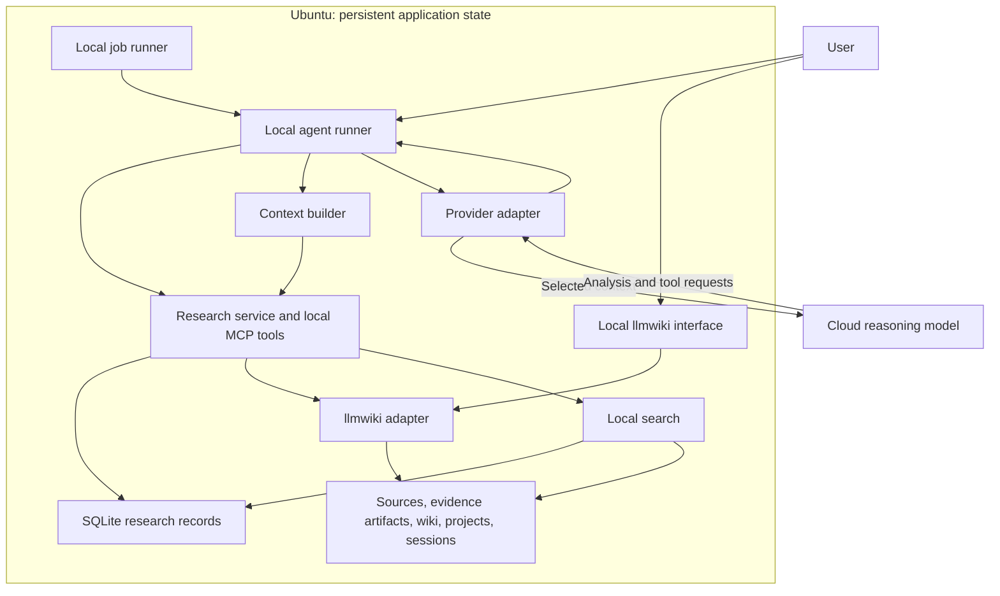

# Local Research Library and Assistant

Version: 2.0 | Updated: 2026-10-25 | Purpose: self-contained implementation handoff for Codex

## 1. Task for Codex

Build a local research library and assistant according to this specification. Treat it as the replacement for the earlier discussion; you do not need access to that conversation.

All authoritative application data, accumulated knowledge, conversations, project memory, search indexes, and workflow state must persist on my Linux/Ubuntu machine. Use AI models or agents for reasoning over selected context. The system must retain its knowledge when I close a conversation, restart the machine, change clients, or switch model providers.

Use `lucasastorian/llmwiki` in local mode as the initial document/wiki foundation. Add a separate research service for structured evidence, memory, coverage, and resumable jobs. Do not fork or deeply modify upstream merely to add research-specific features.

First inspect the actual workspace, repository instructions, upstream integration surfaces, and any supplied sample summaries. Record a short implementation plan and then implement incrementally. This request is to produce working software, not only a plan or mockup. Make reasonable, reversible implementation choices and document them. Ask only for missing information that materially blocks work; continue independent work when possible.

Use synthetic fixtures and a deterministic fake model provider until real data paths and provider configuration are available. Do not invent my local paths, credentials, summary format, hardware capacity, or completed benchmarks. Do not start processing all 5,000 papers automatically.

## 2. Background and current status

- thousands of computer-vision and robot-learning papers, plus existing summaries.
- The machine runs Linux/Ubuntu.
- Original papers and accumulated knowledge must persist locally.
- Selected excerpts, page images, and relevant project context may be sent to cloud models for inference.
- I want to use Codex/GPT and/or Claude for reasoning.
- No system installation, corpus ingestion, or 5,000-paper benchmark has been completed in this discussion.
- The actual summary files and their generation process have not been inspected.
- Prior review covered repository documentation and selected source files. Recheck the exact upstream revision before relying on an API or tool contract.

Example questions:

1. Find world-action models, object-centric methods, and bimanual dexterous VLA papers.
2. Find multi-view methods that do not require accurate camera poses.
3. Compare methods, assumptions, inputs/outputs, training data, evaluation conditions, results, and limitations.
4. Identify trends across my dated collection.
5. Suggest how to combine a main RGBD camera with RGB-only wrist cameras in my 3DFA model.
6. Revisit previous experiments, explain failures, and propose the next experiment.

## 3. Required outcomes

### Research capabilities

- Technical Q&A with citations to original paper versions and precise locations where available.
- Comparisons that preserve method variants and experimental conditions.
- Research advice combining project constraints, accumulated knowledge, and original-source verification.
- Collection-wide screening and reviews with explicit coverage reports.
- Incremental knowledge updates when new papers, revised sources, or experiment results arrive.
- Useful continuity across sessions without depending on provider-hosted memory.

### Important distinctions

- Indexing a PDF is not analysis of that PDF.
- Reading a summary does not establish full-text coverage.
- Delivering text to a model is access coverage; a recorded assessment is analysis coverage.
- Summaries are lossy. Revisit text, figures, tables, equations, and appendices when needed.
- Missing information remains unknown. Never convert an absent field into a negative finding.
- A citation resolving to an existing file does not establish that the cited material supports the claim.
- Source verification establishes what a source supports, not universal scientific truth.
- Published findings, author claims, agent inferences, project observations, and proposed hypotheses must remain distinguishable.
- Collection-wide trend claims identify the collection snapshot, publication-date coverage, denominator, and classification gaps.
- Durable memory exists only after an explicit local write succeeds.

## 4. Local ownership and cloud boundary

### Everything the application remembers is local

Persist locally:

- PDFs, supplements, original summaries, extracted text, rendered pages, tables, and figures.
- Bibliographic identities, source versions, structured findings, and evidence records.
- Markdown syntheses, contradictions, trends, and open questions.
- Project goals, constraints, decisions, hypotheses, experiments, and failures.
- Conversation messages, tool results, session summaries, task state, and checkpoints.
- Keyword indexes, embeddings, reranking caches, and retrieval metadata.
- Model/configuration versions, usage accounting, job attempts, and audit records.

Use local extraction/OCR, embedding, and reranking by default. Do not silently fall back to cloud OCR, hosted embeddings, a cloud vector store, remote tracing, or a hosted document library. Downloading software/model weights is distinct from transmitting corpus data; document setup network requirements.

Cloud reasoning receives only the context selected for that task, which can include original passages and relevant visual excerpts. Do not upload the entire corpus to a hosted knowledge service. Do not depend on provider conversation IDs or persistent remote threads to reconstruct a task. No automatic cloud backup, repository push, or corpus synchronization.

### What local ownership does not guarantee

Cloud inference transmits selected content outside the machine. Provider retention is separate from application memory. Do not claim that local execution or `store: false` guarantees zero cloud retention. For an OpenAI API backend, explicitly disable stored responses where supported and maintain replayable application context locally; verify the current endpoint/model/account retention behavior. Verify equivalent controls independently for other providers and CLI clients.

If a future requirement prohibits any content leaving the machine, route reasoning to a local model through the same provider interface. That stricter requirement is not the current assumption.

### Execution modes

1. `offline`: no inference network requests; local search, browsing, imports, and saved reports work; reasoning jobs remain pending or use a configured local model.
2. `fake`: deterministic local provider for development and tests.
3. `cloud`: explicitly configured provider and per-run budgets; selected context may be transmitted.

Default to `fake` for development and require explicit configuration to enable `cloud`. Do not interpret API-key presence alone as permission to ingest the whole corpus.

## 5. Architecture



These are logical modules, not a requirement for many independent services. Start with one research package, one local database, a small worker pool, and the upstream application. Redis, Kubernetes, a graph database, and a new custom frontend are outside the initial scope.

### Reuse versus custom work

| Reuse | Build |
|---|---|
| llmwiki local document access, wiki UI, citations, and file operations | Paper/summary matching and scientific data model |
| Existing extraction where it preserves required locations | Evidence locators, provenance, and reading coverage |
| SQLite and migrations | Local memory/context service and resumable review jobs |
| Existing local keyword search | Research filtering, retrieval fusion, and coverage-aware search |
| QMD if a pilot validates its integration | Thin adapters and context packaging |
| Codex/Claude clients where appropriate | Provider-independent persistent task and project state |

The exact supported llmwiki operations must be verified at a pinned revision. Do not write directly into its private database tables. Keep `research.db` separate. If a stable integration is unavailable, preserve the adapter interface, report the gap, and implement a documented local-file fallback without pretending integration passed.

## 6. Implementation defaults and scope

Proposed defaults, adjustable when the actual repository requires otherwise:

- Python 3.11 or newer, a conventional `src/` package, and `uv` for environment management.
- SQLite with foreign keys, migrations, short transactions, and controlled writes.
- Typed request/response models, preferably Pydantic.
- CLI first, with local MCP exposing the same application services.
- MCP over stdio initially. Any HTTP service binds to loopback by default.
- A local queue with bounded worker concurrency and durable checkpoints.
- Local FTS/keyword baseline followed by measured semantic-search integration.
- Provider adapters with a deterministic fake implementation and at least one working cloud backend when configured. A second provider is useful but is not a prerequisite for the first runnable milestone.
- Human-readable Markdown plus JSON exports; no provider-specific format as the sole durable representation.

Initial deployment is for one user on one machine. Avoid concurrent unrestricted wiki writers. Use existing clients/UI rather than building a separate chat product.

## 7. Local storage layout

All paths are proposed relative paths under a configurable `data_root`, not existing paths on my machine.

| Path | Purpose |
|---|---|
| `sources/` | Immutable imported source snapshots, organized by content hash or stable asset ID |
| `extracted/` | Versioned text, page renders, figures, tables, and extraction metadata |
| `db/research.sqlite3` | Authoritative research records, inspections, sessions, jobs, reviews |
| `wiki/` | Derived topic syntheses and comparisons, compatible with the chosen llmwiki workspace |
| `projects/` | Project briefs, experiments, decisions, and hypotheses |
| `sessions/` | Conversation/tool event exports and compact session summaries |
| `exports/papers/` | Generated searchable Markdown paper records |
| `indexes/` | Rebuildable retrieval indexes and local embeddings |
| `runs/` | Job reports, request manifests, and local diagnostics |
| `backups/` | Backup manifests or configurable external-disk/NAS backup destination |

Do not move or modify the user's original files. Default import should preserve immutable local bytes, with deduplication by content hash. A registration-only mode may reference external files, but must check their identity before reads and must not claim old versions remain available if their bytes were overwritten. Do not use mutable hardlinks as an immutability guarantee.

`research.db` owns structured scientific facts. Export paper records to Markdown in one direction. Arbitrary edits to generated exports must not silently update the database. Wiki and project prose may be edited, but their scientific claims require provenance. Track external edits as revisions and recheck affected dependencies.

Treat llmwiki's annotations/application state as backup-worthy even if some of its search data can be regenerated.

## 8. Data model and invariants

Use stable IDs independent of filenames. Recognize paper identity separately from PDF byte identity: preprint revisions, published versions, supplements, and summaries may belong to one paper without being interchangeable evidence. Deduplicate identical bytes; do not merge scientific papers on title similarity alone.

| Entity | Required information |
|---|---|
| `paper` | ID, title, identifiers when known, publication date/date precision, bibliography |
| `asset_version` | ID, paper association or unresolved status, source type, content hash, local location, provenance, predecessor/version relations |
| `extraction` | Source version, extractor/version/config, artifacts, page map, success/failure and quality signals |
| `method_variant` | Paper, variant name, structured I/O, assumptions, training/adaptation fields |
| `finding` | Typed field/value or claim, scope, origin, reasoning type, verification state, evidence links |
| `evidence` | Immutable source version, location, excerpt/crop reference, locator details |
| `evaluation_result` | Variant, task/benchmark, robot, training setting, evaluation protocol, metric/value/unit, evidence |
| `inspection` | Source version, inspected text/pages/objects, access event, assessment purpose/result, model/reviewer |
| `project_item` | Project, item kind, content/revision, links to experiments, decisions and evidence |
| `session_event` | Session, ordered user/assistant/tool events, local attachments, timestamp |
| `session_summary` | Session/range, decisions, unresolved issues, next steps, original event references |
| `job` and `attempt` | Task key, input versions, configuration, status, lease, attempts, usage, errors |
| `review_run` and `review_item` | Criteria, immutable membership snapshot, per-paper outcome/basis/evidence/status |
| `dependency` | Source/finding/project revisions supporting derived pages or reports |
| `pending_write` | Recoverable staged database-to-file/wiki operation |

Avoid an enormous fixed ontology. Use normalized core relations and validated JSON for evolving modality/training/task attributes. Version schemas.

### Research fields

Capture these when available, leaving absent values unknown:

- Observation modalities and camera roles; number of views; image/depth/point-cloud representation.
- Intrinsics/extrinsics requirements, supplied versus estimated poses, training versus inference requirements, fixed versus changing cameras, and robustness to calibration errors.
- Coordinate frames, history windows, synchronization assumptions, embodiment, action representation, horizon, control frequency, and deployment latency conditions.
- Training datasets, amounts, supervision, pretraining, adaptation/finetuning requirements, and supported tasks.
- Evaluation variants, dataset splits, environments, robots, trials/seeds, success definitions, aggregate/per-task results, uncertainty, baselines, ablations, and limitations.

One paper may contain many variants and evaluations. A single `success_rate` or `requires_camera_pose` field at paper level is inadequate.

### Separate status dimensions

- Origin: `original_source`, `existing_summary`, `project_observation`, `conversation`.
- Reasoning type: `reported_result`, `author_claim`, `agent_inference`, `hypothesis`, `project_decision`.
- Verification: `unverified`, `source_checked`, `contradicted`, `unresolved`.
- Processing: `pending`, `running`, `completed`, `failed`, `cancelled`.

These dimensions must not collapse into one confidence score. An unknown value is null with an explanation, not false. A completed import is not a verified paper.

### Evidence contract

An evidence pointer includes `asset_version_id`, source hash, and a locator. For PDFs, support 1-based physical page index separately from printed page labels, section names, and figure/table/equation IDs. Add bounding boxes or character spans where extraction supports them; document coordinate conventions and extraction version. Keep original page rendering available for verification of layout-sensitive evidence.

Summary-derived claims initially point to the summary asset. Do not invent a PDF page citation. Verification adds an explicit original-source link and assessment. Table values must identify the appropriate row/column or equivalent contextual locator. Missing or stale locators are reported, not silently redirected to a newer paper revision.

## 9. Existing-summary audit and ingestion

Do not regenerate all summaries upfront. Audit roughly 20–30 representative summary/PDF pairs when available. Measure identity matching, generation provenance, original-input coverage, supported formats, field completeness, factual fidelity, source locators, and handling of numerical results. Until actual files are supplied, implement import adapters against documented synthetic fixtures and label them as such.

Bootstrap pipeline:

Deterministic import can normalize fields already present in structured summaries. Extracting scientific claims from unstructured prose is a reasoning job: use the fake provider for fixtures, leave it pending in offline mode, and use the configured model in cloud mode. Do not substitute keyword presence for a verified scientific attribute.

1. Discover files in explicitly configured roots; create a manifest without modifying them.
2. Register immutable asset versions and resolve exact duplicates.
3. Match summaries to papers using supplied identifiers/metadata; flag ambiguous matches.
4. Preserve original summary bytes and generation provenance when known.
5. Extract candidate structured records with origin `existing_summary` and verification `unverified`.
6. Validate schemas, preserve unknowns, and commit records.
7. Export paper records and refresh local indexes.
8. Queue targeted source enrichment and affected wiki updates.

Source enrichment reads relevant original sections and visual material. Record the exact inspected scope. If extraction fails, keep the paper registered with an explicit error; a metadata-only entry is never labeled analyzed.

Allow a later baseline-review campaign to inspect all papers, but do not claim full analysis merely because every summary was imported. Coverage for text, figures, tables, equations, and appendices remains separate.

## 10. Retrieval and context construction

Index three distinguishable collections: structured paper exports, original-source evidence/extractions, and wiki/project/session memory. Preserve source types in results. A derived wiki page is not independent corroboration for its own underlying claims.

Start with local structured filtering and keyword search. Add local semantic retrieval and reranking through an adapter after measuring a retrieval gap. QMD is the initial candidate, not a mandatory hidden dependency. Full hybrid-search completion requires an actual working local semantic backend, not only a mock interface.

Merge candidate sets, deduplicate by paper/evidence identity, and retain the reason each candidate matched. Missing calibration or modality attributes must remain eligible for uncertain-candidate investigation. Exact filters intended for confirmed positives may be narrower, but the returned scope must say so.

The context builder assembles:

- Current question and the tools available to the agent.
- Relevant project brief, decisions, failures, and unresolved constraints.
- Relevant paper records and accumulated syntheses.
- Original excerpts or visual evidence required for decisive claims.
- Coverage/unknowns and local evidence identifiers.

Use explicit budgets. Truncation must return a continuation cursor or an incomplete marker. Never mark truncated content as fully read. Do not inject all 5,000 records into every prompt. Expand context through local tool requests when needed.

## 11. Reasoning modes

### Focused Q&A

Retrieve relevant material, inspect decisive original evidence, answer with citations, and state material unknowns. Persist reusable findings through explicit local operations. Save the conversation locally regardless of whether a new wiki page is warranted.

### Research advice

Combine project context and evidence, then separate: published findings; applicability to the project; proposed experiments. Each experiment proposal should describe the hypothesis, modification, evaluation conditions/metrics, and plausible failure modes. A suggestion does not become a project decision until the user adopts it, and is not an experiment result until executed.

### Whole-library review

Freeze a snapshot of all registered paper IDs and asset/record versions. Enumerate membership deterministically with stable pagination. Create a review item for every member, including missing/unreadable papers.

For each paper, record `match`, `nonmatch`, or `uncertain`, the criteria version, rationale, and evidence basis. Keep processing status separate; failed/pending items are not nonmatches. Distinguish summary screening from original-source verification. A summary that does not mention a requirement is insufficient evidence of its absence.

Investigate uncertain cases, and audit a sample of exclusions for systematic false negatives. If the budget stops the run, report partial coverage explicitly. Added papers belong to a new snapshot or an explicit continuation snapshot; do not mutate completed review membership.

Report total membership, records screened, papers source-checked, confirmed matches, unverified candidates, unresolved cases, failed/pending items, source versions, date range, and criteria. Screening every record does not establish full-text analysis or perfect recall.

### Trends

Aggregate structured review/classification records locally. Report publication-date coverage, collection snapshot, denominators, unknown classifications, and deduplication policy. Preserve the limits of this curated collection. Do not claim field-wide popularity or causal trends from it alone.

## 12. Agent and MCP tool contracts

Expose the same typed application services through CLI and local MCP. These names are proposed custom tools, not claims about existing llmwiki endpoints.

| Tool | Inputs | Output contract |
|---|---|---|
| `search_library` | Query, filters, source types, limit/cursor | Results with stable IDs, source type, provenance, match basis and continuation |
| `list_papers` | Snapshot or scope, cursor, limit | Deterministic membership enumeration with total and next cursor |
| `get_paper` | Paper ID, optional record revision | Variants, findings, evaluations, assets and coverage |
| `read_source` | Asset version, page/object/section selection, budget | Text/images, exact source locations, truncation and access event ID |
| `record_inspection` | Access/evidence IDs, inspected scope, purpose, assessment | Persistent assessment and updated coverage |
| `record_finding` | Claim/value, scope, origin, reasoning type, evidence and expected revision | Validated stored record or structured conflict/error |
| `get_project_context` | Project ID, query/scope, budget | Versioned brief plus relevant decisions/experiments |
| `save_project_item` | Project, kind, content, references, expected revision | Persistent hypothesis/decision/experiment record |
| `start_review` | Criteria, collection scope, budget | Snapshot ID and local job ID |
| `get_review_status` | Review ID, optional item cursor | Counts, unresolved/failed items and continuation |
| `save_synthesis` | Page/report content, dependencies, expected revision | Staged/committed revision and references |
| `checkpoint_session` | Session, event range, compact summary, open tasks | Locally reconstructible checkpoint |

Every scientific read goes through the research service when coverage accounting is required. Browsing a PDF in the UI does not automatically count as an assessment. Tool results and durable memory use provider-independent IDs and formats.

## 13. Persistence, updates, and job behavior

- Use at-least-once execution with idempotent commits. Do not promise exactly-once model charges after a crash.
- Job keys include operation, input source/record versions, schema/prompt versions, relevant project revision, and processing/model configuration. Review caches also include criteria version.
- Keep job leases/heartbeats so interrupted workers can be recovered. Bound retries and preserve terminal errors.
- Record usage per attempt when available; unavailable usage is unknown, not zero. Budgets stop further work predictably and leave resumable jobs.
- A new source version marks dependent claims/pages/reports for review; preserve historical evidence. An updated prompt does not silently relabel old assessments as current.
- Serialize wiki writes initially. Use revision checks for edits and a local pending-write/outbox record to recover interrupted database/file updates.
- Automatically save conversation events and job checkpoints. Persist findings and syntheses through validation; do not turn every model statement into accepted knowledge.
- Store session summaries with links to original events. Changing models must not require replaying provider-specific hidden state to recover accepted knowledge.
- Treat source text as evidence, not executable instructions. Model tool requests are validated locally. Protect configured source roots from modification.
- Keep credentials in the local environment or an appropriate secret mechanism; never in prompts, corpus files, ordinary logs, or committed config.
- Keep content-bearing diagnostics local. Record outgoing context manifests locally without logging credentials.

## 14. CLI, configuration, and suggested source organization

Provide a CLI named `researchlib` (or document an equivalent established project convention). Minimum commands:

```text
researchlib init --data-root PATH
researchlib import --papers PATH --summaries PATH --dry-run
researchlib import --papers PATH --summaries PATH
researchlib search "QUERY"
researchlib ask "QUESTION" --project PROJECT_ID
researchlib review start --criteria FILE --scope all
researchlib review status REVIEW_ID
researchlib jobs run --limit N
researchlib jobs status
researchlib doctor
researchlib backup --destination PATH
researchlib mcp
```

These are required command shapes to implement, not commands that already exist. Provide `--help`, structured JSON output where useful, and actionable errors. A missing optional backend should be reported without breaking offline browsing or core imports.

Configuration includes `data_root`, source roots/import mode, llmwiki workspace/revision/connection settings, search backend, execution mode, provider/model, embedding model/version, context limits, worker concurrency, retry limits, per-run budgets, and backup destination. Use documented defaults; never embed secrets.

Suggested module responsibilities under `src/researchlib/`:

| Module | Responsibility |
|---|---|
| `cli.py`, `config.py` | Entry points and validated configuration |
| `storage/` | Database, migrations, revisions, pending writes, backups |
| `ingest/` | Discovery, identity matching, summary adapters, extraction coordination |
| `evidence/` | Source locators, findings, inspections, coverage |
| `retrieval/` | Search interface, keyword/semantic adapters, fusion |
| `memory/` | Sessions, project items, summaries, context assembly |
| `reasoning/` | Local agent loop and fake/cloud/local provider adapters |
| `jobs/`, `reviews/` | Durable jobs, snapshots, criteria, aggregation |
| `integrations/` | llmwiki adapter and MCP server |

Follow existing repository conventions when present. Exact function signatures and migration files should be settled in the implementation plan after workspace inspection; do not invent existing upstream interfaces.

## 15. Delivery milestones and acceptance gates

Implement these sequentially, keeping a usable system at each stage. No milestone requires cloud credentials merely to run its tests.

### M0 — Inspect and pin the integration

- Inspect workspace instructions and current upstream APIs/tools.
- Record the llmwiki revision and the actual read/search/write integration.
- Add configuration, diagnostics, and adapter contract tests using fixtures.
- Deliver a concise compatibility report. Do not claim integration success from documentation alone.

### M1 — Offline corpus registry and summary bootstrap

- Implement storage/migrations, immutable assets, identity matching, summary import, and keyword search.
- Normalize existing structured fields; preserve unstructured summaries as searchable inputs and queue their semantic extraction rather than claiming it occurred offline.
- Support dry-run manifests and explicit ambiguity/error reporting.
- Demonstrate imports twice without duplicate committed records; preserve unknowns and original files.
- Provide generated small fixtures, including multiple PDF versions and an ambiguous summary match.

### M2 — Evidence, memory, and fake reasoning loop

- Implement source locators, page/object reads, findings, inspections, project items and local sessions.
- Add the context builder and fake provider, plus core CLI/MCP tools.
- Demonstrate an answer with traceable evidence, a locally saved finding, and retrieval of that finding in a fresh session.
- Verify failed/truncated extraction does not become completed analysis.

### M3 — Real reasoning and persistent synthesis

- Add at least one configured cloud backend with explicit request/storage controls and budget accounting.
- Integrate tested llmwiki operations and recoverable wiki writes.
- Demonstrate source evidence versus hypotheses and project decisions, with revision checks.
- Without credentials, report live integration as untested while completing fake/offline verification.

### M4 — Resumable whole-library review

- Implement snapshot enumeration, criteria, per-paper dispositions/bases, job leases, restart recovery and coverage reports.
- Demonstrate a forced interruption and successful resume on a fixture collection.
- Verify pending/failed/uncertain papers remain visible and new imports do not alter an old snapshot.

### M5 — Retrieval evaluation and local hybrid search

- Create a small labeled query set based on the user's questions, including known relevant papers and difficult negatives when real examples are supplied.
- Measure the keyword baseline; implement and test the local semantic backend where needed for the target design.
- Document retrieval recall on the evaluated set, citation support, unknown handling, latency and resource usage.
- Distinguish implementation completeness from performance validation on real papers.

### M6 — Pilot, backup, and scaling readiness

- Audit roughly 20–30 real summary/PDF pairs and run a roughly 100-paper pilot after paths are supplied.
- Measure tokens/time by stage, extraction failures, identity errors, supported citations, retrieval misses, and review coverage.
- Verify a backup restore into a clean data root, including pending jobs and application annotations.
- Only then estimate and configure a 5,000-paper run. Report exactly what has and has not been validated.

## 16. Required behavioral tests

Tests should exercise meaningful behavior rather than mirror implementation details. At minimum cover:

1. Unknown camera calibration does not become `false` or a confirmed nonmatch.
2. A summary-only import never becomes original-source verification.
3. A numeric result is associated with the correct method variant, task and protocol.
4. Different paper versions keep independent evidence locations.
5. Renamed files retain stable identity; identical bytes deduplicate; similar titles do not force a merge.
6. Missing, scanned, or malformed PDFs remain visible with processing errors/quality limits.
7. Truncated reads expose continuation and incomplete access coverage.
8. Whole-library pagination visits every snapshot member exactly once in committed review accounting.
9. A forced worker crash resumes without duplicate committed findings; exhausted retries remain visible.
10. Budget exhaustion produces a partial report with unresolved items, not a false complete result.
11. A source/finding revision marks dependent syntheses stale without destroying historical support.
12. A conflicting wiki edit is detected, and a database/file interruption is reconciled.
13. A new session reconstructs project context from local records without provider history.
14. Two fake provider adapters can continue the same project from normalized local memory.
15. Offline mode makes no inference/network calls and preserves search/browsing/export functions.
16. Source content cannot instruct the runtime to overwrite originals or expose unrelated files.
17. A backup/restore preserves source mappings, evidence, sessions, review state and pending writes.

Live-provider and real-corpus tests are separate from synthetic tests. Passing synthetic tests is not evidence of full-text coverage or 5,000-paper suitability.

## 17. Required deliverables from the coding agent

- Working source code, dependency lockfile, migrations, sample configuration, and CLI/MCP entry points.
- README with install/run/recovery/backup instructions and exact tested versions.
- Architecture and data-model documentation matching the implementation.
- Deterministic fixtures and tests that run without external credentials.
- A local demo showing ingestion, evidence-based Q&A, session continuity, and a resumable review.
- An implementation status report separating completed, mocked, untested, and deferred capabilities.
- Actual validation output and material limitations; no invented benchmark numbers.

Do not introduce PaperQA2, Zotero MCP, Local Deep Research, a second wiki framework, or a custom frontend until a demonstrated requirement justifies them. Keep the foundation small and interchangeable.

## 18. Sources and repository decisions

Initial foundation:

- https://github.com/lucasastorian/llmwiki — use local mode; verify/pin integration contracts.
- https://github.com/tobi/qmd — candidate local hybrid retrieval backend.

Workflow references, not additional runtimes to install automatically:

- https://gist.github.com/karpathy/442a6bf555914893e9891c11519de94f
- https://github.com/sdyckjq-lab/llm-wiki-skill
- https://github.com/JiaheXu/karpathy-llm-wiki
- https://github.com/JiaheXu/karpathy-llm-wiki-vault

Current OpenAI guidance to verify during integration:

- https://developers.openai.com/api/docs/guides/your-data
- https://developers.openai.com/api/docs/guides/conversation-state

Use official provider documentation for actual request schemas and retention settings. A locally run client is not, by itself, a guarantee about backend retention.

## 19. Definition of success

I can ask a new technical question, obtain a useful answer with original-source evidence and explicit unknowns, save the resulting knowledge locally, restart with a different reasoning provider, and continue the same research project. I can also request a whole-library review and see an honest accounting of every paper, including those not yet resolved. My accumulated knowledge and workflow state remain recoverable from local storage without a cloud conversation history.
