# Robot Literature Assistant Architecture and Implementation Plan

> Codex handoff, version 1.1, 2026-10-13. This is a proposed build specification, not a report of an implemented or benchmarked system. The user's corpus has not been accessed here.
>
> For agentic workers: use `superpowers:executing-plans` if available to implement this plan task by task. Otherwise follow the same checkpoints using native execution. Read this entire specification first. No parallel agent delegation is required. Preserve existing repository instructions and user changes.

**Goal:** Build a personal research assistant for approximately 3,000 robot-learning PDFs totaling 30 GB, stored on Linux. Find papers satisfying technical requirements, show evidence for each match, and use project context and experiment history to propose research and engineering actions.

**Architecture:** A modular Python application, a PostgreSQL database with pgvector, local immutable document storage, and a resumable worker. Parsing, embeddings, lexical search, vector search, and reranking run locally. A configurable cloud LLM interprets questions, extracts selected facts, reviews evidence, and generates answers from selected excerpts and relevant project context.

**Tech stack:** Python 3.11 or later; uv; FastAPI; Pydantic; SQLAlchemy and Alembic; PostgreSQL 17 with pgvector 0.8 or later; Docling; Sentence Transformers using BAAI/bge-m3; BAAI/bge-reranker-v2-m3; pytest. These are design choices, not claims of best-in-class performance. Resolve a compatible dependency set and commit the lockfile. Pin embedding and reranker model revisions. Support CPU execution and optional accelerator execution through configuration.

**Spec:** This file is the architecture, contracts, acceptance specification, implementation plan, and Codex handoff. Copy it to `docs/robot_literature_system_codex_spec.md` in the implementation repository.

**Version 1.1 additions:** Method input/output contracts, training and dataset details, published evaluation records, baseline comparability, engineering dependencies, scoped record search, field-level provenance and missingness, and related acceptance tests. Sections 5–8 define these additions; tasks 1, 3–7, and 9 incorporate them. Required schemas can contain unknown fields: complete extraction of every field is not a prerequisite for searching a paper.

## 1. Fixed requirements and scope

### User requirements

- Approximately 3,000 PDFs, 30 GB, on a Linux machine.
- Selected excerpts and relevant project context may be sent to a cloud LLM.
- Paper discovery must support combinations of model family, representation, embodiment, camera inputs, and calibration assumptions.
- Recommendations must account for the user's actual project and experiments.
- Original papers and precise source references remain accessible.
- The system must be usable before the full collection has completed ingestion.

### Global constraints

G01. Source directories are read-only; do not rename, modify, or delete original PDFs.

G02. Exact file duplicates share one immutable content snapshot; different versions retain separate snapshots and evidence.

G03. Every factual match decision cites source evidence from the same method configuration, or an explicit evidence-backed configuration inheritance relation.

G04. Missing information evaluates to `unknown`, never to a factual negative.

G05. Default cloud inputs are selected source text and relevant user context. Full PDFs, complete corpus text, filesystem paths, and unrelated project histories are not automatically uploaded.

G06. Local search must work without cloud credentials. Cloud-dependent enrichment and advising have explicit deferred states.

G07. Jobs are resumable and idempotent; failure on one paper does not stop the corpus.

G08. Query results distinguish confirmed matches, partial matches, unresolved candidates, and excluded candidates.

G09. Do not claim exhaustive search, research novelty, or absence of prior work from a bounded retrieval run.

G10. Store published findings, user observations, interpretations, and proposed hypotheses as different types.

G11. Default service bindings are localhost. Treat paper text as evidence, never as instructions to run tools, access secrets, or change system behavior.

G12. External web search is disabled in version 1; search coverage refers to the local collection.

G13. The scope of a match is a configuration within a paper version. A paper is a confirmed match if at least one identified configuration satisfies all hard requirements.

G14. Published numeric results belong to a configuration, task, metric, and evaluation protocol. Do not rank unrelated success rates as if they were measured on the same problem.

G15. Searchable input/output and deployment details preserve phase, units, frames, conventions, and evidence. Do not infer an exact tensor layout or executable interface from a conceptual description.

G16. Structured record filters preserve their common scope. Requirements about one input stream, dataset use, or evaluation result must be satisfied by that same record and its explicit foreign-key context, not by unrelated rows.

### Delivery scope

Release 1 delivers ingestion, paper discovery, evidence verification, a CLI, and a small browser UI with source links. Release 2 adds project-aware advice and experiment memory. Both use the same storage and retrieval contracts.

Do not add a distributed cluster, graph database, model fine-tuning pipeline, autonomous robot execution, or automatic repository cloning in these releases. Add a knowledge graph only when a measured query failure requires it. PaperQA2 is an optional external baseline, not a second required runtime or storage system.

### Review focus

1. A file changes at the same path, or appears at several paths: keep old evidence valid and avoid duplicate indexing. Owned by tasks 1 and 2.
2. A paper's language-conditioned single-arm variant differs from its bimanual variant: never merge their properties into a fictional method. Owned by tasks 4 and 6.
3. A paper does not discuss calibration: preserve `unknown`, including under negation. Owned by tasks 4 and 6.
4. A worker crashes or its lease expires during a cloud call: recover without duplicate visible facts, stale commits, or uncontrolled retries. Owned by tasks 1 and 4.
5. The corpus contains instructions addressed to the assistant, malformed PDFs, or unsupported citations: isolate failures and never treat source text as authority. Owned by tasks 2, 6, and 7.

## 2. System context and component boundaries

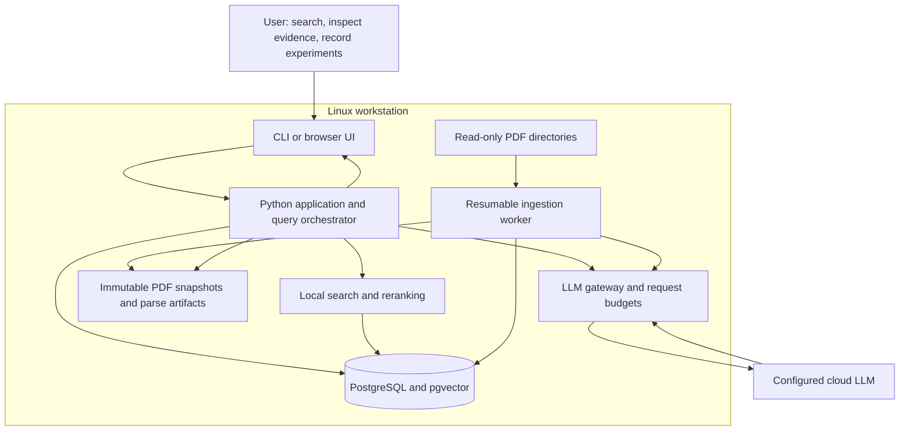

| Component | Responsibility | Must not do |
|---|---|---|
| CLI and UI | Accept requests, show progress, paper tables, evidence, and user corrections | Decide scientific truth or call cloud APIs directly |
| Application service | Validate requests, manage query runs and budgets, assemble results | Load the full corpus into a prompt |
| Ingestion worker | Inventory, snapshot, parse, chunk, embed, enrich, and retry | Modify originals or keep long network calls inside database transactions |
| Retrieval service | Lexical, vector, and metadata candidate search; rank fusion and reranking | Interpret a high similarity score as verified evidence |
| Evidence service | Resolve source spans, fetch surrounding context, inspect tables and relevant pages | Substitute an LLM summary for original evidence |
| Fact service | Store scoped assertions, contradictions, and provenance | Treat absent fields as false |
| LLM gateway | Provider adaptation, structured output validation, usage accounting, bounded retries | Expose shell or unrestricted filesystem tools to a model |
| Memory service | Versioned project profiles and experiment records | Promote a suggestion into an observed result |
| PostgreSQL | Relational metadata, jobs, facts, text search, vectors, query audit trail | Store large PDF bytes in database rows |
| Filesystem store | Content-addressed PDFs, parser JSON, table data, cached crops | Discard cited artifacts during ordinary reindexing |

Run the API and worker as separate processes from the same Python package. PostgreSQL is the only required infrastructure service. A database job queue avoids an additional Redis service in version 1.

## 3. Ingestion and artifact lifecycle

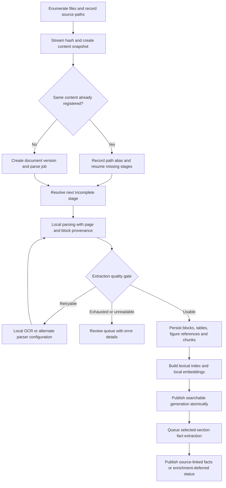

### Identity and snapshots

- `paper_id` identifies the conceptual publication. `document_id` identifies an exact PDF byte sequence. `config_id` identifies a described method configuration within that document. All are UUIDs.
- SHA-256 over the PDF bytes is the immutable file identity and has a unique constraint. Stream reads; do not load whole files into memory.
- Store one managed snapshot at `data/blobs/<sha256>.pdf`. Copy with a temporary path, verify its hash, then atomically rename. Never hard-link to a mutable original. A verified copy-on-write clone is an optional optimization.
- `source_files` records absolute local paths, observed size/mtime, hash, and scan time. These paths never enter cloud requests. A changed path produces a new document snapshot.
- Group versions automatically only when a trusted identifier, such as a verified DOI or arXiv identifier, agrees. Title similarity creates a review suggestion, not an automatic merge. Keep identifiers' provenance.
- A file disappearing from a watched directory marks its source alias unavailable. Retain its snapshot and citations until an explicit retention action.

### Parsing and quality

- Use Docling's local parser adapter and retain its structured document output. The adapter converts coordinates to a documented canonical coordinate system: normalized page coordinates in `[0,1]`, origin at the top-left.
- Save one-based physical PDF page numbers. Printed page labels are optional strings; never confuse them with PDF page indices.
- Every block records type, section path, page, bounding box if available, exact normalized text, and parser provenance. Normalization must be deterministic and retain a mapping to the displayed evidence text.
- Tables retain headers, row/column associations, caption, footnotes, page references, and a structured representation. Never flatten a numeric result without its column and evaluation setting.
- Store figure references and captions initially. Render page/figure crops on demand, with a bounded cache. The default cloud mode is text-only; optional selected image excerpts require an explicit configured image-capable adapter.
- Initial text-quality heuristic: flag pages with fewer than 80 non-whitespace extracted characters when the page has substantial image content. This is a review signal, not proof that OCR is required. Record flags for broken reading order and malformed table extraction when detectable.
- Use a maximum of 3 attempts per job, including the initial attempt. OCR/parser retries follow the same bound. A per-document timeout and worker memory limit must be configurable; timeout failures remain visible.
- Sampling plan: inspect ordinary two-column papers, scanned pages, large appendices, equations, and benchmark tables before corpus-wide ingestion. Document heuristic changes and increment the parser configuration hash.

### Chunking and index publication

- Target 700 embedding-tokenizer tokens per text chunk; maximum 1,000; overlap up to 100 within a section. Carry paper title and section path as separate retrieval context, not as quoted evidence.
- A chunk contains an ordered list of source block spans. Preserve page transitions and exact evidence text.
- Table and figure-caption retrieval units retain links to their full parent object. Large tables may have row groups that repeat headers; the original table remains authoritative.
- Do not intermingle bibliography entries with method passages. Index them as a separate type for citation discovery and lower their default search weight.
- Start with dense BGE-M3 embeddings, normalized, dimension 1,024. Use the same model revision and normalization for queries and corpus vectors. Multilingual embeddings handle Chinese/English semantic matching; the English lexical index is not a Chinese search solution.
- Store PostgreSQL text-search vectors for title, section, and body with descending weights. Preserve acronym/name variants in a separate aliases field.
- Use `vector(1024)` with cosine distance and an HNSW index. Capture retrieval parameters in query-run metadata. Compare with exact vector search on evaluation samples before relying on approximate results.
- A generation is identified by document hash, parser configuration, chunker configuration, and embedding model revision. Write a new generation separately; switch `active_generation_id` only after all required local stages succeed.
- Fact enrichment is a separate readiness dimension. A locally indexed document is searchable even if cloud extraction has not run.

## 4. Durable jobs and recovery

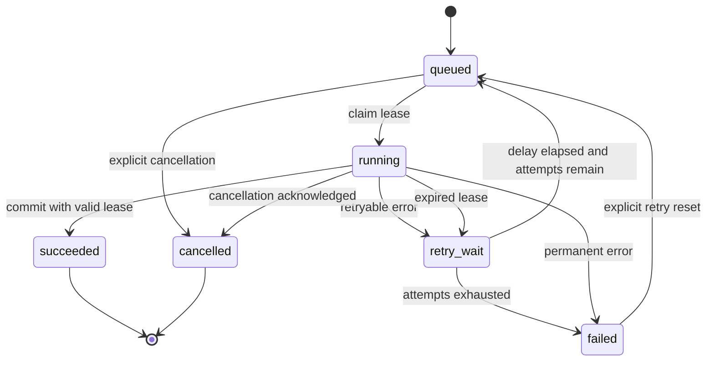

Claim jobs with a short PostgreSQL transaction using row locking and `SKIP LOCKED`. Increment a fencing token, set a 10-minute lease, and heartbeat every 60 seconds. Parsing and network calls happen outside the transaction. Final writes must check the current fencing token and lease; an expired worker cannot publish stale output.

The unique job key is `(document_id, stage, input_artifact_hash, configuration_hash)`. Publication and marking the job succeeded occur in one database transaction after filesystem artifacts are atomically written. Orphan artifacts are harmless and can be garbage-collected after references are checked.

Default concurrency is 2 parsing jobs, 1 embedding job, and 2 cloud jobs. These are conservative starting values, not throughput promises. Retry with exponential backoff and jitter; provider throttling honors `Retry-After` when available. Each network attempt counts against the call budget. Log uncertain timeouts as possibly billed; do not promise exactly-once provider billing.

Observe separate document readiness flags: `snapshot_ready`, `parse_ready`, `search_ready`, and `facts_ready`. A completed job does not imply the full document is enriched. Queryable facts have their own extractor/prompt version and can be refreshed without rebuilding embeddings.

## 5. Logical storage and provenance

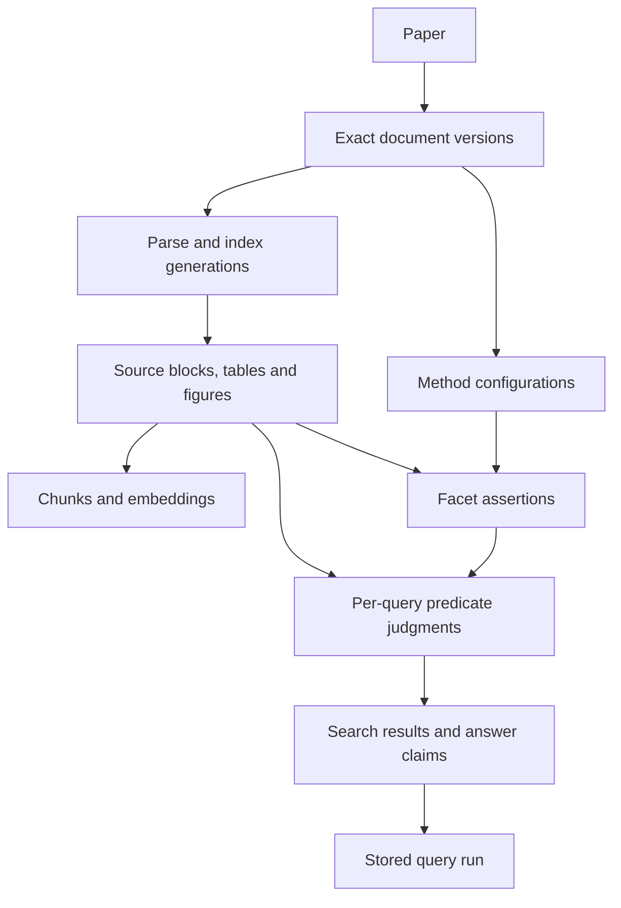

| Table | Required fields and constraints |
|---|---|
| `papers` | `paper_id`, preferred title, optional verified DOI/arXiv ID, identity provenance |
| `documents` | `document_id`, `paper_id`, unique SHA-256, byte size, page count, blob path, optional version label |
| `source_files` | source root, canonical local path, current `document_id`, size, mtime, last seen, availability |
| `generations` | `generation_id`, `document_id`, parser/chunker/embedding revisions, stage flags, creation time, active flag |
| `blocks` | `block_id`, `generation_id`, type, section path, PDF page, printed label, bbox, text, structured artifact reference |
| `chunks` | `chunk_id`, `generation_id`, exact text, source span list, token count, section path, `tsvector`, `vector(1024)` |
| `method_configs` | `config_id`, `document_id`, label, description, identity evidence IDs, optional parent relation with evidence |
| `facet_assertions` | `assertion_id`, `config_id`, facet key, typed JSON value, evidence refs, origin, evidence status, extractor/prompt revisions, created time, optional superseded assertion ID |
| `io_contracts` | `io_id`, `config_id`, phase, direction, stream/port name, schema version, typed contract JSON, field assertion references |
| `method_details` | `detail_id`, `config_id`, schema version, architecture/learning/embodiment/deployment/limitation JSON, field assertion references |
| `dataset_uses` | `dataset_use_id`, `config_id`, dataset identity/version, role and phase, split and scale JSON, field assertion references |
| `evaluation_protocols` | `protocol_id`, `document_id`, benchmark/task/environment identity, protocol JSON, field assertion references |
| `reported_results` | `result_id`, `config_id`, `protocol_id`, optional checkpoint label, task and metric, raw and normalized values, aggregation and uncertainty, field assertion references |
| `comparison_members` | paper-local comparison group ID, `result_id`, role such as proposed method/baseline/ablation, reproduced-versus-quoted status and source refs |
| `artifact_mentions` | artifact ID, `document_id`, optional `config_id`, kind, URL/identifier, claimed availability/license, observation source and date, field assertion references |
| `record_field_assertions` | assertion ID, record type/ID, schema-approved field path, typed value, raw representation, unit, evidence status/refs, derivation if any, revisions and optional superseded assertion ID |
| `field_reviews` | record/config ID, field path, inspected evidence scope, review state, unknown reason, reviewer/extractor revision, timestamp |
| `entity_aliases` | entity ID/type, canonical label, alias, language, namespace/version, provenance, ambiguity/review state |
| `paper_user_state` | Release 2: user/paper ID, reading status, tags, project links, update version; personal metadata only |
| `saved_queries` | Release 2: query ID, user label, original question, validated plan/schema version, optional project ID, last run ID |
| `jobs` | job key, stage, state, attempt, lease expiry, fencing token, error code, artifact references |
| `query_runs` | run ID, question, resolved interpretation, mode, plan, corpus snapshot, budgets, timings, usage, coverage, response |
| `projects` | project ID, version, profile JSON, update provenance |
| `experiments` | experiment ID, project ID/version, config/code revision, hypothesis, observed results, interpretation, attachments, date |
| `research_notes` | note ID, project ID, typed note category, body, evidence refs, review state, date |

Use UUID foreign keys, UTC timestamps, and transactional writes. Index document/config IDs and facet keys used for filtering. Use a JSONB facet value with a strict application-level registry and type validation. Denormalized effective-facet views are caches; their rows must retain source assertion IDs.

Typed record JSON is validated with versioned application schemas. `record_field_assertions` is the provenance authority for its fields; record JSON and scalar search columns are materialized effective views. A common assertion payload can implement both facet and record assertions without two competing sources of truth. Enforce valid record types and record IDs in the repository. A derived coarse facet must reference the detailed assertions that justify it. Conflicts cannot silently disappear during materialization.

`reported_results` describes experiments in publications. The existing `experiments` table describes the user's own runs. Keep these identities distinct; they may refer to the same task/metric vocabulary but have different provenance. Structured records also participate in the query snapshot revision watermark, corrections, and retained-generation rules.

Old generations remain available while cited. Backups include PostgreSQL and all referenced content blobs/artifacts; a database-only backup cannot restore source viewing. A restore smoke test must resolve a saved citation.

### EvidenceRef contract

`EvidenceRef` contains `document_id`, `generation_id`, `block_id`, optional `char_start` and `char_end`, `pdf_page`, optional `bbox`, and `content_sha256`. Character offsets are Unicode code-point indices into the persisted normalized block text. End offsets are exclusive. The application, not the model, resolves the quoted text from these references.

Local grounding validation checks that IDs exist, offsets are in bounds, page/bbox belong to the source, and the source hash matches. Semantic support is a separate review outcome; valid IDs alone do not prove that a claim is supported.

For numeric table evidence, also retain a structured locator with the table artifact ID and row/column path, plus separate references for the relevant header, caption, and footnote. Validate the cell against the persisted table artifact. A value cell alone cannot establish the task, units, baseline identity, or aggregation method. If extraction is ambiguous, retain the crop/source and mark the field unresolved instead of publishing a guessed number.

### Assertion contract

`FacetAssertion` contains a configuration ID, whitelisted facet key, typed value, evidence references, and `evidence_status` in `supported | refuted | insufficient | conflicted`. An assertion also records `origin` in `llm_extraction | human_review`, and an optional explanatory rationale. A model confidence number, if recorded, must never substitute for evidence status or be presented as a calibrated probability.

Several source-supported values may coexist for genuinely different scopes. Conflicting values for the same configuration, facet, and scope produce `conflicted`; do not overwrite one silently. Missing assertions produce `unknown` in the query evaluator. A human correction is an append-only revision with a reason; retain previous assertions for audit.

## 6. Robotics facet registry

Use these exact keys initially. Extend the registry through migrations/schema versions rather than accepting arbitrary model-generated fields.

| Facet key | Value type | Meaning |
|---|---|---|
| `model.world_action_joint` | boolean | The scoped system jointly models future world observations/states and robot actions under the glossary's WAM definition |
| `model.future_world_prediction` | boolean | Predicts future observations or world states |
| `model.robot_action_prediction` | boolean | Produces robot actions |
| `representation.object_centric` | boolean | Explicit object-level entities are used in modeling, reasoning, or control; mere object detection is insufficient |
| `representation.object_types` | string array | Examples: slots, object tokens, tracked instances, object graph, object point sets |
| `robot.bimanual_control` | boolean | The scoped policy controls both arms in the relevant configuration |
| `robot.left_hand_type` | enum | `parallel_gripper`, `dexterous_hand`, `other`, or absent |
| `robot.right_hand_type` | enum | Same values; arm count alone does not establish dexterity |
| `policy.vision_conditioned` | boolean | Visual observations condition the action-producing policy |
| `policy.language_conditioned` | boolean | Language conditions the action-producing system; record whether directly or through a planner in supporting details |
| `policy.outputs_robot_actions` | boolean | The scoped system emits robot actions, not only high-level text plans |
| `policy.multiview_input` | boolean | Multiple simultaneous camera views are actual policy inputs |
| `policy.view_count_min` | integer | Supported lower bound on simultaneous input views for this configuration |
| `camera.modalities` | string array | RGB, depth, point clouds, etc.; per-view details remain in structured supporting data |
| `camera.placements` | string array | External, left wrist, right wrist, head, etc. |
| `camera.extrinsics_supplied_train` | boolean | Training requires externally supplied camera poses/calibration |
| `camera.extrinsics_supplied_infer` | boolean | Inference requires externally supplied camera poses/calibration |
| `camera.extrinsics_estimated_infer` | boolean | The method estimates camera poses internally during inference |
| `camera.registered_3d_required_train` | boolean | Training requires observations geometrically registered into a shared frame |
| `camera.registered_3d_required_infer` | boolean | Inference requires geometrically registered observations |
| `camera.intrinsics_supplied_infer` | boolean | Inference requires supplied camera intrinsics |
| `camera.depth_required_infer` | boolean | Inference requires depth |
| `camera.calibration_noise_tested` | boolean | A reported experiment tests calibration error, with conditions linked |
| `camera.calibration_test_details` | object | Error distribution, translation/rotation units, robot, task, metric, and outcome; missing values stay absent |
| `evaluation.real_robot` | boolean | Results include a physical robot for this configuration |

The glossary resolves WAM to `world-action model` by default for this user, but visibly reports this interpretation and allows correction. Do not match the acronym alone: it could name a robot or another model family. Record whether an object-centric claim concerns perception, world modeling, policy, or planning. A VLA query uses a declared operational definition: vision and language condition an action-producing robot system; show whether the language path is direct or hierarchical.

For `bimanual dexterous VLA`, the default interpretation requires bimanual control, both hands classified as dexterous, and all three VLA facets. Mixed hand configurations appear as partial matches. This interpretation is visible and editable, rather than silently treating a pair of parallel grippers as dexterous hands.

### Searchable detail catalog and extraction priorities

Use three extraction priorities. **P0** supports the five original discovery questions and evidence navigation. **P1** supports method selection, reproduction, and fair result comparison. **P2** is targeted enrichment for a shortlisted method or a specific project question. Define the schemas now; extract P0 broadly, P1 from relevant method/setup/table passages, and P2 on demand. Missing P1/P2 fields never block local indexing.

| Detail group | Fields to preserve | Example search enabled | Priority |
|---|---|---|---|
| Publication identity | Title, authors, publication/preprint date, venue, DOI/arXiv ID, document version, supplement relationship | Find the newest local version and its appendix | P0 |
| Contribution and method identity | Canonical method name, aliases, proposed method versus evaluated baseline versus related-work mention, contribution type, configuration/checkpoint labels | Find actual object-centric policies, excluding background mentions | P0 |
| Problem and task | Manipulation/locomotion/navigation; task name; task family; contact precision; deformable/articulated objects; sequential subtasks; episode horizon | Find long-horizon bimanual assembly methods | P0/P1 |
| Embodiment | Robot family/model, arms and controlled DoF, left/right end effector, finger DoF, mobile base, observed versus controlled joints | Find policies for two anthropomorphic hands | P0/P1 |
| Sensors and input contracts | Modalities, view identities/count, placements, synchronization, observation history, language/proprioception/touch/force, required preprocessing | Find wrist RGB plus tactile policies | P0/P1 |
| Geometry and observability | Intrinsics/extrinsics, metric scale, depth, registration, object pose, segmentation, tracking, simulator-only privileged state; phase and producer | Find RGB policies without externally supplied object poses | P0/P1 |
| Outputs and control | Joint or Cartesian outputs, position/velocity/torque, absolute/delta actions, frames/units, rotation convention, temporal chunking, gripper encoding | Find methods compatible with delta end-effector control | P1 |
| Representation and architecture | Object slots/tokens/graphs, persistent identities, 2D/3D/latent features, fusion location, temporal memory, backbone, action head, world prediction, planner/controller split | Find object-centric multi-view fusion before the action decoder | P0/P1 |
| Learning and adaptation | Behavior cloning/offline RL/online RL; diffusion/flow/autoregression; pretraining, fine-tuning, frozen modules, losses, conditioning, test-time optimization | Find policies adaptable using a small demonstration set | P1 |
| Training data | Dataset identity/version, source robot/domain, role, split, demos/episodes/transitions/hours, annotation types, mixture weights, filtering, augmentation | Find real-robot fine-tuning with at most 100 demonstrations | P1 |
| Evaluation protocol | Benchmark version, task list, split, simulator/real robot, initialization, held-out factors, trial budget, assistance/reset/termination rules | Find zero-shot transfer to unseen camera arrangements | P1 |
| Metrics and comparisons | Success definition, success rate, counts, aggregation, uncertainty, baseline/ablation identity, measurement source | Compare methods on the same tasks and conditions | P1 |
| Generalization and robustness | Unseen objects/tasks/robots/views, lighting/occlusion, calibration error, missing views, distribution and magnitude of each perturbation | Find methods tested under camera displacement | P1 |
| Deployment and resources | Parameter count, training/inference hardware, precision, batch size, peak memory, measured latency, policy/control rates, controller dependencies | Shortlist methods for a specified GPU and control loop | P1/P2 |
| Limitations and failures | Reported failure category, conditions, measured failure frequency if given, author explanation versus observed result, recovery/termination behavior | Find methods addressing hand occlusion or contact instability | P1/P2 |
| Reproduction artifacts | Code, weights, data, robot configs, dependency/framework versions, license as reported, release/access statements, pinned revision when available | Find methods with reported code and checkpoint links | P1/P2 |
| Connections and personal relevance | Evidence-backed method variants/ablations; dataset/baseline references; user tags, reading status, saved queries, project links and experiment references | Find unread papers relevant to my current failure mode | P2 |

User tags and reading status are user metadata, not scientific evidence. Existing paper/configuration/project IDs can express connections in relational tables; a graph database is unnecessary for these queries. Citation counts and current artifact availability cannot be verified from the local PDFs alone.

### Detailed field states, scope, and normalization

Every searchable scientific field must have a value state, scope, and provenance. Use a common typed wrapper or equivalent normalized tables:

| Field | Contract |
|---|---|
| `value` and `raw_value` | Typed normalized value and the source's original representation; neither is filled from the model's general knowledge |
| `value_state` | `known | unknown | conflicted | not_applicable`; a known false boolean is different from unknown |
| `unknown_reason` | When unknown: `not_reviewed | partially_reviewed | not_found_in_reviewed_scope | parse_failure | ambiguous` |
| `scope` | Document and configuration, plus phase, stream, dataset use, protocol, task, or result as applicable |
| `unit` and `convention` | Required when interpreting a numeric value depends on them; preserve unknown units instead of guessing |
| `evidence_refs` | Field-level source references; use the section 5 evidence contract |
| `evidence_status` | The existing support judgment, independent of retrieval relevance |
| `value_origin` | `paper_reported | system_derived | user_annotation`; a user note is not automatically a verified paper claim |
| `derivation` | For a derived value: parent assertion IDs, formula/conversion, assumptions and implementation revision |
| `review_scope` | Inspected sections/pages/tables and extraction/review revisions |

An explicit author statement that a value was not reported can itself be cited, but a failed search only establishes that the value was not found in the inspected scope. `not_applicable` needs a supported reason. Conflicted or unknown fields cannot satisfy a hard requirement.

Normalize names through a versioned glossary and alias table; retain the original wording. Store units canonically only after a documented conversion. Degrees and radians, seconds and milliseconds, fractions and percentages need explicit conversions. Demonstrations, trajectories, transitions, video hours, and unique tasks are different quantities. Do not convert between them without additional evidence. Model capacity, measured capability, author claim, and hypothesized applicability are different kinds of statements.

A phase is `pretrain | train | finetune | inference | evaluation`. Store multiple explicit phase records when requirements differ. A dataset's cameras do not establish a policy's camera inputs. An inference sensor need not be present during pretraining. A method described as calibration-free may still depend on calibrated reconstruction upstream; record the dataflow.

### Method input and output contracts

Create one `io_contracts` record per configuration, phase, direction, and named stream/port. Use `direction = input | output`. Link derived inputs to their producing component and its requirements when the paper supplies that connection.

| Schema group | Fields and interpretation |
|---|---|
| Common contract | `port_name`, `phase`, `direction`, `semantic_type`, `required`, `producer`, `consumer`, `upstream_io_ids`, `representation_level` |
| Exact representation | `dtype`, ordered `axes`, per-axis `dimensions`, variable dimensions, `layout`, channel order, serialization/container format, masks/padding; all may be unknown |
| Images and video | Modality, stream/view identity, camera placement, resolution, crop/resize, image normalization, history frames, timestamp convention, synchronization tolerance |
| Geometric inputs | Intrinsics, extrinsics, distortion, depth/point clouds, coordinate frame, metric scale, calibration source, supplied versus internally estimated, noise assumptions |
| Robot state and other sensors | Joint ordering and units, observed DoF, velocities/forces/torques, proprioceptive history, tactile layout, sampling rate, filtering |
| Language and goal inputs | Natural-language string versus tokens/embedding, instruction granularity, goal image/state, task ID, tokenization if specified |
| Action outputs | `action_space`, ordered components, left/right ownership, absolute/delta convention, joint versus Cartesian control, coordinate frame and reference pose, units, bounds |
| Rotation and end effectors | Rotation representation and component order, intrinsic/extrinsic convention where relevant, gripper open/close encoding, hand joint ordering |
| Temporal behavior | Observation rate, prediction horizon, action stride, actions executed per inference, replanning rate, controller rate, latency measurement |
| Output postprocessing | Unnormalization statistics and data split, clipping, smoothing, inverse kinematics, collision handling, low-level controller |
| Other model outputs | Predicted images, object slots/poses, world states, rewards, uncertainty, latent trajectories, and their use by policy/planning |

`representation_level` is `conceptual | tensor | serialized`. A paper may support “RGB image and joint positions” without specifying `float32`, `B,T,V,C,H,W`, RGB/BGR order, or a dataset file format. Leave these exact implementation details unknown. Keep algorithmic input representation separate from dataset storage format and transport/API encoding.

For an action vector, retain ordered named components and a dimension only when supported. Do not assume that a Cartesian pose action has seven dimensions, a particular quaternion order, or meters/radians merely because those conventions are common. Similarly, prediction horizon is not controller frequency, and model inference speed is not end-to-end robot control speed.

For variable camera counts, distinguish the count actually evaluated, the architectural accepted range, and the claimed range. Generalizing to a new viewpoint, a moving camera, a new camera count, an asynchronous stream, and a missing camera are separate capabilities.

The version 1 evidence adapter reads local PDFs and their ingested supplements. A URL to author code is an artifact mention, not verification of its contents. Exact tensor/file formats absent from these sources remain unknown. A later explicitly enabled code adapter must cite an imported source file and pinned commit; it must not silently follow URLs or clone repositories.

### Training data, supervision, and dependencies

A `dataset_uses` record identifies one dataset/split used for a specific configuration and role. Minimum fields are dataset name/version, role (`pretraining | training | finetuning | validation | testing`), domain, embodiment, modality and annotation inventory, split, scale quantities, and evidence. Add mixture weights, sampling/filtering, source license, action relabeling and normalization when available.

“Uses 50 demonstrations” must identify the stage and unit: per task or total, unique versus replayed, fine-tuning versus all training. Store prior pretraining separately. “Zero-shot” requires the held-out factor and what adaptation, prompting, calibration, or environment-specific information was still provided. Unknown train/test overlap is not proof of a clean split.

A constraint on total training or fine-tuning data needs an explicitly reported configuration/stage total, or a derived total from a complete non-overlapping inventory with supported accounting. One qualifying dataset-use row does not establish the total across a mixture. Store supported stage totals in `method_details` with phase, domain, count unit/scope and source or derivation references; register their filters separately from per-dataset quantities. If these conditions are unmet, a total-data requirement remains unresolved.

Represent training-only privileged information separately from inference dependencies. Examples include simulator state, depth, segmentation, object pose, reward annotations, human correction, and calibrated point clouds. An upstream detector, tracker, pose estimator, reconstruction system, or inverse-kinematics controller remains a dependency even if it is not part of the learned policy.

### Published experiments, baselines, and success rates

A result is one reported observation about a method configuration under one evaluation protocol. Store per-task results and suite aggregates as separate records linked by explicit membership. Preserve a checkpoint label when known; do not invent a checkpoint identity when the paper omits it.

`evaluation_protocols` contains benchmark name/version, task IDs and task descriptions, environment/robot, test split and held-out factors, observation/action setup, initialization distribution, episode time/step limit, reset and intervention rules, number of trials/seeds when reported, and the operational success criterion. Relevant sensor/robot settings reference a specific contract or carry their own scoped evidence.

`reported_results` contains:

- `metric_name`, `metric_definition`, `metric_direction`, `raw_value`, `raw_scale`, normalized value/unit, configuration/protocol/task IDs and checkpoint label if known.
- `success_count`, `trial_count`, `seed_count`, and failed/aborted/excluded-trial accounting when reported; unknown counts remain null.
- `aggregation`: `single_run | pooled_trials | macro_task_mean | weighted_task_mean | seed_mean | other | unspecified`, plus aggregation weights or members when available.
- `uncertainty_kind`: standard deviation, standard error, confidence interval, range, none reported, or unspecified; preserve bounds, confidence level and the quantity over which uncertainty was calculated.
- `measurement_origin`: measured by the paper's authors, reproduced by them, quoted from another source, or unclear. Preserve the original source attribution.
- Table/figure/paragraph evidence, including units, headings, setup references, footnotes, and whether the value was machine-readable or only visually estimated. Visually estimated graph values cannot become exact reported scores.

Never save a bare `success_rate = 0.85` as a complete scientific result. Preserve whether 85 means percent, a count, or another score. Deriving 0.85 from 85% is allowed with a conversion record. Do not infer 17 successes out of 20 from a rounded percentage unless the counts and aggregation support that calculation. A mean of per-task rates cannot be treated as a pooled binomial sample.

Baselines are roles within a particular comparison group, not permanent properties of models. The same model can be a proposed method in one paper, a baseline in another, and the parent of an ablation. Record whether each baseline was rerun under the current protocol or copied from an earlier publication. A shared table does not, by itself, establish a controlled comparison.

Use a deterministic comparison assessment with these outcomes:

| Outcome | Interpretation |
|---|---|
| `comparable` | The requested outcome, metric, task set, split, robot/environment, execution protocol and aggregation match; material differences are listed |
| `conditional` | Scores address sufficiently related evaluations, but differences such as training data, pretraining, sensors, adaptation or compute require a qualified comparison |
| `incomparable` | A known mismatch changes the measured question, such as different task sets, success definitions, or real versus simulated evaluation |
| `insufficient_context` | A required comparison field is unknown or conflicted |

The assessment states its purpose: performance under the reported setups versus a causal claim about an architectural change. Different compute/training resources may still permit an explicitly conditional performance comparison; they do not isolate an architectural effect. A causal ablation needs the relevant factors controlled.

Rank numeric scores only within a declared comparison scope and show conditions beside them. A higher point estimate alone is not a statistically established improvement. If uncertainty is absent, state that it is absent. Derived statistical summaries must record assumptions and never be presented as author-reported measurements.

Example, entirely synthetic: “85% on real-robot task A over 20 trials” and “92% on simulated suite B” cannot establish that the second method is better for task A. A missing trial count or unspecified success criterion must stay visible.

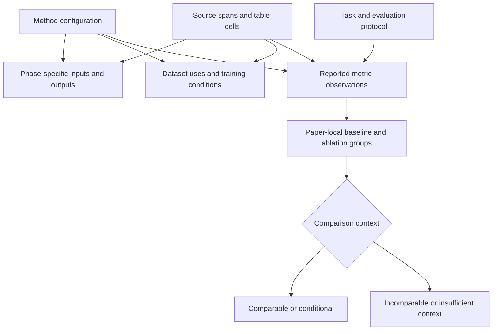

### Implementation feasibility, failures, and artifact status

Store measured resource results with hardware, batch size, precision, input shape/view count, timing boundary, and whether preprocessing/controller time is included. “Real time” is a searchable author claim, not a numeric latency measurement. Unknown memory requirements cannot satisfy a GPU-memory hard limit. Deployment speed on one GPU is not an estimate for a different GPU unless explicitly labeled as an estimate.

Failure records include task/condition, observed failure, reported frequency if available, proposed cause, and source. Distinguish an observed grasp slip from an author's hypothesis about why it occurred. An ablation result can support the value of a component in that evaluation setting; it does not prove universal necessity.

Artifact mentions record kind (`code | checkpoint | dataset | robot_config | video | supplement`), URL/identifier, authors' release statement, license statement, observation date/source, and optional revision. In this local-only release, use `availability_state = reported_available | reported_planned | reported_unavailable | unknown`; never label a repository currently reachable or a checkpoint downloadable without a separate dated verification. Code availability and pretrained weight availability are separate filters.


## 7. Structured extraction and fact review

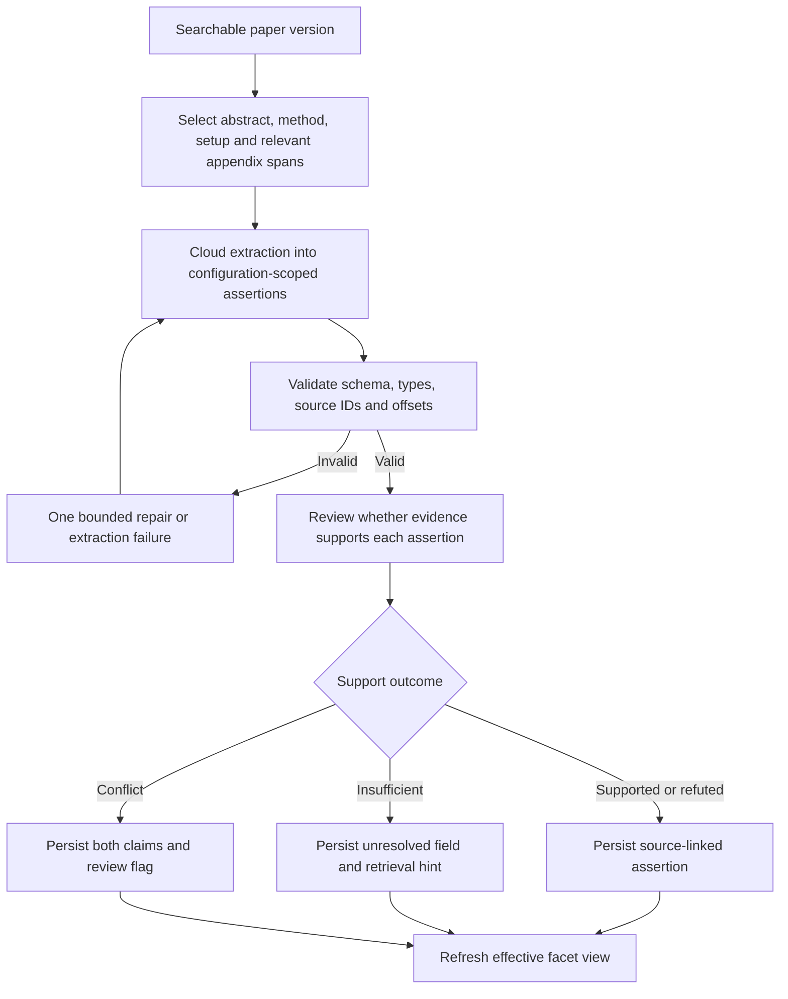

A schema repair is allowed once within the job's attempt/call limits; there is no unlimited loop. The cloud receives only the selected evidence packet and allowed facet definitions. It cannot invent source IDs or use pretrained knowledge to assert a paper-specific result.

Initial enrichment chooses at most 12,000 source-text tokens per call, with one extraction and one semantic-review call per job attempt. If relevant sections exceed the budget, split into section jobs with a shared configuration registry and an explicit merge/review job. Store uninspected sections and incomplete field coverage. Do not imply a complete paper review after processing only an abstract.

Project-independent paper facts are reusable across questions. Query-time inspection may add newly supported assertions with provenance. Cache results by document/generation, selected span hashes, facet schema, prompt version, provider/model revision, and decoding settings.

No negative requirement is inferred solely from a keyword's absence. A negative may be supported by an explicit methodological statement or sufficiently complete input/dataflow evidence; the reviewer must identify that evidence and its scope. Failure to locate such evidence yields `unknown`.

The extraction batch contains configuration identities, facet assertions, typed record updates, field assertions, and field-review coverage. Route abstract/method/setup/table/appendix spans to the applicable schema groups from section 6. Use the same gateway budgets and grounding review for detailed records; do not add unbounded per-field cloud calls. P0 extraction is broad, P1 extraction targets available evidence, and P2 extraction follows a search or review need. Reuse parsed blocks and existing assertions rather than reparsing PDFs to add a new field. Adding a scalar field usually requires a fact job and database-view refresh; re-embedding is needed only if indexed text or the embedding configuration changes.

## 8. Query interpretation and retrieval

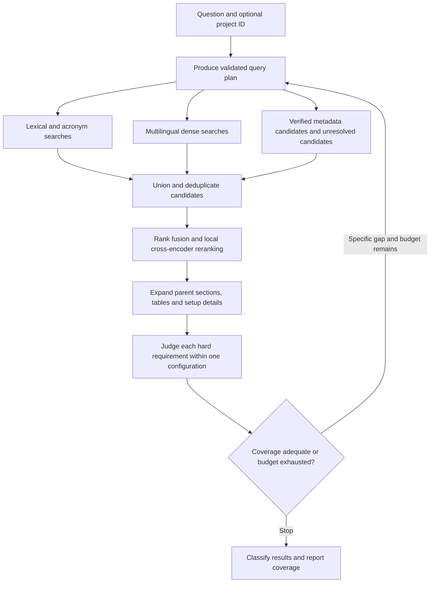

### QueryPlan contract

The planner outputs a validated `QueryPlan` with:

- `intent`: `find_papers | compare_methods | advise_project | survey_collection`.
- `resolved_terms`: explicit acronym and ambiguous-term interpretations.
- `hard_requirements`: predicate list using whitelisted facet keys and type-appropriate operators `eq | gte | lte | contains | in`.
- `soft_preferences`: the same predicate type, used for ranking only.
- `search_queries`: up to 4 distinct strings, including useful synonyms.
- `evidence_targets`: sections or details needed to verify the criteria.
- `mode`: `quick | collection_review`.
- `project_id`: optional; project constraints are soft preferences unless the user explicitly asks for them as requirements.

Each predicate has `id`, `facet`, `operator`, `value`, and an explanation. Negation is represented as a typed desired value, such as boolean `false`, with the evidence-state semantics in section 9. Never implement a negative requirement as SQL `NOT EXISTS(assertion)`.

If cloud planning is unavailable, the UI/CLI can submit an explicit structured `QueryPlan`, or use plain local keyword/vector search marked as unverified discovery. Failure to plan must not fabricate an answer.

### Candidate generation and ranking

For each search string, retrieve the top 60 lexical and top 60 dense passages. Union with candidates from effective facet views. Early filters may remove explicit hard contradictions, but cannot drop a document just because a field is missing. Metadata candidates with unresolved criteria get a separate exploration allocation.

Combine channel ranks with Reciprocal Rank Fusion using `k=60`: each appearance contributes `1 / (60 + rank)`, where ranks begin at 1. Deduplicate by immutable passage ID, retain channel attribution, and cap the quick-mode working set at 120 document versions. Reserve at least 20 percent of that candidate budget for unresolved-facet discovery when such candidates exist.

Cross-encode the top 80 candidate passages initially. Use a maximum pair length of 2,048 reranker-tokenizer tokens and report any truncation in debug records; query and relevant span selection take precedence over boilerplate. Reranker scores rank relevance and are not calibrated match probabilities.

Build each cloud evidence packet from at most 16 source items and at most 12,000 source-text tokens. Expand with method/setup context instead of selecting many near-duplicate abstract chunks. Tables retain headers and footnotes. Candidate verification can operate in batches; unverified candidates remain visible as unreviewed, not excluded.

Limit quick-mode retrieval to 3 rounds, 8 cloud attempts, 60,000 input tokens and 12,000 output tokens in total per run. The gateway enforces all caps, including planning, repair, semantic review, synthesis, and verification calls. Per-call output limits must also fit the configured provider context window. Stop with a partial result when a limit is reached. These are initial tunable product defaults.

### Collection review mode

Quick search cannot substantiate "all papers" or a collection-wide absence claim. `collection_review` runs as a resumable job over a fixed corpus snapshot. Evaluate known facets for every configuration, queue targeted evidence inspection for unresolved candidates, and retain a cursor when the user-configured review budget is exhausted. Require an explicit total call/token budget when launching this mode; it is not an unbounded background loop.

Return counts for documents in the snapshot, locally searchable documents, configurations evaluated, configurations semantically reviewed, unresolved cases, and excluded cases. A snapshot pins the document/version set, active generation IDs, and the facet-revision watermark. Paging through results does not change that snapshot. Existing stored facts are read at the watermark; newly generated query-specific judgments are attached to the run and may be published for later runs. Broad surveys aggregate structured records with denominators and missingness before consulting original evidence for narrative claims. They must not infer trends from the top few nearest neighbors.

### Index organization and search routing

Keep the original full text even when structured extraction succeeds. A schema cannot anticipate every future research question. Use these complementary indexes, all inside the same local application/database:

| Retrieval object | Index and role | Guardrail |
|---|---|---|
| Publication and entity names | Exact IDs, normalized titles, aliases, acronym/name lexical fields | WAM and other ambiguous acronyms require context; aliases do not merge uncertain identities |
| Method/configuration records | Typed fields, foreign-key joins and effective assertions | Every conjunction must keep the intended configuration and phase |
| Original passages and captions | Full-text and dense-vector search | A related-work mention does not establish a method capability |
| Tables and experiment rows | Structured cells/results plus lexical row text with headers | Numeric conditions use typed values and protocols, not embedding similarity |
| Derived method overview | Optional short searchable description assembled from supported facts, with backing assertion IDs | A navigation aid; answers still cite original evidence |
| User context and notes | Separate project/experiment/tag index with typed provenance | Personal hypotheses never become published findings |

An overview can help retrieve an entire configuration when its relevant details are scattered across sections. Generate it deterministically from supported fields initially; omit unknown details rather than filling them. Treat it as a replaceable derived artifact. Overviews and table rows add retrieval objects beyond the initial passage count; measure their storage impact during the pilot.

Mark each retrieval item with document/configuration IDs when known, section and object type, rhetorical role (`method_description | experiment | ablation | related_work | reference | unknown`), and parser/index revisions. Related-work and reference hits remain useful leads, but capability verification must follow method/setup evidence for the candidate configuration. Resolve cited entities to local documents only with identity evidence.

Route requests according to their needs:

- Exact names and identifiers: alias/lexical lookup, then method identity verification.
- Concept discovery: lexical plus dense search, followed by evidence-based classification.
- Requirements and exclusions: structured candidate selection plus unresolved-candidate exploration and scoped evidence review.
- Numeric constraints: typed comparisons after unit normalization and protocol/phase checks.
- Method comparison: retrieve configuration contracts and compatible evaluation records, then produce an assessment of comparability.
- Engineering advice: retrieve project requirements, relevant published evidence, and the user's experiment history separately before synthesis.

A search for “camera-pose free” may expand to uncalibrated, unknown extrinsics, view-invariant, camera-agnostic and calibration robustness. These are discovery leads, not equivalent predicates. The planner must still verify the actual requirement. Preserve exact model/dataset names and distinguish typo correction from glossary-based synonym expansion.

Use standard B-tree/appropriate JSONB indexes for frequently used equality, range and join fields, the existing PostgreSQL full-text index for lexical content, and pgvector for semantic similarity. Do not embed numbers and expect vector distance to answer “at most 100 demonstrations” or “under 50 ms.” Add specialized indexes only after observing query plans and measured bottlenecks.

### Scoped structured predicates

Extend `QueryPlan` with optional `record_requirements` and `comparison_request`; both default to empty/absent so the original Q1–Q5 plans remain valid. A record requirement contains `id`, `record_type`, `quantifier = exists`, and an AND-list of typed filters. Every filter in a group applies to the same record, with only approved foreign-key context joins. Different record groups still share the candidate `config_id`.

Each filter contains `field`, `operator`, `value`, optional `unit`, and an explanation. The operator set is `eq | gte | lte | contains | in`; the schema registry restricts operators by field type. Boolean false is evaluated against evidence for false, never absence. Numeric filters require compatible units. Arbitrary model-generated JSON paths, SQL, joins, or formulas are rejected.

Initial approved record types and filter families:

| Record type | Example approved fields | Scope rule |
|---|---|---|
| `input_stream` | phase, modality/semantic type, placement, required, history frames, width/height | One input port within one phase and configuration |
| `output_stream` | phase, action space, absolute/delta convention, frame, units, prediction horizon, actions per inference | One output contract; do not combine units or conventions from another variant |
| `method_detail` | representation role, fusion stage, learning paradigm, adaptation type, controller dependency | One configuration; typed repeated features retain their local scope |
| `dataset_use` | dataset identity/version, role, split, episode count, demo count, count scope, annotation types | One dataset use; a fine-tuning count is not total training data |
| `reported_result` | metric name, normalized value/unit, aggregation, trial count; joined protocol benchmark/version, task, robot, split | One result and its exact protocol; no join to another experiment's high score |
| `artifact_mention` | kind, availability state, license statement | One artifact; a code link cannot satisfy a checkpoint requirement |

The registry maps these human-readable field descriptions to stable schema paths in implementation; commit its keys and types before adding the corresponding planner prompts. `record_requirements` must reference that registry. Unsupported questions can still use text discovery and show the unsupported filter rather than inventing a key.

For example, “multi-view, no supplied extrinsics at inference, success rate at least 80% on benchmark X” requires:

1. The existing configuration facets satisfy the multi-view and inference-pose requirements.
2. One `reported_result` group has `metric_name = success_rate`, normalized fraction `>= 0.80`, and its own protocol identifies benchmark X.
3. The result belongs to that same configuration. The answer exposes the exact benchmark version, tasks, split, success definition, aggregation and unknown context.

This filter finds a reported observation; it is not a claim that all tasks or all configurations reach 80%. If no benchmark or task is specified, the plan visibly treats the request as “at least one reported evaluation” and shows the setting. Do not turn such a query into a global ranking.

A `comparison_request` identifies selected configurations or a bounded candidate set, desired fields, optional protocol/task constraints, and comparison purpose. It invokes section 6's comparison assessment and yields a matrix, not an unqualified leaderboard.

For an existential record group, one record satisfying every filter is a sufficient witness. No matching stored row is not evidence that no qualifying experiment/input/artifact exists. Return `contradicted` only with an evidence-backed complete inventory for the requested scope whose members fail the requirement, or explicit evidence ruling it out. Otherwise retain `unknown` or `conflicted` as appropriate. Record the inventory's inspected scope and completeness in review coverage. All record-group judgments join the ordinary facet judgments when classifying a configuration; a plan with record requirements is not `discovery_only` merely because its facet list is empty.

### Ranking, missingness, and search explanations

After hard-criterion classification, use semantic/lexical relevance and explicit soft preferences to order candidates within a bucket. Show separate components for relevance, known project compatibility, evidence completeness and reported artifact status. Avoid a single opaque “research quality” score.

Return why a result matched, which conditions remain unknown, what contradicts it, and the next source section to inspect. Unknown values are not hard negatives; users can explicitly choose a strict view of confirmed matches while retaining unresolved candidates in a separate view. Keep extraction coverage distinct from retrieval coverage.

The UI should support result-table columns for inputs, outputs, robot/end effector, training data, evaluation task, success rate with trial count, code/weights statements, and requirement gaps. Result details expand the exact configuration and evidence. Let the user save an interpreted query and its filters; later execution uses a new recorded snapshot and can report newly matching documents.

### Additional acceptance questions for the detailed index

These extend Q1–Q5 without replacing them. Controlled fixtures supply the expected records; real-corpus labels are added during the pilot.

| Query | Critical distinction to test |
|---|---|
| Find RGB-only inference policies trained with depth supervision | Training-only depth must not become an inference dependency; derived geometric inputs must still be checked |
| Find multi-view policies tested with a missing camera | Differentiate missing views from a changed camera pose or fixed-view training |
| Find methods using at most 100 real-robot fine-tuning demonstrations | Stage, domain, count unit and per-task versus total count must match |
| Find bimanual policies that output delta end-effector poses | Confirm both-arm output contract; report coordinate frame and rotation convention |
| Find tactile object-centric dexterous manipulation methods | Object structure must participate in the relevant method, not only background perception |
| Compare two methods on the same benchmark tasks | Match protocol, task set, success definition, aggregation and baseline measurement origin |
| Find models deployable below a specified latency on my hardware | Unknown hardware or timing boundary is unresolved; do not translate “real time” into milliseconds |
| Find papers with reported pretrained weights, not merely code | Code and checkpoint artifact records must be distinct |
| Find methods addressing the occlusion failures in my project | Distinguish observed failure evidence, author explanations and proposed interventions |
| Show promising papers I have not read | Reading status is personal metadata and does not imply lower scientific relevance |


## 9. Predicate semantics and the difficult camera query

For a desired predicate, use `satisfied | contradicted | unknown | conflicted`:

| Available scoped evidence | Predicate outcome |
|---|---|
| Supported typed value matches desired value | `satisfied` |
| Supported typed value contradicts desired value | `contradicted` |
| No sufficient evidence | `unknown` |
| Incompatible supported evidence within the same scope | `conflicted` |

Missing data never satisfies a negative predicate. `conflicted` is not satisfied. Apply the following classification in order: all hard predicates satisfied means `confirmed`; no contradicted predicate but at least one unknown/conflicted predicate means `unresolved`; at least one contradicted and at least one satisfied predicate means `partial`; any other configuration with a contradiction means `excluded`. A partial match is a near miss excluded from the strict matching set. Always name its failed criteria. For plans with no hard predicates, use `discovery_only` results ranked by relevance and do not call them verified matches.

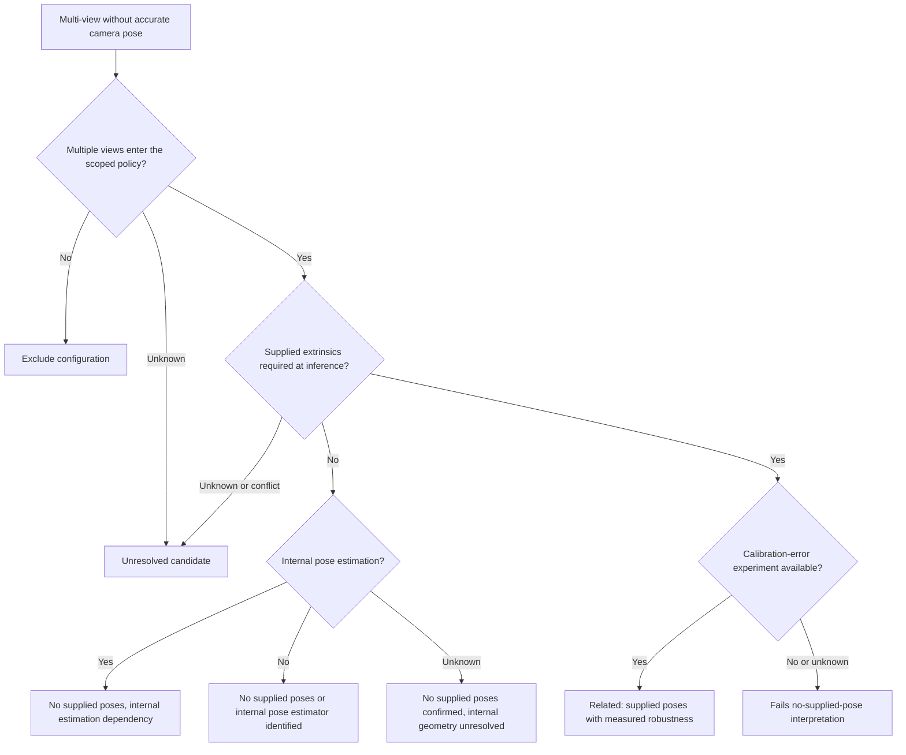

Always append training-time requirements, shared-frame reconstruction dependencies, depth requirements, and the evidence scope. No supplied extrinsics does not establish viewpoint generalization or freedom from all calibration assumptions. Internally estimated poses can be inaccurate or computationally costly; do not assume their robustness.

For ambiguous wording, the default interpretation is "multiple simultaneous policy views and no externally supplied extrinsics at inference." Show this interpretation in the response and expose alternative filters for "no accurate calibration during training either" and "robust to calibration error." Camera extrinsics, camera intrinsics, robot end-effector pose, and proprioception are distinct fields.

## 10. The user's five acceptance queries

These are functional requirements, not requests to populate results with invented papers. Use controlled synthetic fixtures for logic tests and a human-labeled real-paper set for retrieval evaluation.

| ID | Question | Required behavior |
|---|---|---|
| Q1 | Find WAM models | Display the world-action-model interpretation; search expanded terms; verify both world and action roles; exclude acronym-only matches such as a robot name |
| Q2 | Find object-centric methods | Verify explicit object-level representation; group slots/tokens/graphs/tracked entities; distinguish perception-only detection from object-centric modeling/control |
| Q3 | Find bimanual dexterous VLA papers | Satisfy bimanual, both dexterous hands, vision conditioning, language conditioning, and action output in one configuration; show mixed-hand or gripper systems as partial |
| Q4 | Find papers using multi-view camera inputs | Verify simultaneous views actually enter the policy; do not match a multi-camera dataset where the evaluated policy consumes one view |
| Q5 | Find multi-view papers without accurate camera pose | Apply section 9; separate absent supplied poses, internal estimation, training dependencies, measured calibration robustness, and unknown requirements |

### Example Q5 plan

```json
{
  "intent": "find_papers",
  "resolved_terms": {
    "multi-view": "multiple simultaneous camera views used by the policy",
    "without accurate camera pose": "no externally supplied extrinsics at inference"
  },
  "hard_requirements": [
    {"id": "r1", "facet": "policy.multiview_input", "operator": "eq", "value": true, "explanation": "Multiple views must enter this configuration"},
    {"id": "r2", "facet": "camera.extrinsics_supplied_infer", "operator": "eq", "value": false, "explanation": "An explicit negative requires supporting source evidence"}
  ],
  "soft_preferences": [],
  "search_queries": [
    "multi-view robot policy camera calibration extrinsics",
    "uncalibrated multi-camera manipulation",
    "external wrist RGB policy camera inputs",
    "camera pose estimation multi-view robot learning"
  ],
  "evidence_targets": ["policy inputs", "coordinate transformations", "training setup", "inference requirements", "calibration ablations"],
  "mode": "quick",
  "project_id": null
}
```

### Result contract

`SearchResult` has a run ID, resolved interpretation, corpus snapshot, coverage object, confirmed matches, partial matches, unresolved candidates, exclusions with reasons, and an optional `discovery_only` list for plans without hard predicates. Each `PaperMatch` has paper/document/config IDs, title, optional date/DOI, every predicate judgment, evidence references, caveats, and ranking metadata. Display a representative match per paper by default, with expandable matching configurations and separate document versions. A paper with one confirmed configuration and other partial configurations appears in the confirmed bucket with the others expandable; otherwise apply priority partial, unresolved, then excluded while preserving all per-configuration judgments.

Suggested UI columns for Q5: paper; configuration; actual camera inputs; supplied poses at training; supplied poses at inference; internal estimation; calibration-error tests; match status; source links. Do not display a single confidence percentage that conflates retrieval relevance, factual support, and applicability.

Version 1.1 adds `record_judgments`, input/output summaries, matching result IDs, field-level missingness, and an optional `comparison` payload. A `ComparisonResult` contains the configurations and reported result IDs, requested comparison scope and purpose, per-field differences/unknowns, the section 6 comparability outcome with reasons, metric values with units/counts/aggregation, and source references. Comparison decisions are reproducible from the pinned facts and a versioned rule set. A narrative may explain the matrix but cannot override an incompatible protocol or missing evidence. JSON and Markdown exports retain these distinctions.

## 11. Cloud request, synthesis, and verification

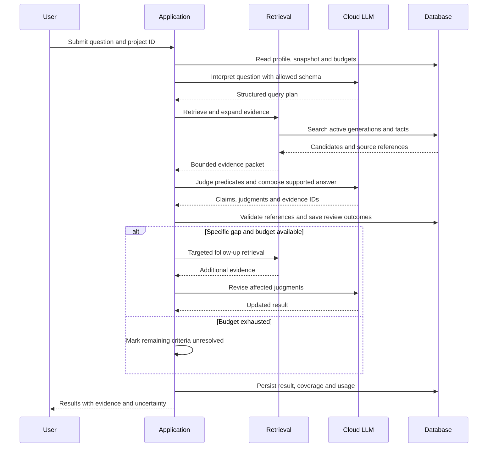

The gateway exposes one provider-neutral interface for structured generation. Implement one chosen cloud provider first; make model IDs environment/config values rather than hard-coded defaults. Read that provider's current official SDK documentation during implementation. Credentials come from environment variables, never the repository or browser frontend. Tests use a deterministic fake provider.

Prompt inputs have separate fields for trusted task instructions, facet schema, user question, project context, and untrusted evidence objects. Source text cannot create additional tool permissions. No LLM-generated SQL is executed; the application compiles validated predicates into parameterized queries.

The model produces answer claims with `claim_type` in `published_finding | inference | proposed_experiment`, evidence IDs, applicability assumptions, and uncertainty. A factual paper claim must have source support. A proposal may be novel but must be labeled untested; citations support premises rather than pretend to prove the proposal.

Verification has two layers:

1. Deterministic checks validate document/config IDs, span bounds, exact resolved source text, budget limits, and predicate types.
2. Semantic review checks entailment, contradictions, and whether a result belongs to the cited configuration and evaluation setting. A cloud review is fallible; provide a user correction action and an unresolved status when support is inadequate.

Repair unsupported factual claims by retrieving missing evidence, removing the claim, or stating the uncertainty. Do not attach a loosely related citation. Cache paper-level judgments using evidence hashes and versions so repeated questions can reuse them.

## 12. Project advice and experiment memory

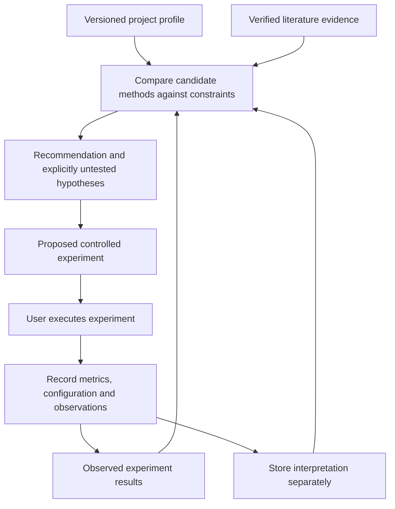

`ProjectProfile` contains versioned goals, robot, end effectors, observations, camera properties, action space, policy architecture, datasets, compute/latency constraints, known failure modes, and current questions. Values can be unknown. A cloud-generated suggested profile change must be shown as a proposal; it does not silently overwrite user-entered facts.

`ExperimentRecord` stores project version, code commit/config hash, hypothesis, intervention, baseline, controlled variables, dataset/task/robot, metrics and trial counts, observations, interpretation, and artifact references. A run with a final successful outcome may still have intermediate failures; preserve both when recorded.

An advice response includes the suggested intervention, source evidence, applicability gaps, engineering effort estimate labeled as an estimate, failure risks, controlled ablations, and decision metrics. The application does not execute robot actions, alter training code, or launch training jobs in these releases.

## 13. API, CLI, and user interface contracts

### API

| Endpoint | Contract |
|---|---|
| `POST /v1/ingest` | Configured source-root ID, optional file selection and dry-run flag; returns ingestion run ID |
| `GET /v1/ingest/{run_id}` | Counts per readiness stage, failures, retries, and progress |
| `POST /v1/search` | Question or explicit QueryPlan, optional project ID, mode and budgets; returns `202` and run ID |
| `GET /v1/search/{run_id}` | State, partial/final SearchResult, coverage and usage |
| `GET /v1/search/{run_id}/events` | Server-sent progress events; reconnectable via event ID |
| `GET /v1/papers/{paper_id}` | Versions, configurations, effective facets, unresolved fields |
| `GET /v1/configurations/{config_id}` | Scoped input/output contracts, method details, dataset uses, reported evaluations, artifacts and field evidence/missingness |
| `GET /v1/evidence/{block_id}` | Exact evidence text, provenance, and local source-view URL |
| `GET /v1/documents/{document_id}/pdf` | Immutable PDF by ID; supports browser source viewing |
| `POST /v1/assertions/{assertion_id}/corrections` | User correction, reason, optional replacement value and evidence |
| `POST /v1/projects` and `PATCH /v1/projects/{project_id}` | Create and version a project profile; edits require expected version |
| `POST /v1/experiments` | Store an ExperimentRecord linked to project version |
| `POST /v1/advice` | Question and project ID; returns async run ID using the same run status contract |

The ingestion endpoint accepts configured root IDs, not arbitrary model-generated paths. Evidence links use server-resolved IDs; reject traversal and out-of-root paths. Serve a local PDF page anchor as a convenience, with the exact quoted block visible even if the browser ignores the anchor.

Use `POST /v1/search` with `intent = compare_methods` and `comparison_request` for comparisons; a separate search engine or comparison service is unnecessary. Add append-only correction handling for structured record fields with the same evidence/revision rules as facet corrections. Release 2 may expose personal reading state and saved-query CRUD after the discovery path works; saving a query does not schedule automatic runs or authorize new cloud spending.

### Planned CLI

The following commands are target interfaces to implement, not existing commands:

```bash
robotlit inventory --source-root papers --dry-run
robotlit ingest --source-root papers --limit 100
robotlit worker
robotlit status --run-id RUN_ID
robotlit search "Find multi-view policies without supplied camera poses"
robotlit search --plan query_plan.json
robotlit review-collection --plan query_plan.json --max-cloud-calls 200 --max-input-tokens 2000000 --max-output-tokens 200000
robotlit advise --project PROJECT_ID "Where should I fuse wrist RGB features?"
robotlit evaluate --dataset evals/gold.jsonl
robotlit serve --host 127.0.0.1 --port 8000
```

Build a minimal server-rendered browser UI with search input, editable interpreted filters, result buckets, source viewer, ingestion progress, and correction controls. Release 2 adds project selection and an experiment form. Use plain templates and minimal JavaScript; no separate frontend service is required. Support JSON and Markdown export with source IDs and coverage.

## 14. Configuration and capacity assumptions

```yaml
app:
  host: 127.0.0.1
  port: 8000
  external_web_search: false
schemas:
  specification_version: "1.1"
  fact_registry_version: "1.1"
  structured_record_version: "1.0"
enrichment:
  broad_priority: P0
  selected_evidence_priority: P1
  on_demand_priority: P2
storage:
  source_roots:
    papers: /absolute/path/to/papers
  data_dir: /absolute/path/to/robotlit-data
  database_url_env: ROBOTLIT_DATABASE_URL
models:
  embedding: BAAI/bge-m3
  embedding_revision_env: ROBOTLIT_EMBEDDING_REVISION
  embedding_dimension: 1024
  normalize_embeddings: true
  reranker: BAAI/bge-reranker-v2-m3
  reranker_revision_env: ROBOTLIT_RERANKER_REVISION
  device: cpu
cloud:
  provider_env: ROBOTLIT_LLM_PROVIDER
  model_env: ROBOTLIT_LLM_MODEL
  api_key_env: ROBOTLIT_LLM_API_KEY
  send_figures: false
  max_concurrency: 2
ingestion:
  parser_workers: 2
  embedding_workers: 1
  max_job_attempts: 3
  lease_seconds: 600
  heartbeat_seconds: 60
  document_timeout_seconds: 900
chunking:
  target_tokens: 700
  max_tokens: 1000
  overlap_tokens: 100
retrieval:
  max_search_queries: 4
  lexical_k: 60
  dense_k: 60
  rrf_k: 60
  quick_document_cap: 120
  unresolved_candidate_fraction: 0.2
  rerank_passages: 80
  reranker_max_pair_tokens: 2048
  max_evidence_items: 16
  max_evidence_tokens: 12000
query_budget:
  max_rounds: 3
  max_cloud_attempts: 8
  max_input_tokens: 60000
  max_output_tokens: 12000
```

Resolve environment-supplied model revisions to immutable revisions before indexing. A missing cloud configuration enables local-only operations and disables cloud-dependent commands with an actionable error. A missing embedding revision may be resolved during setup, recorded in the lock metadata, and thereafter must not silently drift. Validate configuration before starting jobs; supplied paths are examples to replace on the user's Linux machine.

At 3,000 papers and an assumed 30–100 chunks per paper, expect 90,000–300,000 vectors. Raw float32 1,024-dimensional vectors occupy approximately 0.37–1.23 GB before index and database overhead. This is a sizing calculation, not a measured corpus statistic. Managed PDF snapshots add up to another 30 GB if no byte-identical duplicates exist. Parsed artifacts, table/crop caches, database indexes, and backups add more.

Measure parsing/OCR seconds per page, embedding throughput, chunks per paper, bytes per artifact, query latency, and cloud tokens on the pilot. Estimate full ingestion from those measurements, with separate scanned/native-PDF groups. Do not promise a completion time or dollar cost before measuring the corpus and configuring model prices. Record input/output tokens and attempts even when dollar rates are unavailable.

## 15. Proposed repository structure and interfaces

| Path | Responsibility |
|---|---|
| `pyproject.toml`, `uv.lock` | Package, dependency lock, console entry point |
| `config/example.yaml` | Configuration matching section 14 |
| `src/robotlit/config.py` | Validated settings and model revisions |
| `src/robotlit/contracts.py` | Shared Pydantic request/response models and enums |
| `src/robotlit/db/models.py`, `db/repository.py` | ORM models and transaction-safe persistence |
| `migrations/` | Alembic revisions, pgvector and text-search indexes |
| `src/robotlit/jobs/queue.py`, `jobs/worker.py` | Claims, leases, fencing, retry dispatch |
| `src/robotlit/ingest/inventory.py`, `snapshot.py` | File discovery, hash identity, immutable copies |
| `src/robotlit/ingest/parser.py`, `quality.py`, `chunker.py` | Docling adapter, quality policy, provenance-preserving chunks |
| `src/robotlit/retrieval/embedding.py`, `index.py` | Local model adapter and atomic generation publication |
| `src/robotlit/retrieval/search.py`, `fusion.py`, `rerank.py` | Candidate generation and ranking |
| `src/robotlit/facts/registry.py`, `extract.py`, `predicates.py` | Facets, extraction, and truth evaluation |
| `src/robotlit/facts/records.py`, `io_contracts.py`, `normalization.py` | Typed detail schemas, field provenance, input/output scope and unit conversions |
| `src/robotlit/results/protocols.py`, `comparability.py` | Published evaluation records, baseline roles and deterministic comparison rules |
| `src/robotlit/evidence/resolver.py`, `verify.py` | Source resolution, context expansion, citation validation |
| `src/robotlit/llm/gateway.py`, `llm/providers/` | Provider-neutral interface, concrete adapters, request budgets |
| `src/robotlit/query/planner.py`, `orchestrator.py`, `coverage.py` | Query interpretation, bounded workflow, corpus review |
| `src/robotlit/memory/projects.py`, `experiments.py`, `adviser.py` | Versioned context, observations, advice |
| `src/robotlit/api/app.py`, `routes.py`, `templates/` | Local API and minimal UI |
| `src/robotlit/cli.py` | Planned command interface |
| `tests/unit/`, `tests/integration/`, `tests/fixtures/` | Logic tests, real PostgreSQL integration, controlled documents |
| `evals/queries.yaml`, `evals/gold.jsonl`, `evals/run.py` | Retrieval and answer evaluation |
| `docs/` | This specification, runbook, design decisions |

Use these exact public service signatures, with shared types defined in `contracts.py`:

```python
inventory(root_id: str, limit: int | None = None) -> list[SourceRecord]
snapshot(source: SourceRecord) -> DocumentRef
parse(document: DocumentRef, config: ParserConfig) -> ParsedDocument
chunk(document: ParsedDocument, config: ChunkConfig) -> list[ChunkRecord]
embed(texts: list[str]) -> list[list[float]]
publish_generation(document_id: UUID, chunks: list[ChunkRecord], vectors: list[list[float]], config: IndexConfig) -> GenerationRef
claim_job(worker_id: str, stages: list[str]) -> JobLease | None
complete_job(lease: JobLease, result: JobResult) -> bool
plan_query(request: SearchRequest, context: ProjectProfile | None) -> QueryPlan
retrieve(plan: QueryPlan, snapshot: CorpusSnapshot) -> CandidateSet
resolve_evidence(candidates: CandidateSet, budget: EvidenceBudget) -> EvidencePacket
extract_facts(packet: EvidencePacket, configs: list[MethodConfig]) -> PaperFactBatch
evaluate_predicate(predicate: Predicate, assertions: list[FacetAssertion]) -> PredicateJudgment
evaluate_record_requirement(requirement: RecordRequirement, records: StructuredRecordSet) -> PredicateJudgment
assess_comparison(request: ComparisonRequest, results: list[ReportedResult], protocols: list[EvaluationProtocol]) -> ComparisonResult
verify_match(config: MethodConfig, plan: QueryPlan, packet: EvidencePacket) -> ConfigurationMatch
run_search(request: SearchRequest) -> SearchResult
run_advice(request: AdviceRequest) -> AdviceResult
```

These are synchronous domain-facing signatures; I/O adapters may be async internally. Use dependency injection for the database, clock, local models, and LLM gateway. `evaluate_predicate` is deterministic and must not make network calls. Service-layer IDs are UUIDs, serialized as strings at the API boundary. `CandidateSet` preserves retrieval channel, rank, source IDs, generation, and candidate configuration IDs when known; an unknown configuration is not discarded before inspection.

`SearchRequest` includes question or explicit plan, optional project ID/version, mode, optional reduced budgets, and optional resume token. `SearchResult` is specified in section 10. `AdviceRequest` adds a required project ID; `AdviceResult` has recommendations, typed claims, proposed experiments, evidence, coverage, and usage. All API response models include a schema version.

`PaperFactBatch` contains scoped configuration identities, facet assertions, structured record updates, record-field assertions and review coverage. Validate the whole batch before transactional publication. `StructuredRecordSet` carries configuration/protocol IDs and field evidence states; its deterministic evaluator cannot join unrelated records. `assess_comparison` operates on stored evidence and explicit rules without cloud calls. Keep the published-result module `results/` distinct from `evals/`, which measures the assistant itself.

## 16. Implementation plan

Implement sequentially. Each task is an independently verifiable deliverable. Run the stated tests, inspect failures, implement, and run the same checks again. Commit coherent changes without including PDFs, credentials, model weights, generated caches, or unrelated user files.

### Task 1: Identity, database, and durable job substrate

**Files:** `config.py`, `contracts.py`, `db/models.py`, `db/repository.py`, `jobs/queue.py`, initial migrations, `tests/integration/test_identity_jobs.py`.

**Consumes:** requirements G01–G16 and configuration defaults. **Produces:** shared types, schema, `claim_job`, `complete_job`, and repository methods for source/document/generation identity, including versioned structured-record identities from section 5.

- [ ] Write `test_duplicate_content_has_one_document`: two source aliases with the same hash reference one document.
- [ ] Write `test_changed_path_retains_old_document`: a new hash at an old path creates a new document and retains old references.
- [ ] Write `test_expired_worker_cannot_commit`: an expired/fenced lease returns false from `complete_job` and cannot publish data.
- [ ] Write `test_structured_record_rejects_wrong_configuration_reference` and `test_query_snapshot_retains_prior_record_field_revision`.
- [ ] Run `uv run pytest tests/integration/test_identity_jobs.py -q`; confirm the unimplemented behaviors fail.
- [ ] Implement transactional identity operations, migrations, job uniqueness, leases, and retry limits.
- [ ] Rerun the test file against real PostgreSQL with pgvector; commit the passing substrate.

### Task 2: Inventory, immutable snapshots, and parse quality

**Files:** `ingest/inventory.py`, `snapshot.py`, `parser.py`, `quality.py`, `tests/integration/test_ingestion.py`.

**Consumes:** source/document repository and job contracts. **Produces:** `inventory`, `snapshot`, `parse`, and persisted `ParsedDocument` with source blocks.

- [ ] Write `test_source_bytes_unchanged_after_ingest` and `test_snapshot_survives_source_replacement`.
- [ ] Write `test_scan_paths_with_spaces_and_unicode`: paths are handled correctly without shell interpolation.
- [ ] Write `test_corrupt_pdf_does_not_block_next_job` and `test_ocr_exhaustion_enters_review_queue`.
- [ ] Run `uv run pytest tests/integration/test_ingestion.py -q`; verify missing behaviors fail.
- [ ] Implement streaming hashes, safe snapshots, Docling adapter, one-based physical page mapping, configurable timeouts, and bounded fallback.
- [ ] Rerun tests and manually inspect a two-column page, table, and OCR-needed fixture; commit.

### Task 3: Provenance-preserving chunks and local hybrid retrieval

**Files:** `ingest/chunker.py`, `retrieval/embedding.py`, `index.py`, `search.py`, `fusion.py`, `rerank.py`, `tests/unit/test_chunking.py`, `tests/integration/test_retrieval.py`.

**Consumes:** parsed blocks and generation repository. **Produces:** `chunk`, `embed`, `publish_generation`, and `retrieve` for explicit plans.

- [ ] Write `test_chunk_span_resolves_exact_original_text` and `test_table_chunk_keeps_headers_and_source`.
- [ ] Write `test_incomplete_generation_never_replaces_active_index` and `test_embedding_revision_mismatch_is_rejected`.
- [ ] Write `test_rrf_combines_acronym_and_semantic_candidates` and `test_unknown_facet_candidate_survives_generation`.
- [ ] Write `test_related_work_hit_is_not_method_evidence` and `test_table_row_retrieval_preserves_parent_header_and_footnote_refs`.
- [ ] Run both test files; verify failures before implementation.
- [ ] Implement section-aware chunks, normalized local embeddings, full-text search, vector search, rank fusion with k=60, and deterministic tie-breaking by immutable ID.
- [ ] Rerun tests; compare approximate and exact vector retrieval on a fixed sample and record recall differences; commit.

### Task 4: Cloud gateway, source-linked facts, and corrections

**Files:** `llm/gateway.py`, one `llm/providers/` adapter, `facts/registry.py`, `extract.py`, `records.py`, `io_contracts.py`, `normalization.py`, `results/protocols.py`, `evidence/resolver.py`, `tests/unit/test_fact_extraction.py`, `tests/unit/test_record_extraction.py`, `tests/integration/test_fact_jobs.py`.

**Consumes:** evidence blocks, job leases, method configuration registry. **Produces:** budgeted structured-generation interface, `resolve_evidence`, `extract_facts`, typed records with field evidence, and append-only corrections.

- [ ] Write `test_unknown_stays_unknown_without_evidence`, `test_invalid_source_id_rejected`, and `test_conflicting_assertions_are_retained`.
- [ ] Write `test_cloud_unavailable_leaves_local_search_ready` and `test_retry_attempt_consumes_budget`.
- [ ] Write `test_fenced_cloud_job_does_not_duplicate_assertions`.
- [ ] Write `test_train_only_input_is_not_inference_requirement`, `test_unspecified_tensor_shape_remains_unknown`, and `test_action_frame_and_rotation_order_are_not_guessed`.
- [ ] Write `test_percent_conversion_retains_raw_scale_and_evidence`, `test_rounded_rate_does_not_invent_success_count`, and `test_macro_average_does_not_become_pooled_trials`.
- [ ] Write `test_table_footnote_changes_result_context`, `test_not_reviewed_differs_from_not_found`, and `test_artifact_url_is_not_current_availability_verification`.
- [ ] Run the task's test files using a deterministic fake provider; verify intended failures.
- [ ] Implement one real provider adapter using current official SDK documentation, structured output validation, usage logging, the facet/record registries, configuration and phase scope, bounded repairs, and cloud-free deferred behavior. Add P0/P1/P2 enrichment routing within the existing budgets; all P1/P2 fields may remain unknown.
- [ ] Rerun tests. An optional live smoke call is explicitly labeled and requires configured credentials; do not make the test suite require paid API access. Commit.

### Task 5: Query planning, local search mode, and coverage

**Files:** `query/planner.py`, `orchestrator.py`, `coverage.py`, `tests/unit/test_query_plans.py`, `tests/integration/test_search_runs.py`.

**Consumes:** `retrieve`, gateway, projects repository if present. **Produces:** `plan_query`, initial `run_search`, corpus snapshots, resumable collection-review cursor.

- [ ] Write fixtures and schema assertions for Q1–Q5, including visible WAM and dexterity interpretations.
- [ ] Write `test_project_preferences_are_not_implicit_hard_filters` and `test_invalid_facet_or_operator_rejected`.
- [ ] Write `test_collection_review_resumes_same_snapshot` and `test_budget_stop_returns_partial_coverage`.
- [ ] Write `test_record_filter_rejects_arbitrary_field_path`, `test_numeric_filter_rejects_incompatible_units`, and `test_unspecified_success_rate_query_displays_existential_scope`.
- [ ] Run the test files and confirm missing behaviors fail.
- [ ] Implement plan validation, local-only explicit plans, candidate union, unresolved exploration allocation, query limits, and coverage counters.
- [ ] Rerun tests; verify that paging and resuming do not silently change the corpus snapshot; commit.

### Task 6: Configuration-scoped verification and result classification

**Files:** `facts/predicates.py`, `results/comparability.py`, `evidence/verify.py`, query orchestration updates, `tests/unit/test_predicates.py`, `tests/unit/test_comparability.py`, `tests/integration/test_verified_search.py`.

**Consumes:** query plans, scoped assertions/records, evidence packets. **Produces:** `evaluate_predicate`, `evaluate_record_requirement`, `assess_comparison`, `verify_match`, completed `SearchResult`, evidence-grounded classification and comparison matrices.

- [ ] Write `test_false_requirement_rejects_missing_value`: the outcome is unknown, never satisfied.
- [ ] Write `test_no_cross_configuration_conjunction`: properties from different configurations cannot satisfy one conjunction.
- [ ] Write `test_multiview_dataset_singleview_policy_is_excluded` and `test_parallel_grippers_do_not_satisfy_bilateral_dexterity`.
- [ ] Write `test_train_only_calibration_is_reported`, `test_internal_pose_estimation_has_separate_label`, and `test_unsupported_claim_is_removed_or_unresolved`.
- [ ] Write `test_paper_instruction_cannot_change_tools_or_filters` with malicious-looking source text as data.
- [ ] Write `test_record_group_cannot_mix_datasets_or_results`: benchmark X from one row and 90% from another cannot satisfy a single result requirement.
- [ ] Write `test_missing_result_row_is_unknown_without_inventory_coverage`, `test_record_only_query_is_not_discovery_only`, and `test_one_small_dataset_does_not_establish_small_total_training_set`.
- [ ] Write `test_different_success_definitions_are_incomparable`, `test_missing_protocol_yields_insufficient_context`, and `test_changed_pretraining_is_visible_in_comparison`.
- [ ] Write `test_baseline_role_is_local_to_comparison_group` and `test_quoted_baseline_is_not_labeled_rerun`.
- [ ] Run the test files and verify intended failures.
- [ ] Implement four-state predicate semantics, match buckets, bounded evidence follow-up, valid source resolution, and claim-support review.
- [ ] Rerun all task tests; inspect the five example query outputs on controlled fixtures; commit.

### Task 7: CLI, local UI, and paper/source inspection

**Files:** `cli.py`, `api/app.py`, `api/routes.py`, templates, `tests/integration/test_api_cli.py`.

**Consumes:** ingestion/search services and evidence repository. **Produces:** section 13 interfaces for Release 1.

- [ ] Write `test_search_is_async_and_progress_is_reconnectable` and `test_evidence_link_resolves_saved_pdf_page`.
- [ ] Write `test_source_view_rejects_path_traversal` and `test_unknown_results_are_not_rendered_as_confirmed`.
- [ ] Write `test_result_export_retains_protocol_counts_and_missingness` and `test_comparison_ui_does_not_rank_incomparable_scores`.
- [ ] Run `uv run pytest tests/integration/test_api_cli.py -q`; confirm unimplemented behaviors fail.
- [ ] Implement CLI commands, local API, progress events, interpreted filters, result buckets, PDF source links, and correction controls.
- [ ] Rerun tests and inspect the UI on desktop width; verify source text, table wrapping, citations, and partial-result labels; commit.

### Task 8: Project-aware advice and experiment memory

**Files:** `memory/projects.py`, `experiments.py`, `adviser.py`, API/UI extensions, `tests/integration/test_memory_advice.py`.

**Consumes:** verified search, source-linked claims, gateway, project and experiment repositories. **Produces:** `run_advice`, versioned profile editing, experiment logging.

- [ ] Write `test_observation_is_separate_from_interpretation`, `test_proposal_does_not_overwrite_project_fact`, and `test_profile_version_conflict_is_reported`.
- [ ] Write `test_advice_uses_relevant_experiment_and_marks_new_hypothesis_untested`.
- [ ] Run the test file; verify failures before implementation.
- [ ] Implement versioned profiles, append-only experiments, relevant-context retrieval, and advice output with controls and metrics.
- [ ] If personal workflow features are enabled, add versioned reading state/tags and saved interpreted queries. Keep saved-query execution manual and link each run to its own snapshot/budget.
- [ ] Rerun tests and inspect one mixed-camera advice example with fake provider evidence; commit.

### Task 9: Evaluation, pilot, and full-corpus operation

**Files:** `evals/queries.yaml`, `evals/gold.jsonl`, `evals/run.py`, `docs/runbook.md`, restore/integration tests.

**Consumes:** the full application. **Produces:** evaluation reports, measured pilot sizing, runbook, resumable full ingestion.

- [ ] Define a human-labeled set of at least 25 questions: the five user query families with multiple variants and section 8's detailed queries, including Chinese/English formulations and queries with no known match. Include near misses and unresolved papers.
- [ ] Record expected configuration IDs, relevance labels, hard-predicate labels, and evidence spans. Unjudged documents are not automatic negatives. Separate a tuning split and a held-out split.
- [ ] Implement Recall@50 on known relevant papers, Precision@10, hard-criterion violation rate, citation-support rate, unresolved rate, ingestion coverage, latency, and cloud tokens. Report denominators and annotation limits.
- [ ] Add per-field extraction accuracy and coverage on human-labeled inputs/outputs, dataset uses and result tables; measure numeric/unit accuracy, protocol association and unsupported-value rate. Report abstentions and unknowns separately so abstaining on every difficult field cannot produce an apparently strong score.
- [ ] Compare local lexical-only, dense-only, hybrid, and hybrid-plus-structured-retrieval baselines on the same snapshots and held-out questions. Keep available evidence, reranking/synthesis settings and budgets fixed for the comparison being measured, and report which components differ. These are assistant baselines, separate from robot-method baselines in publications.
- [ ] Run `uv run robotlit evaluate --dataset evals/gold.jsonl`; save the report with config/model revisions.
- [ ] Pilot on 100 representative PDFs; manually check at least 20 difficult pages or tables and inspect failed jobs.
- [ ] Proposed acceptance targets: at least 0.90 known-match Recall@50, at least 0.80 Precision@10 on judged results, at least 0.95 human-checked citation support, and zero critical negative-filter/configuration-mixing errors in the controlled tests. These are target gates, not reported results. Do not inflate scores by dropping hard cases.
- [ ] Extend the zero-critical-error gate to cross-record result mixing, invented trial counts/units, and unconditional ranking of incompatible protocols. Set numeric extraction and coverage targets after labeling the pilot; publish them before evaluating the held-out set.
- [ ] Verify a database-plus-artifact backup restore resolves a stored citation and an interrupted ingestion resumes without duplicate visible records.
- [ ] Document setup, exact dependency/model revisions, worker restart, budgets, retry/review actions, and coverage limitations; commit.
- [ ] After the pilot meets the agreed gates, expand local indexing to all 3,000 papers. Enrich in bounded resumable batches. Report actual indexed/enriched/failed counts.

### Build dependency flow

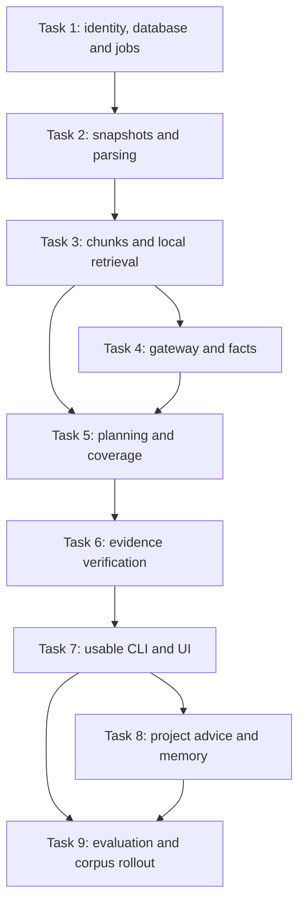

## 17. Copyable Codex kickoff instruction

```text
Implement the Robot Literature Assistant described in
docs/robot_literature_system_codex_spec.md.

Read the full specification and the repository's existing instructions first.
Treat the specification's requirements and proposed interfaces as the contract.
Keep original PDFs read-only. Do not assume missing metadata is false, combine
facts from different configurations, or claim an exhaustive search from top-k
retrieval. Every factual match needs valid source evidence.

Implement the version 1.1 input/output, dataset, evaluation and result contracts.
Keep unknown fields explicit. Preserve phase, frames, units, table context and
trial counts. Numeric comparisons must keep one result's protocol and task;
never rank unrelated success rates or mix facts from different records.

Work through the implementation tasks in order. Build the local ingestion and
retrieval path before cloud-dependent advising. Use a fake LLM in tests and a
configurable provider adapter for live calls. Keep the system runnable after
each coherent task, run its acceptance checks, and record progress and decisions
in docs/implementation_status.md. Commit coherent changes when the repository
workflow allows it; preserve unrelated user work.

Start by inspecting the repository, creating the configuration/contracts and
database/job substrate, and implementing Task 1. Continue through the plan
without repeatedly asking for routine implementation decisions. Resolve ordinary
details consistently with this specification. If a missing input genuinely blocks
execution, complete the independent work and ask one targeted question.

Keep cloud calls bounded and disabled in ordinary automated tests. Do not invent
paper results or benchmark numbers. Use clearly labeled synthetic fixtures until
the user's corpus and human gold labels are available. Report what was built,
what was tested, and any actual remaining blockers.
```

## 18. Primary implementation references

These links establish the capabilities of the proposed components. The architecture, limits, schema, and acceptance targets above are project-specific design decisions.

- [Docling parser](https://github.com/docling-project/docling): local execution, PDF layout, OCR, structured exports.
- [pgvector](https://github.com/pgvector/pgvector): cosine search, HNSW, and hybrid search with PostgreSQL full-text search.
- [PostgreSQL text-search concepts](https://www.postgresql.org/docs/current/textsearch-intro.html).
- [BGE-M3 model card](https://huggingface.co/BAAI/bge-m3): multilingual retrieval and 1,024-dimensional representations.
- [BGE reranker model card](https://huggingface.co/BAAI/bge-reranker-v2-m3): query-passage relevance scoring.
- [Optional PaperQA2 baseline](https://github.com/Future-House/paper-qa): scientific-document QA and local embedding configuration.

Recheck the selected provider's official SDK documentation and lock dependency/model revisions when implementation begins. The architecture deliberately does not depend on a particular cloud model name or its current price.
